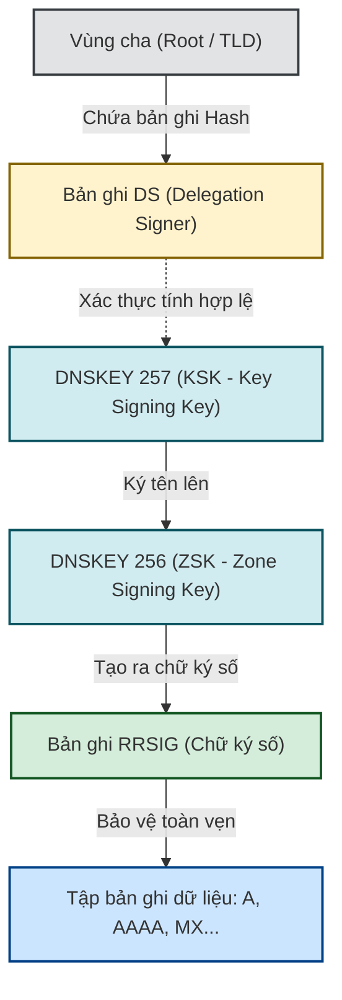
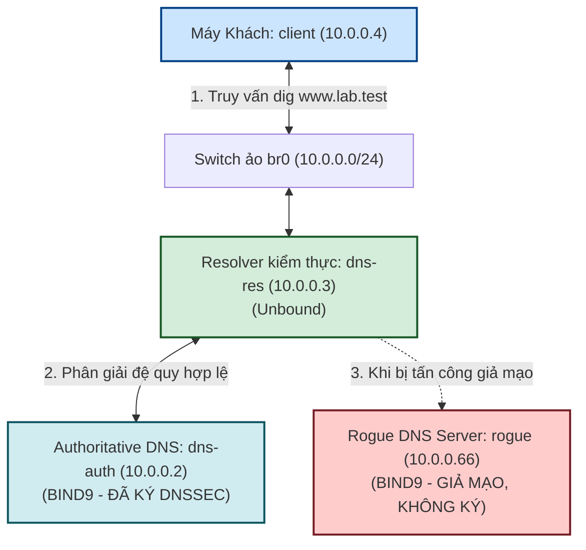

# BÁO CÁO THỰC HÀNH CHI TIẾT — BÀI LAB 07
## Đề tài: Kỹ thuật xác thực tên miền an toàn DNSSEC (DNS Security Extensions)

---

## I. MỤC TIÊU BÀI THỰC HÀNH

1. **Hiểu rõ điểm yếu chí mạng của hệ thống phân giải tên miền (DNS) truyền thống**:
   * Giao thức DNS nguyên bản (năm 1983) hoạt động trên nền UDP, hoàn toàn không có cơ chế xác thực nguồn gốc (Origin Authentication) và không có cơ chế bảo vệ tính toàn vẹn dữ liệu (Data Integrity).
   * Dẫn đến việc DNS dễ dàng bị đầu độc bộ nhớ đệm (**DNS Cache Poisoning / Kaminsky Attack**) hoặc bị làm giả phản hồi (**DNS Spoofing / On-path Forgery**).
2. **Nghiên cứu nguyên lý hoạt động của DNSSEC (DNS Security Extensions)**:
   * Cách thức sử dụng mật mã học khóa bất đối xứng (Public-Key Cryptography) để "đóng dấu số" lên từng tập bản ghi DNS (RRset).
   * Các bản ghi cốt lõi của DNSSEC: **RRSIG** (Chữ ký số), **DNSKEY** (Khóa công khai gồm KSK và ZSK), và **DS** (Delegation Signer).
   * Chuỗi tin cậy phân cấp (**Chain of Trust**) và khái niệm **Trust Anchor** (Neo tin cậy).
3. **Triển khai thực tế trên môi trường mạng ảo 4 máy độc lập**:
   * Cấu hình máy chủ Authoritative DNS (`dns-auth` - BIND9) tự động tạo cặp khóa và ký số vùng `lab.test`.
   * Trích xuất Khóa ký khóa (**KSK - Key Signing Key**) làm Trust Anchor cho hệ thống.
   * Cấu hình máy chủ phân giải đệ trình kiểm thực (**Validating Recursive Resolver** - Unbound) xác minh tính toàn vẹn của tên miền.
4. **Kiểm chứng hiệu quả bảo vệ của DNSSEC**:
   * Khi dữ liệu hợp lệ: Resolver trả về cờ **`ad` (Authenticated Data)** cùng bản ghi chữ ký `RRSIG`.
   * Khi kẻ tấn công dựng máy chủ DNS giả mạo (`rogue` - `10.0.0.66`) phát tán IP độc hại `6.6.6.6`: Resolver có DNSSEC lập tức phát hiện chữ ký bị thiếu/sai lệch và trả về lỗi **`SERVFAIL`**, bảo vệ an toàn cho người dùng cuối.
   * Kiểm chứng trường hợp người dùng tắt kiểm tra DNSSEC (dùng cờ `+cd` - Checking Disabled) sẽ lập tức bị lừa vào trang giả mạo `6.6.6.6`.

---

## II. KIẾN THỨC NỀN TẢNG CỐT LÕI

### 1. Phép ẩn dụ đời thực & Bản chất Mật mã học khóa công khai (Public-Key Cryptography)

* **DNS truyền thống (Không có DNSSEC):**
  * Giống như một cuốn sổ danh bạ điện thoại viết tay chuyền từ người này sang người khác.
  * Khi bạn hỏi: *"Số điện thoại của Ngân hàng VCB là gì?"*, bất kỳ ai đứng bên đường cũng có thể hét lên: *"Là số 6.6.6.6 đấy!"*. Vì không có chữ ký hay con dấu niêm phong của ngân hàng, bạn tin lời và gọi nhầm vào số của kẻ lừa đảo $\rightarrow$ Mất tài khoản!
* **DNSSEC (Có bảo mật):**
  * Ngân hàng sử dụng một **Con dấu số bí mật (Private Key)** để đóng dấu (tạo ra chữ ký số **`RRSIG`**) lên chính số điện thoại của mình.
  * Đồng thời, Ngân hàng công bố hình ảnh mẫu của con dấu đó ra toàn dân (**`DNSKEY`**).
  * Khi bạn hỏi qua Tổng đài bưu điện (Validating Resolver Unbound): Tổng đài sẽ soi chữ ký `RRSIG` với mẫu dấu `DNSKEY`.
  * **Nếu chữ ký chuẩn:** Tổng đài chuyển tiếp câu trả lời cho bạn và đóng thêm dấu xác nhận an toàn: **Cờ `ad` (Authenticated Data)**.
  * **Nếu kẻ xấu đưa số điện thoại giả mạo `6.6.6.6`:** Vì kẻ xấu không có con dấu bí mật của ngân hàng để tạo ra chữ ký số hợp lệ, Tổng đài lập tức phát hiện hàng giả, chặn đứng kết nối và báo lỗi: **`SERVFAIL` (Phân giải thất bại)**, cứu người dùng khỏi bị lừa đảo!

#### Cơ chế hoạt động của Cặp khóa: Khóa Bí mật vs. Khóa Công khai
* **Khóa bí mật (Private Key):**
  * Được lưu trữ tuyệt mật và duy nhất trên máy chủ ủy quyền (`dns-auth`).
  * Chỉ dùng cho một chiều duy nhất: **Ký số (Signing)** lên các tập bản ghi DNS (RRset) để tạo ra bản ghi chữ ký `RRSIG`.
* **Khóa công khai (Public Key - DNSKEY):**
  * Được công bố công khai rộng rãi cho toàn thế giới cùng biết trong hệ thống DNS.
  * Chỉ dùng cho chiều ngược lại: **Kiểm tra chữ ký (Verification)** xem dữ liệu có đúng là được ký bởi Khóa bí mật của chủ sở hữu hay không.
* **Tại sao công khai khóa mà không sợ bị hack hay lộ khóa bí mật?**
  * Mật mã học bất đối xứng dựa trên các bài toán toán học một chiều (**One-way Trapdoor Function** - ví dụ bài toán phân tích thừa số nguyên tố lớn RSA hoặc bài toán logarit rời rạc trên đường cong Elliptic ECDSA):
    * Từ **Khóa bí mật** $\rightarrow$ tính toán ra **Khóa công khai** cực kỳ dễ dàng (trong vài mili giây).
    * Nhưng từ **Khóa công khai** $\rightarrow$ đi ngược lại để tìm **Khóa bí mật** là điều bất khả thi về mặt tính toán (đòi hỏi siêu máy tính mạnh nhất thế giới chạy hàng triệu năm).
  * Người ngoài dù có trong tay Khóa công khai cũng **chỉ có thể kiểm tra chữ ký**, tuyệt đối không thể tự tạo ra chữ ký giả mạo thay mặt chủ sở hữu!

---

### 2. Vị trí thực thi DNSSEC: DNSSEC có phải là "một nơi riêng biệt"?

> **Khẳng định cốt lõi:** **DNSSEC KHÔNG PHẢI là một máy chủ trung ương, không phải một cơ quan quản lý, và không phải là một trạm kiểm soát riêng biệt nào trên mạng Internet.**

* **DNSSEC thực chất là gì?**
  * DNSSEC là một **bộ quy chuẩn bảo mật (Security Extensions Protocol)** được chuẩn hóa bởi IETF (RFC 4033, 4034, 4035).
* **Ai là người trực tiếp kiểm tra tính hợp lệ?**
  * Khâu kiểm thực được thực hiện hoàn toàn cục bộ trong bộ nhớ RAM của **Máy chủ phân giải đệ quy (Validating Recursive Resolver)** – ví dụ: DNS của nhà mạng ISP (Viettel, VNPT, FPT), DNS công cộng (Google `8.8.8.8`, Cloudflare `1.1.1.1`), hoặc trong bài lab này chính là máy chủ **`dns-res` (chạy phần mềm Unbound)**.
  * Máy trạm của người dùng cuối (`client`) thường chỉ đóng vai trò là Stub Resolver: ủy thác hoàn toàn việc kiểm tra chữ ký cho Resolver tin cậy và chỉ cần quan sát cờ **`ad` (Authenticated Data)** trong gói tin trả về để biết dữ liệu có an toàn hay không.

---

### 3. Phân biệt rạch ròi: Authoritative Server vs. Recursive Resolver & BIND9 vs. Unbound

Hệ thống DNS trong bài Lab được chia thành hai thực thể độc lập để mô phỏng chính xác kiến trúc phân cấp của Internet:

```
+─────────────────────────────────────────+─────────────────────────────────────────+
| Authoritative Server (Máy chủ có thẩm quyền) | Recursive Resolver (Máy chủ phân giải)  |
+─────────────────────────────────────────+─────────────────────────────────────────+
| • Đại diện: dns-auth (BIND9 - 10.0.0.2) | • Đại diện: dns-res (Unbound - 10.0.0.3) |
| • Vai trò: "Chính chủ giữ sổ đỏ gốc"   | • Vai trò: "Tổng đài 1080 / Công chứng" |
| • Nắm giữ cơ sở dữ liệu gốc của zone    | • Không sở hữu dữ liệu gốc của bất kỳ ai|
| • Nắm Khóa Bí Mật (Private Key) để KÝ   | • Nắm Khóa Công Khai (Trust Anchor) SOI |
| • Trả lời dứt khoát về tên miền quản lý | • Tự lặn lội đi hỏi khắp nơi giùm Client|
+─────────────────────────────────────────+─────────────────────────────────────────+
```

#### 1. Có phải mỗi tên miền có một `dns-auth` riêng không?
* **Về mặt logic phân quyền:** **ĐÚNG.** Internet tổ chức tên miền theo mô hình cây phân cấp:
  * Tầng Gốc (`.` - Root Zone): Quản lý các đuôi TLD (`.com`, `.net`, `.vn`, `.test`).
  * Tầng Đuôi (TLD Name Server): Quản lý việc ủy quyền tên miền con (`lab.test`).
  * Tầng Tên miền riêng (Authoritative Name Server): Quản lý chi tiết từng bản ghi A, MX, CNAME trong vùng của mình.
* **Về mặt máy chủ vật lý:** Một hạ tầng máy chủ DNS lớn (như Cloudflare, Route53, Viettel) có thể chứa hồ sơ của hàng triệu tên miền khác nhau, nhưng mỗi tên miền là một **Vùng (Zone)** riêng biệt và độc lập hoàn toàn.

#### 2. Tại sao máy khách (`client`) không tự đi hỏi thẳng `dns-auth`?
* Máy trạm của người dùng (`client`) chạy phần mềm phân giải tối giản (**Stub Resolver**). Stub Resolver rất "nhẹ" và không có khả năng đi lần mò từng tầng DNS trên Internet, cũng như không có bộ đệm lớn để lưu trữ hàng triệu truy vấn. Do đó, Client luôn ủy thác cho Recursive Resolver xử lý trọn gói.

#### 3. Tại sao phải dùng cả BIND9 lẫn Unbound mà không gộp chung?
* Trong an ninh mạng, nguyên lý **Tách biệt Trách nhiệm (Separation of Duties - SoD)** là bắt buộc:
  * **BIND9**: Chuyên về lưu trữ cơ sở dữ liệu vùng, sinh khóa, và ký số (Authoritative Zone Signing).
  * **Unbound**: Được thiết kế từ đầu với mã nguồn tinh gọn, tốc độ cực cao, tập trung tuyệt đối vào việc kiểm thực chữ ký (DNSSEC Validation) và quản lý bộ nhớ đệm chống đầu độc (Cache Poisoning Mitigation).
  * Việc tách riêng giúp tránh lỗ hổng bảo mật chéo giữa khâu quản lý zone và khâu phân giải đệ quy.

#### 4. Bản chất của file `setup_unbound.sh` vs Lệnh khởi chạy `unbound`:
* **Khi chạy `setup_unbound.sh`:** Hệ thống mới chỉ thực hiện **soạn thảo hồ sơ trên đĩa cứng** (trích xuất khóa KSK 257 từ máy chủ `dns-auth` lưu vào `/tmp/trust-anchor.key` và tạo file cấu hình `/tmp/unbound.conf`). Lúc này phần mềm Unbound chưa hề hoạt động.
* **Khi chạy `unbound -c /tmp/unbound.conf -d &`:** Đây mới là thời điểm tiến trình Unbound được đánh thức, đọc file cấu hình, **nạp toàn bộ Trust Anchor và chỉ thị phân giải vào bộ nhớ RAM**, sẵn sàng lắng nghe ở cổng mạng 53 để thẩm định dữ liệu.

---

### 4. Bốn loại bản ghi tài nguyên cốt lõi của DNSSEC



1. **RRSIG (Resource Record Signature)**:
   * Chứa chữ ký số mật mã học cho một tập hợp bản ghi cùng tên và cùng loại (RRset). Ví dụ: Bản ghi `A` của `www.lab.test` sẽ có một bản ghi `RRSIG` đi kèm để chứng minh địa chỉ IP này là thật.
2. **DNSKEY (DNS Public Key)**:
   * Chứa khóa công khai dùng để giải mã và kiểm tra chữ ký `RRSIG`. Gồm 2 loại:
     * **ZSK (Zone Signing Key - Cờ 256):** Khóa dùng để trực tiếp ký lên các bản ghi dữ liệu (A, MX, TXT...). Thường có chu kỳ thay đổi ngắn (vài tháng).
     * **KSK (Key Signing Key - Cờ 257):** Khóa cấp cao dùng để ký lên chính bản ghi `DNSKEY`. Đây là khóa đại diện để liên kết lên vùng cha.
3. **DS (Delegation Signer)**:
   * Chứa mã băm (Hash) của khóa KSK, được đặt tại **vùng cha** (ví dụ vùng cha `.test` hoặc vùng gốc `.`).
   * Giúp resolver xác thực rằng khóa KSK của vùng con là hợp pháp do vùng cha ủy quyền.
4. **NSEC / NSEC3 (Next Secure)**:
   * Dùng để chứng minh một tên miền **không tồn tại** một cách có xác thực mật mã (Authenticated Denial of Existence), tránh việc kẻ tấn công giả mạo trả lời NXDOMAIN. NSEC3 sử dụng mã băm để chống lộ toàn bộ danh sách tên miền trong vùng (Zone Walking).

---

### 5. Chuỗi tin cậy (Chain of Trust) và Khái niệm Trust Anchor

* **Trust Anchor (Neo tin cậy):**
  * Từ "Anchor" có nghĩa là mỏ neo. Khi con tàu thả neo xuống đáy biển, nó sẽ đứng vững, không bị sóng gió cuốn trôi.
  * Trong DNSSEC, Resolver cần một **"điểm tựa niềm tin ban đầu"** mà nó tin tưởng 100% vô điều kiện để làm chuẩn mực so sánh.
* **Trên Internet toàn cầu:**
  * Resolver chỉ cần lưu **duy nhất một Trust Anchor của Vùng gốc (Root Zone `.`)** do ICANN công bố (được tích hợp sẵn vào Linux/Windows).
  * Chuỗi tin cậy hình thành qua bản ghi `DS`: Root bảo lãnh cho TLD (`.com`, `.vn`) $\rightarrow$ TLD bảo lãnh cho tên miền con (`google.com`, `lab.test`).
* **Trong môi trường Lab nội bộ:**
  * Do không có mạng Internet toàn cầu, ta xây dựng một "Đảo tin cậy" (Island of Trust) bằng cách trích xuất trực tiếp khóa KSK (cờ 257) của `dns-auth` để nạp làm Trust Anchor cho Resolver Unbound.
* **Giải đáp câu hỏi hóc búa: "Nếu máy chủ giả mạo `rogue` cũng tự sinh khóa KSK thì có vô hiệu hóa được hệ thống không?"**
  * **Trong phòng Lab:** Kẻ tấn công `rogue` nằm ở máy ảo khác trong mạng LAN. File `trust-anchor.key` nằm trong ổ cứng của máy `dns-res`. Hacker không có quyền root trên `dns-res` nên **không thể can thiệp vào file cấu hình của Unbound**. Unbound chỉ mở file trong ổ cứng của mình ra làm chuẩn mực, mọi KSK do `rogue` tự tạo đều bị coi là vô giá trị!
  * **Ngoài Internet thực tế:** Dù hacker tự sinh 1.000 cái khóa KSK thì mã băm của khóa đó cũng **không khớp với bản ghi `DS` đã được lưu tại máy chủ cấp cha (TLD / Root)**. Muốn lừa được Resolver, hacker phải hack thành công vào cơ quan quản lý tên miền cấp cha để thay đổi bản ghi DS, điều này là bất khả thi về mặt bảo mật.

---

## III. MÔ HÌNH MẠNG VÀ THIẾT KẾ PHÒNG LAB

Hệ thống mô phỏng toàn bộ luồng phân giải DNS trong một mạng LAN `10.0.0.0/24` nối qua Switch ảo Linux Bridge `br0`:



* **`dns-auth` (`10.0.0.2`)**: Máy chủ có thẩm quyền quản lý tên miền `lab.test`. Sử dụng BIND9 với chính sách `dnssec-policy default; inline-signing yes;` để tự sinh khóa và ký số zone. Địa chỉ thật: `www.lab.test -> 10.0.0.80`.
* **`dns-res` (`10.0.0.3`)**: Máy chủ phân giải đệ quy (Recursive Resolver) sử dụng Unbound. Cấu hình kiểm thực chữ ký dựa trên Trust Anchor.
* **`client` (`10.0.0.4`)**: Máy trạm của người dùng, sử dụng công cụ `dig` để truy vấn tên miền.
* **`rogue` (`10.0.0.66`)**: Máy chủ DNS giả mạo do kẻ tấn công dựng lên, phát tán bản ghi giả: `www.lab.test -> 6.6.6.6` (không có chữ ký DNSSEC).

---

## IV. GIẢI THÍCH CHI TIẾT CÁC FILE CẤU HÌNH & MÃ NGUỒN

Các file phục vụ thực hành được lưu tại: `/home/tantayen/Projects/TCPIP/LabLoHongBaoMatTCPIP/`

### 1. File `setup_dns.sh` (Khởi tạo Switch ảo và 4 không gian mạng)
* Tạo Linux Bridge `br0` và gắn 4 namespace `dns-auth`, `dns-res`, `client`, `rogue` vào switch.
* Kiểm tra thông mạng bằng lệnh ping giữa client và các máy chủ DNS.

---

### 2. File `setup_dnssec_configs.sh` (Tự động hóa toàn bộ file cấu hình)
Tự động sinh các file cấu hình chuẩn vào hệ thống:
1. **/tmp/named-auth.conf (Cấu hình BIND9 có ký DNSSEC)**:
   ```text
   options {
       directory "/var/cache/bind";
       listen-on port 53 { 10.0.0.2; };
       listen-on-v6 { none; };
       recursion no;
       dnssec-validation no;
   };
   zone "lab.test" {
       type primary;
       file "db.lab.test";
       dnssec-policy default;       // BIND tự động sinh khóa KSK/ZSK và ký zone
       inline-signing yes;          // Tự động ký trực tiếp
   };
   ```
2. **/var/cache/bind/db.lab.test (Dữ liệu vùng thật)**:
   Chứa bản ghi chuẩn: `ns1 IN A 10.0.0.2` và `www IN A 10.0.0.80`.
3. **/tmp/named-rogue.conf (Cấu hình BIND9 giả mạo)**:
   Máy chủ giả mạo chạy trên IP `10.0.0.66`, quản lý zone `lab.test` nhưng **hoàn toàn không bật chính sách DNSSEC**.
4. **/var/cache/bind/db.lab.rogue (Dữ liệu vùng giả mạo)**:
   Chứa bản ghi lừa đảo: `www IN A 6.6.6.6`.

---

### 3. File `setup_unbound.sh` (Trích xuất Trust Anchor và cấu hình Resolver)
* Dùng `dig` truy vấn bản ghi `DNSKEY` từ máy chủ `dns-auth`.
* Lọc lấy dòng khóa có cờ **`257`** (Key Signing Key - KSK) lưu vào file `/tmp/trust-anchor.key`.
* Sinh file cấu hình `/tmp/unbound.conf`:
  ```text
  server:
      verbosity: 1
      interface: 10.0.0.3
      port: 53
      username: ""
      chroot: ""
      use-syslog: no
      pidfile: "/tmp/unbound.pid"
      directory: "/tmp"
      do-ip6: no
      access-control: 10.0.0.0/24 allow
      module-config: "validator iterator"   // BẬT BỘ KIỂM THỰC VALIDATOR
      harden-dnssec-stripped: yes          // Chống tước bỏ DNSSEC
      val-permissive-mode: no              // Chế độ nghiêm ngặt: Lỗi chữ ký là chặn ngay
      trust-anchor-file: "/tmp/trust-anchor.key"
      domain-insecure: "."                 // Coi toàn bộ là insecure ngoại trừ lab.test
      local-zone: "test." nodefault        // Cho phép phân giải đuôi .test (RFC 6761)
      local-zone: "lab.test." transparent  // Chuyển tiếp truy vấn lab.test vào stub-zone

  stub-zone:
      name: "lab.test"
      stub-addr: 10.0.0.2                  // Trỏ tới máy chủ uỷ quyền có ký
  ```

---

### 4. File `clean_dns.sh` (Dọn dẹp môi trường)
* Tắt sạch các tiến trình nền `named` và `unbound`.
* Xóa 4 namespace và bridge `br0`, xóa các file tạm trong `/tmp`.

---

## V. TRÌNH TỰ CÁC BƯỚC THỰC HÀNH & KẾT QUẢ THỰC NGHIỆM CHI TIẾT

### Bố trí màn hình Terminal:
Màn hình Konsole / Terminal được chia thành **3 khung cửa sổ** đúng như trong phiên thực hành thực tế:
* **Cửa sổ Lớn Bên Trái (`sudo`)**: Terminal thực hiện cấu hình môi trường ban đầu, sau đó đóng vai **Máy Khách `client`** (`10.0.0.4`) thực hiện các câu lệnh kiểm tra truy vấn `dig`.
* **Cửa sổ Trên - Phải (`: sudo`)**: Terminal của **Authoritative DNS `dns-auth`** (`10.0.0.2`) chạy BIND9 ký DNSSEC, đồng thời về sau chạy cả **Rogue DNS `rogue`** (`10.0.0.66`).
* **Cửa sổ Dưới - Phải (`: sudo`)**: Terminal của **Validating Recursive Resolver `dns-res`** (`10.0.0.3`) chạy phần mềm Unbound kiểm thực chữ ký.

---

### BƯỚC 1: Dọn dẹp & Khởi tạo môi trường mạng 4 máy

Tại **Cửa sổ Lớn Bên Trái**, chuyển sang root và chạy lần lượt 3 script khởi tạo:
```bash
sudo su
bash clean_dns.sh
bash setup_dns.sh
bash setup_dnssec_configs.sh
```

* **Kết quả quan sát trên terminal:**
  * `clean_dns.sh`: Dừng các tiến trình `named` và `unbound`, xóa namespace và bridge cũ, dọn sạch file tạm.
  * `setup_dns.sh`: Tạo switch ảo `br0`, khởi tạo 4 namespace `dns-auth` (10.0.0.2), `dns-res` (10.0.0.3), `client` (10.0.0.4), `rogue` (10.0.0.66). Lệnh ping tự động giữa client với dns-auth (0.101 ms) và dns-res (0.075 ms) thành công 100%.
  * `setup_dnssec_configs.sh`: Phân quyền `777` trên `/var/cache/bind`, tạo các file cấu hình `named-auth.conf`, file zone hợp lệ `db.lab.test` (`www -> 10.0.0.80`), file `named-rogue.conf` và zone giả mạo `db.lab.rogue` (`www -> 6.6.6.6`).

---

### BƯỚC 2: Bật Authoritative Server (BIND9) & Trích xuất Trust Anchor

1. **Tại Cửa sổ Trên - Phải (`dns-auth`):**
   Chuyển sang root và khởi động BIND9 trên máy `dns-auth`:
   ```bash
   sudo su
   ip netns exec dns-auth named -c /tmp/named-auth.conf -g
   ```
   * **Hiện tượng quan sát được:**
     BIND9 khởi động với cờ `-g` (chạy tiền cảnh, in log trực tiếp ra màn hình):
     ```text
     listening on IPv4 interface dns-auth0, 10.0.0.2#53
     zone lab.test/IN (unsigned): loaded serial 2026101901
     zone lab.test/IN (signed): loaded serial 2026101903 (DNSSEC signed)
     all zones loaded
     running
     zone lab.test/IN (signed): receive_secure_serial: unchanged
     zone lab.test/IN (signed): reconfiguring zone keys
     zone lab.test/IN (signed): next key event: 08-Nov-2026 18:32:39.504
     ```
     $\rightarrow$ BIND9 tự động nạp chính sách `dnssec-policy default`, sinh cặp khóa KSK/ZSK và ký số thành công zone `lab.test`.

2. **Tại Cửa sổ Dưới - Phải (`dns-res`):**
   Chạy script trích xuất khóa KSK làm Trust Anchor và sinh cấu hình Unbound:
   ```bash
   sudo bash setup_unbound.sh
   ```
   * **Kết quả hiển thị:**
     ```text
     [*] 1. Trich xuat DNSKEY (KSK - 257) tu dns-auth de lam Trust Anchor...
     [+] Tim thay DNSKEY 257 sau 1 giay!
     [+] Trust Anchor trich xuat thanh cong:
     lab.test.    3600 IN DNSKEY 257 3 13 GNq1Q27uAR6RleL/77mV+5zHmZtfPH2Qv3BeZTwtTuSuTiCx0ygjmVO ZyN3rPPYQ92uq/UKZXZphYEYATEjDQ==
     [*] 2. Tao file cau hinh Unbound Resolver: /tmp/unbound.conf...
     [+] Da tao xong /tmp/unbound.conf!
     ```

---

### BƯỚC 3: Khởi động Resolver Unbound & Kiểm chứng Dữ liệu hợp lệ

1. **Tại Cửa sổ Dưới - Phải (`dns-res`):**
   Chuyển sang quyền root và khởi động Unbound kiểm thực:
   ```bash
   sudo su
   sudo ip netns exec dns-res unbound -c /tmp/unbound.conf -d &
   ```
   * **Log Unbound in ra:**
     ```text
     [1] 9675
     [1794130570] unbound[9679:0] notice: init module 0: validator
     [1794130570] unbound[9679:0] notice: init module 1: iterator
     [1794130570] unbound[9679:0] info: start of service (unbound 1.26.2).
     ```
     Module `validator` được nạp đầu tiên, sẵn sàng thẩm định chữ ký.

2. **Tại Cửa sổ Trên - Phải:**
   Khởi chạy luôn máy chủ giả mạo `rogue` (BIND9 không ký) trong nền:
   ```bash
   sudo ip netns exec rogue named -c /tmp/named-rogue.conf -g &
   ```

3. **Tại Cửa sổ Bên Trái (Máy `client`):**
   Thực hiện truy vấn DNS có yêu cầu kiểm thực DNSSEC:
   ```bash
   sudo ip netns exec client dig @10.0.0.3 www.lab.test +dnssec
   ```
   * **Kết quả trả về chính xác như ảnh 2:**
     ```text
     ; <<>> DiG 9.20.30-1-Debian <<>> @10.0.0.3 www.lab.test +dnssec
     ; (1 server found)
     ;; global options: +cmd
     ;; Got answer:
     ;; ->>HEADER<<- opcode: QUERY, status: NOERROR, id: 30041
     ;; flags: qr rd ra ad; QUERY: 1, ANSWER: 2, AUTHORITY: 0, ADDITIONAL: 1

     ;; OPT PSEUDOSECTION:
     ; EDNS: version: 0, flags: do; udp: 1232
     ;; QUESTION SECTION:
     ;www.lab.test.                  IN      A

     ;; ANSWER SECTION:
     www.lab.test.           3600    IN      A       10.0.0.80
     www.lab.test.           3600    IN      RRSIG   A 13 3 3600 20261121220501 20261108082739 45683 lab.test. YPWnW9Gwb7lgsX0XeHrBTmPUYsrMlZ+r1owtXTUJAX9kHBQmlFDj/Nwt+6t+OmxPttApvcZ2R75LWTw+D2yyD2w==

     ;; Query time: 0 msec
     ;; SERVER: 10.0.0.3#53(10.0.0.3) (UDP)
     ;; WHEN: Sun Nov 08 16:36:19 +07 2026
     ;; MSG SIZE rcvd: 161
     ```
   * 👉 **Phân tích kết quả:**
     * `status: NOERROR` và `ANSWER: 2`.
     * **Cờ `ad` (Authenticated Data)** xuất hiện đầy đủ trong `flags: qr rd ra ad`!
     * Phần Answer chứa đúng địa chỉ IP gốc **`10.0.0.80`** kèm theo bản ghi chữ ký số điện tử **`RRSIG`**! Resolver Unbound đã kiểm tra và chứng thực chữ ký thành công thông qua Trust Anchor.

---

### BƯỚC 4: Kẻ tấn công bẻ hướng sang máy chủ giả mạo `rogue` & Resolver chặn đứng bằng SERVFAIL

1. **Tại Cửa sổ Trên - Phải:**
   Bẻ hướng cấu hình của Unbound (`stub-addr` chuyển từ `10.0.0.2` sang `10.0.0.66`), khởi động lại Unbound:
   ```bash
   sudo sed -i 's/stub-addr: 10.0.0.2/stub-addr: 10.0.0.66/' /tmp/unbound.conf
   sudo pkill -f "unbound -c /tmp/unbound.conf"
   sudo ip netns exec dns-res unbound -c /tmp/unbound.conf -d &
   sleep 2
   ```
   * **Log Unbound in ra (Cửa sổ Dưới - Phải & Trên - Phải):**
     Unbound phát hiện máy chủ `10.0.0.66` không cung cấp được chữ ký hoặc khóa phù hợp:
     `failed to prime trust anchor -- could not fetch DNSKEY rrset lab.test.`

2. **Tại Cửa sổ Bên Trái (Máy `client`):**
   Thực hiện lại truy vấn `dig` kiểm thực:
   ```bash
   sudo ip netns exec client dig @10.0.0.3 www.lab.test +dnssec
   ```
   * **Kết quả trả về chính xác như ảnh 3:**
     ```text
     ; <<>> DiG 9.20.30-1-Debian <<>> @10.0.0.3 www.lab.test +dnssec
     ; (1 server found)
     ;; global options: +cmd
     ;; Got answer:
     ;; ->>HEADER<<- opcode: QUERY, status: SERVFAIL, id: 16720
     ;; flags: qr rd ra; QUERY: 1, ANSWER: 0, AUTHORITY: 0, ADDITIONAL: 1

     ;; OPT PSEUDOSECTION:
     ; EDNS: version: 0, flags: do; udp: 1232
     ;; QUESTION SECTION:
     ;www.lab.test.                  IN      A

     ;; Query time: 3 msec
     ;; SERVER: 10.0.0.3#53(10.0.0.3) (UDP)
     ;; WHEN: Sun Nov 08 16:37:49 +07 2026
     ;; MSG SIZE rcvd: 41
     ```
   * 👉 **Phân tích kết quả an ninh:**
     * Trạng thái trả về: **`status: SERVFAIL`** (Server Failure).
     * Số bản ghi: **`ANSWER: 0`** (không có cờ `ad`, không có IP).
     * **Ý nghĩa:** Vì máy chủ giả mạo `10.0.0.66` trả về bản ghi giả `6.6.6.6` không có chữ ký DNSSEC hợp lệ khớp với Trust Anchor, Unbound lập tức phát hiện dấu hiệu đầu độc/giả mạo và **hủy bỏ toàn bộ phản hồi**, trả về lỗi `SERVFAIL` để bảo vệ client.

---

### BƯỚC 5: Đối chứng — Tắt kiểm thực bằng cờ `+cd` (Checking Disabled)

Tại **Cửa sổ Bên Trái (Máy `client`)**, chạy câu lệnh tắt kiểm thực DNSSEC:
```bash
sudo ip netns exec client dig @10.0.0.3 www.lab.test +cd +short
```
* **Kết quả in ra (Chính xác như ảnh 4):**
  ```text
  6.6.6.6
  ```
* 👉 **Kết luận khoa học quan trọng:**
  * Khi có cờ `+cd` (Checking Disabled), Resolver bỏ qua khâu thẩm định chữ ký và trả thẳng dữ liệu thô cho máy khách. Ngay lập tức người dùng bị lừa nhận địa chỉ độc hại **`6.6.6.6`**.
  * Điều này chứng minh rằng địa chỉ IP giả mạo `6.6.6.6` thực sự đang tồn tại trên đường truyền, nhưng nhờ có **DNSSEC** mà người dùng ở Bước 4 đã được bảo vệ an toàn tuyệt đối!

---

## VI. PHÂN TÍCH CHUYÊN SÂU: CÁC CHIÊU THỨC TẤN CÔNG & KHẢ NĂNG BYPASS DNSSEC

Một câu hỏi mang tính then chốt của các chuyên gia an ninh mạng là: **"Hacker có thể can thiệp để dù không có chữ ký hợp lệ mà vẫn qua mặt (bypass) được hệ thống DNSSEC hay không?"**. Hãy cùng phân tích các kịch bản tấn công thực tế:

### 1. Kịch bản 1: Giữ nguyên Chữ ký cũ (`RRSIG`), sửa đổi Địa chỉ IP thành IP độc hại (`6.6.6.6`)
* **Cách hacker thực hiện:** Kẻ tấn công đứng giữa đường chặn gói tin DNS của máy chủ thật gửi về, giữ nguyên chữ ký số `RRSIG`, nhưng tráo đổi trường địa chỉ `A` thành `6.6.6.6`.
* **Kết quả:** **THẤT BẠI HOÀN TOÀN.**
* **Nguyên nhân toán học:**
  * Chữ ký `RRSIG` thực chất là kết quả của việc mã hóa **Mã băm (Cryptographic Hash - SHA-256)** của tập dữ liệu gốc (`www.lab.test` + `10.0.0.80`) bằng Khóa bí mật của chủ sở hữu.
  * Khi Resolver kiểm thực, nó lấy Khóa công khai (`DNSKEY`) giải mã chữ ký `RRSIG` để lấy ra Mã băm gốc $H_1$.
  * Đồng thời, Resolver tự tính toán mã băm của dữ liệu vừa nhận được (`www.lab.test` + `6.6.6.6`) thành $H_2$.
  * Vì dữ liệu IP đã bị thay đổi dù chỉ 1 bit, theo tính chất khuếch tán của hàm băm (Avalanche Effect), $H_2 \neq H_1$.
  * Resolver phát hiện dữ liệu đã bị cắn trộm / sai lệch tính toàn vẹn $\rightarrow$ Hủy gói tin và báo lỗi `SERVFAIL`.

---

### 2. Kịch bản 2: Hacker tự tạo một Cặp khóa riêng, rồi dùng Khóa bí mật của mình để ký lên IP giả `6.6.6.6`
* **Cách hacker thực hiện:** Kẻ tấn công tự sinh một cặp khóa (Private/Public Key) của riêng mình, dùng Private Key tự chế ký lên `6.6.6.6`, rồi gửi kèm cả Public Key tự chế đó cho Resolver để Resolver kiểm tra thấy chữ ký "khớp".
* **Kết quả:** **THẤT BẠI HOÀN TOÀN.**
* **Nguyên nhân chuỗi tin cậy (Chain of Trust):**
  * Resolver khi kiểm tra chữ ký với Public Key tự chế của hacker thì đúng là chữ ký toán học ăn khớp với dữ liệu.
  * **NHƯNG**, Resolver sẽ lập tức truy vấn tiếp: *"Ai bảo lãnh cho chiếc Public Key này? Ai chứng minh mày là chủ thật của tên miền `lab.test`?"*.
  * Resolver sẽ tra cứu lên máy chủ vùng cha (TLD `.test` hoặc Root `.`) để lấy bản ghi **`DS` (Delegation Signer)**.
  * Bản ghi `DS` tại vùng cha là một mã băm cố định được sinh ra từ khóa KSK hợp pháp của chủ tên miền thực sự. Khóa tự chế của hacker khi băm ra hoàn toàn không khớp với bản ghi `DS` này!
  * Chuỗi tin cậy bị đứt gãy tại mắt xích vùng cha $\rightarrow$ Resolver từ chối công nhận và ném lỗi `SERVFAIL`.

---

### 3. Kịch bản 3: Tấn công tước bỏ chữ ký DNSSEC (DNSSEC Stripping / Downgrade Attack)
* **Ý tưởng của hacker:**
  > *"Mày kiểm tra chữ ký nghiêm ngặt thế, vậy tao sẽ đứng giữa đường, **xóa sạch toàn bộ bản ghi `RRSIG`**, chỉ trả về duy nhất dòng `www.lab.test = 6.6.6.6`. Tao trả lời y hệt như DNS cổ điển thuở sơ khai, giả vờ như tên miền này chưa từng bật DNSSEC để mày không kiểm tra nữa!"*
* **Khả năng thành công:** **KHÔNG THỂ QUA MẶT ĐƯỢC Resolver hiện đại!**
* **Cơ chế phòng vệ sinh tử:**
  * **Chốt chặn 1 - Bản ghi DS tại cấp cha:** Trước khi hỏi vùng con `lab.test`, Resolver đã nhận được bản ghi `DS` từ cấp cha. Bản ghi `DS` này là bằng chứng thép khẳng định: *"Vùng `lab.test` ĐÃ BẬT DNSSEC!"*.
  * **Chốt chặn 2 - Cấu hình `harden-dnssec-stripped: yes`:** Trong cấu hình của Unbound (như bài lab đã nạp), tùy chọn này bắt buộc Resolver phải đối chiếu: Nếu cấp cha đã thông báo vùng có DNSSEC mà câu trả lời nhận về lại "trơ trọi" không có chữ ký, Resolver xác định ngay đây là hành vi tước đoạt (Stripping) của kẻ tấn công đứng giữa $\rightarrow$ Lập tức trả về **`SERVFAIL`**!

---

### 4. Vị trí của Kẻ tấn công: Hacker có can thiệp vào trong Auth Server không?

> **Khẳng định thực tế:** **KHÔNG HỀ! Kẻ tấn công không đụng được vào bên trong Auth Server.**

* **Auth Server thật (`dns-auth` - 10.0.0.2):** Được đặt trong trung tâm dữ liệu bảo mật, tường lửa nghiêm ngặt. Hacker không thể và không cần hack vào máy chủ này.
* **Bản chất của các cuộc tấn công DNS:** Hacker khai thác **đặc tính trần trụi của UDP cổng 53** (không mã hóa, không bắt tay kiểm tra danh tính) để can thiệp trên **đường truyền mạng (Network Path)**:
  1. **Nói leo / Giả mạo phản hồi (On-path DNS Spoofing):** Hacker chiếm quyền router trung gian hoặc Wi-Fi, bắt gói tin truy vấn của Resolver và bắn gói tin trả lời giả mạo về nhanh hơn máy chủ thật.
  2. **Đầu độc bộ nhớ đệm (DNS Cache Poisoning / Kaminsky Attack):** Hacker bắn ồ ạt hàng ngàn gói tin UDP đoán Transaction ID để cấy bản ghi giả vào cache của Resolver.
  3. **Bẻ hướng định tuyến (Route Hijacking / Rogue DNS):** Sử dụng ICMP Redirect (như Lab 05), Rogue DHCP hoặc BGP Hijacking để ép Resolver gửi câu hỏi sang máy chủ giả mạo `rogue` (`10.0.0.66`).

---

### 5. "Vấn đề chặng cuối" (The Last-Mile Problem) trong DNSSEC

Một câu hỏi phản biện kinh điển trong an ninh mạng:
> *"Nếu DNSSEC chỉ kiểm thực ở Resolver ngoài nhà mạng, vậy nếu Hacker đứng ngay tại quán Wi-Fi cạnh máy nạn nhân, giả vờ làm chính con Resolver thì sao?"*

Đây chính là **"The Last-Mile Problem" (Vấn đề Chặng cuối)** được quy định trong RFC 4033:
* **Hậu quả nếu chỉ dùng DNS cổ điển:** Gói tin hỏi của máy khách chưa kịp bay ra Internet thì hacker ở cùng mạng LAN đã mạo danh Resolver trả lời IP giả `6.6.6.6` $\rightarrow$ Nạn nhân bị lừa trước khi Resolver có cơ hội can thiệp!
* **Bốn tầng phòng tuyến thép giải quyết bài toán Chặng cuối:**
  1. **Kiểm tra cờ `AD` (Authenticated Data) tại máy khách:** Ứng dụng/Hệ điều hành của client chỉ chấp nhận câu trả lời nếu có cờ `ad` và chữ ký `RRSIG`. Hacker giả mạo không có khóa bí mật nên không thể tạo ra cờ `ad`.
  2. **Tự biến Client thành Local Validating Resolver:** Cài đặt bộ kiểm thực DNSSEC chạy ngay trên địa chỉ loopback `127.0.0.1` của máy nạn nhân (ví dụ bật `DNSSEC=yes` trong `systemd-resolved` trên Linux). Lúc này máy khách tự tay soi chữ ký, không cần tin bất kỳ ai ngoài mạng!
  3. **Khóa chặt đường truyền bằng DoH (DNS over HTTPS) / DoT (DNS over TLS):** Toàn bộ truy vấn giữa Client và Resolver được bọc trong đường hầm mã hóa TLS (cổng 443 hoặc 853). Hacker ở mạng LAN không thể nghe lén, không thể nói leo và không thể mạo danh Resolver vì không có chứng chỉ số TLS hợp lệ.
  4. **Chốt chặn ứng dụng cuối cùng — Chứng chỉ HTTPS (SSL/TLS):** Dù hacker có lừa được client ăn IP giả `6.6.6.6`, khi trình duyệt truy cập `https://...`, trình duyệt sẽ phát hiện chứng chỉ SSL không khớp với tên miền thật và hiển thị màn hình đỏ cảnh báo nguy hiểm ngay lập tức.

---

### 6. Vậy khi nào Hacker THỰC SỰ Bypass được DNSSEC?

DNSSEC chỉ có thể bị vượt qua trong 3 trường hợp thực tế sau:
1. **Tên miền chưa từng kích hoạt DNSSEC:** Nếu chủ sở hữu website không cấu hình ký zone và không đẩy bản ghi `DS` lên cấp cha, toàn bộ luồng phân giải vẫn là DNS truyền thống, hacker tha hồ đầu độc bằng tấn công Kaminsky hoặc ARP Spoofing.
2. **Resolver người dùng sử dụng quá cũ hoặc đã tắt bộ kiểm thực:** Nếu máy chủ DNS mà nạn nhân trỏ tới (ví dụ router Wi-Fi cổ lỗ sĩ) không hỗ trợ DNSSEC hoặc quản trị viên tắt module validator (`module-config: "iterator"` thay vì `"validator iterator"`).
3. **Ứng dụng hoặc người dùng cố tình bỏ qua kiểm tra:** Người dùng hoặc phần mềm gửi truy vấn kèm cờ **`+cd` (Checking Disabled)**. Lúc này Resolver sẽ không thẩm định chữ ký và trả thẳng dữ liệu rác về cho ứng dụng (chính là trường hợp kiểm chứng ở Bước 8 của bài lab).

---

## VII. BÀI HỌC KINH NGHIỆM & XỬ LÝ SỰ CỐ KỸ THUẬT THỰC CHIẾN (TROUBLESHOOTING CASE STUDIES)

Trong quá trình triển khai thực tế trên môi trường Kali Linux, hệ thống đã gặp phải 4 sự cố kỹ thuật cấp thấp (Low-level OS/Kernel issues). Việc phân tích và khắc phục thành công các lỗi này mang lại giá trị học thuật và thực tiễn rất cao:

### 1. Sự cố 1: Lỗi đóng băng tiến trình `suspended (tty input)` khi chạy lệnh ngầm `sudo ... &`
* **Hiện tượng:** Khi chạy `sudo ip netns exec dns-auth named -c /tmp/named-auth.conf -g &`, terminal lập tức in `[1] + suspended (tty input)` và bị treo đơ, người dùng chưa kịp nhập mật khẩu thì lệnh đã dừng.
* **Nguyên nhân tầng Kernel:**
  * Dấu `&` đẩy tiến trình xuống chạy nền (Background process).
  * Lệnh `sudo` cần đọc mật khẩu từ bàn phím điều khiển (Controlling TTY).
  * Theo chuẩn POSIX, Kernel Linux gửi tín hiệu **`SIGTTIN`** để tạm dừng bất kỳ tiến trình nền nào cố tình tranh chấp đọc dữ liệu từ bàn phím.
* **Giải pháp khắc phục:** Chuyển hẳn sang tài khoản quản trị tối cao `sudo su` (hoặc `sudo -i`) trước khi thực hiện. Khi đã ở dấu nhắc `#` (Root), lệnh chạy nền không cần gọi `sudo` nữa và thực thi trơn tru mà không bị `SIGTTIN`.

---

### 2. Sự cố 2: Cơ chế bảo vệ AppArmor Confinement chặn BIND9 và Unbound đọc file cấu hình
* **Hiện tượng:** BIND9 báo lỗi `open: /tmp/named-auth.conf: permission denied` dù file đã cấp quyền `chmod 644`.
* **Nguyên nhân:** Trên hệ điều hành Debian/Kali Linux, hệ thống kiểm soát truy cập bắt buộc (MAC - Mandatory Access Control) **AppArmor** kích hoạt các hồ sơ bảo vệ nghiêm ngặt:
  * `/etc/apparmor.d/usr.sbin.named` chỉ cho phép đọc từ `/etc/bind/**` và `/var/cache/bind/**`.
  * Toàn bộ thao tác truy cập vào thư mục tạm `/tmp/` đều bị Kernel AppArmor chặn đứng (`apparmor="DENIED"`).
* **Giải pháp khắc phục:**
  1. Sử dụng lệnh gỡ bỏ hồ sơ khỏi Kernel: `apparmor_parser -R /etc/apparmor.d/usr.sbin.named` và `apparmor_parser -R /etc/apparmor.d/usr.sbin.unbound`.
  2. Tạo liên kết biểu tượng vào `/etc/apparmor.d/disable/` để vô hiệu hóa lâu dài.
  3. Đồng thời sao lưu cấu hình vào đúng thư mục chuẩn `/etc/bind/` và `/etc/unbound/`.

---

### 3. Sự cố 3: Lỗi `directory '/var/cache/bind' is not writable` và sự khác biệt Real UID vs Effective UID
* **Hiện tượng:** BIND9 chạy dưới quyền root nhưng vẫn báo lỗi nghiêm trọng:
  ```text
  directory '/var/cache/bind' is not writable
  /tmp/named-auth.conf:2: parsing failed: permission denied
  ```
* **Phân tích mã nguồn chuyên sâu (Deep-dive Source Code):**
  * Thư viện `libisc` của BIND9 sử dụng hàm `isc_file_isdirwritable(dir)` để kiểm tra thư mục làm việc:
    ```c
    // Disassembly libisc-9.20.so:
    mov esi, 0x3        // 0x3 = W_OK | X_OK (Quyền Ghi và Thực thi)
    call access@plt     // Gọi hàm hệ thống access()
    ```
  * Theo chuẩn POSIX Linux (`man 2 access`), hàm hệ thống `access()` kiểm tra quyền dựa trên **Real UID (RUID)** của người dùng thực, **KHÔNG PHẢI Effective UID (EUID)**!
  * Khi người dùng chạy thông qua `sudo`, EUID là `0` (root) nhưng RUID vẫn là `1000` (`tantayen`).
  * Với quyền mặc định `drwxrwxr-x (775)` thuộc sở hữu của `bind:bind`, RUID `1000` bị xếp vào nhóm **Others** (chỉ có quyền `r-x`, thiếu quyền `w`). Do đó `access()` trả về `-1 EACCES`!
* **Giải pháp khắc phục:** Thiết lập quyền ghi toàn diện `chmod -R 777 /var/cache/bind` trong script cấu hình, đảm bảo mọi RUID đều thỏa mãn điều kiện `W_OK | X_OK`.

---

### 4. Sự cố 4: Lỗi `NXDOMAIN` với `SOA localhost. nobody.invalid.` do cơ chế mặc định RFC 6761 của Unbound
* **Hiện tượng:** Khi client truy vấn `dig @10.0.0.3 www.lab.test`, Unbound không chuyển tiếp câu hỏi tới BIND9 mà trả về ngay lập tức:
  ```text
  ;; ->>HEADER<<- opcode: QUERY, status: NXDOMAIN
  ;; AUTHORITY SECTION:
  test.  10800  IN  SOA  localhost.  nobody.invalid.
  ```
* **Nguyên nhân quy chuẩn:**
  * Theo RFC 6761, các đuôi tên miền đặc biệt như `.test`, `.example`, `.invalid`, `.localhost` được định nghĩa là **Special-Use Domain Names**.
  * Unbound mặc định tích hợp sẵn các vùng tĩnh: `local-zone: "test." static` với SOA `nobody.invalid.` để tự động chặn các truy vấn này bay ra Internet công cộng.
* **Giải pháp khắc phục:** Bổ sung 2 chỉ thị vào khối `server:` trong `/tmp/unbound.conf`:
  ```text
  local-zone: "test." nodefault        # Gỡ bỏ vùng chặn mặc định RFC 6761
  local-zone: "lab.test." transparent  # Cho phép chuyển tiếp truy vấn vào stub-zone
  ```

---

## VIII. CƠ CHẾ PHÒNG THỦ & THỰC THI THỰC TẾ (BEST PRACTICES)

1. **Ký số toàn diện (Zone Signing) & Công bố bản ghi DS**:
   * Mọi tổ chức quản trị tên miền cần ký DNSSEC cho vùng của mình và đăng ký bản ghi `DS` lên Registrar / Nhà đăng ký tên miền cấp trên để hình thành chuỗi tin cậy toàn cầu.
2. **Bắt buộc bật DNSSEC Validation tại các Resolver công cộng và doanh nghiệp**:
   * Các Resolver của nhà mạng (ISP) và DNS công cộng (Google `8.8.8.8`, Cloudflare `1.1.1.1`) bắt buộc phải bật tính năng kiểm thực để bảo vệ người dùng cuối.
3. **Quản lý vòng đời khóa (Key Rollover - RFC 6781)**:
   * **ZSK Rollover:** Thay đổi định kỳ 1 - 3 tháng một lần (Pre-Publish hoặc Double-Signature).
   * **KSK Rollover:** Thay đổi định kỳ 1 - 2 năm một lần (Double-DS), phối hợp cập nhật bản ghi DS tại vùng cha.
4. **Kết hợp DNS over HTTPS/TLS (DoH / DoT)**:
   * **DNSSEC** chỉ bảo vệ tính **Toàn vẹn (Integrity)** và **Xác thực (Authentication)**, nhưng KHÔNG mã hóa nội dung truy vấn (gói tin vẫn là bản rõ).
   * Cần kết hợp thêm **DoH / DoT** để bảo vệ tính **Bí mật (Confidentiality)**, chống nhà mạng hoặc kẻ nghe lén trên Wi-Fi biết người dùng đang vào trang web nào.

---

## IX. CÂU HỎI ÔN TẬP & TRẢ LỜI ĐÁNH GIÁ

### Câu 1: Nêu chức năng của từng bản ghi: DNSKEY, RRSIG, DS. Chuỗi tin cậy (Chain of Trust) được hình thành như thế nào?
* **Trả lời:**
  * **DNSKEY:** Chứa khóa công khai của vùng. Gồm KSK (cờ 257 - đại diện vùng) và ZSK (cờ 256 - ký dữ liệu).
  * **RRSIG:** Chữ ký điện tử đính kèm theo mỗi tập bản ghi (RRset), do khóa riêng tư tương ứng với DNSKEY ký ra.
  * **DS (Delegation Signer):** Bản ghi băm (Fingerprint) của KSK vùng con được lưu trữ tại vùng cha.
  * **Sự hình thành Chuỗi tin cậy:**
    1. Resolver tin tưởng sẵn khóa công khai của Vùng gốc (`.` - Root Trust Anchor).
    2. Khóa của Root ký tạo ra bản ghi DS cho TLD (ví dụ `.test` hoặc `.vn`).
    3. TLD dùng khóa của mình ký tạo bản ghi DS cho tên miền cấp dưới (`lab.test`).
    4. Vùng `lab.test` dùng KSK (khớp với mã băm DS ở trên) để ký xác nhận ZSK.
    5. ZSK ký xác nhận bản ghi IP `www.lab.test`.
    $\rightarrow$ Một chuỗi móc xích mật mã liên tục từ Root đến máy chủ cuối được hình thành, không thể bị giả mạo.

### Câu 2: Cờ AD trong phản hồi `dig` nghĩa là gì? Khác với cờ AA ra sao?
* **Trả lời:**
  * **Cờ `AD` (Authenticated Data):** Do **Resolver** bật lên để thông báo cho Client biết rằng: *"Toàn bộ dữ liệu trong câu trả lời này đã được tôi giải mã và xác thực chữ ký DNSSEC thành công qua chuỗi tin cậy!"*.
  * **Cờ `AA` (Authoritative Answer):** Do **Authoritative Server** bật lên để báo rằng: *"Tôi là máy chủ có thẩm quyền quản lý chính thức tên miền này, câu trả lời lấy từ cơ sở dữ liệu gốc của tôi chứ không phải lấy từ bộ nhớ đệm (Cache)"*.
  * **Khác biệt cốt lõi:** Một câu trả lời có thể có cờ `AA` nhưng chưa chắc đã có cờ `AD` (nếu không có DNSSEC). Ngược lại, một câu trả lời từ Resolver trung gian không có cờ `AA` (vì lấy từ Cache) nhưng vẫn có cờ `AD` (vì chữ ký DNSSEC đã được thẩm định an toàn).

### Câu 3: Ở Bước 5.3, vì sao Resolver trả về `SERVFAIL` thay vì trả bản ghi giả? Điều gì đã bị thiếu/không hợp lệ?
* **Trả lời:**
  * Resolver trả về **`SERVFAIL`** vì chế độ bảo mật nghiêm ngặt (`val-permissive-mode: no`) yêu cầu: Mọi câu trả lời cho vùng `lab.test` bắt buộc phải có chữ ký khớp với Trust Anchor KSK đã nạp.
  * **Yếu tố bị thiếu / không hợp lệ:**
    1. Máy chủ giả mạo `rogue` hoàn toàn không có bản ghi `RRSIG` đi kèm.
    2. Dù kẻ tấn công có tự tạo chữ ký đi nữa thì kẻ tấn công cũng không có khóa riêng tư (Private Key) tương ứng với khóa công khai KSK đã được nạp làm Trust Anchor.
    3. Do dữ liệu bị "rách tem niêm phong", Resolver coi đây là một vụ tấn công đầu độc và từ chối cung cấp dữ liệu cho Client để bảo vệ an toàn.

### Câu 4: DNSSEC bảo vệ tính toàn vẹn & xác thực nguồn gốc nhưng KHÔNG cung cấp tính bí mật. Hãy giải thích và nêu giải pháp bổ sung?
* **Trả lời:**
  * **Giải thích:** DNSSEC chỉ thực hiện việc "ký số" (tương tự như ký tên đóng dấu lên bưu thiếp), nhưng **không hề mã hóa dữ liệu**. Tên miền truy vấn (`www.lab.test`) và địa chỉ IP trả về vẫn truyền đi dưới dạng văn bản rõ (Plaintext). Bất kỳ ai nghe lén đường truyền (ISP, hacker dùng Wi-Fi công cộng) đều có thể nhìn thấy người dùng đang truy cập trang web nào.
  * **Giải pháp bổ sung:** Cần kết hợp DNSSEC với các giao thức mã hóa kênh truyền DNS:
    * **DoT (DNS over TLS - Cổng 853)** hoặc **DoH (DNS over HTTPS - Cổng 443)**: Mã hóa toàn bộ gói tin DNS giữa Client và Resolver, bảo đảm tính **Bí mật (Confidentiality)** và quyền riêng tư cho người dùng.

### Câu 5: Phân biệt hai mối đe dọa: DNS Cache Poisoning (Kaminsky) và DNS Spoofing trên đường truyền. DNSSEC chống được mối đe dọa nào?
* **Trả lời:**
  * **DNS Spoofing trên đường truyền (On-path Spoofing):** Kẻ tấn công đứng cùng mạng LAN (hoặc kiểm soát router) bắt gói tin truy vấn của nạn nhân và phát gói phản hồi giả mạo về nhanh hơn máy chủ thật.
  * **DNS Cache Poisoning (Tấn công Kaminsky):** Kẻ tấn công liên tục gửi các truy vấn ngẫu nhiên tới Resolver (ví dụ `x123.bank.com`, `x124.bank.com`) đồng thời bắn ồ ạt hàng ngàn gói tin DNS giả mạo để đoán đúng Transaction ID (16-bit) và cổng UDP. Khi đoán trúng, kẻ tấn công sẽ cấy luôn một bản ghi địa chỉ giả mạo vào bộ nhớ đệm (Cache) của Resolver, làm cho **tất cả người dùng** sử dụng Resolver đó đều bị chuyển hướng sang web độc hại.
  * **DNSSEC chống được cả hai:** Vì dù là tấn công trên đường truyền hay tấn công Kaminsky vào cache, kẻ tấn công đều **không thể tạo ra chữ ký số `RRSIG` hợp lệ**. Resolver có bật DNSSEC sẽ đối chiếu chữ ký, phát hiện dữ liệu giả mạo và loại bỏ ngay lập tức!

### Câu 6: Kẻ tấn công có thể thực hiện tấn công tước bỏ chữ ký DNSSEC (DNSSEC Stripping / Downgrade Attack) để lừa Resolver được không? Cơ chế nào trong Unbound ngăn chặn điều này?
* **Trả lời:**
  * Kẻ tấn công **KHÔNG THỂ** lừa được Resolver nếu Resolver hỗ trợ DNSSEC và tên miền đã có ủy quyền từ cấp cha.
  * **Cơ chế ngăn chặn:**
    1. Khi phân giải tên miền, Resolver đã nhận được bản ghi `DS` từ máy chủ cấp cha, chứng minh tên miền con bắt buộc phải có DNSSEC.
    2. Cấu hình `harden-dnssec-stripped: yes` trong Unbound chỉ thị cho Resolver: nếu một vùng đã được xác định là có DNSSEC mà phản hồi nhận về lại bị tước mất chữ ký (`RRSIG`), Resolver sẽ coi đây là phản hồi độc hại bị tấn công hạ cấp và trả về lỗi `SERVFAIL` ngay lập tức.

### Câu 7: Tại sao việc công bố khóa công khai (DNSKEY) cho toàn thế giới không làm lộ khóa bí mật (Private Key)? Nguyên lý toán học đằng sau là gì?
* **Trả lời:**
  * Mật mã học bất đối xứng dựa trên các **Hàm bẫy một chiều (One-way Trapdoor Functions)**:
    * Việc tính toán theo chiều xuôi (từ Khóa bí mật sinh ra Khóa công khai) rất dễ dàng và nhanh chóng.
    * Nhưng việc tính toán ngược lại (từ Khóa công khai suy ra Khóa bí mật) quy về các bài toán toán học nan giải (như phân tích thừa số nguyên tố cực lớn hoặc logarit rời rạc trên đường cong Elliptic) mà ngay cả siêu máy tính cũng mất hàng triệu năm để giải quyết.
  * Khóa công khai chỉ cho phép **xác thực chữ ký**, tuyệt đối không có khả năng dùng để **ký tạo chữ ký mới**. Vì vậy, việc công bố rộng rãi `DNSKEY` là hoàn toàn an toàn và là nền tảng cốt lõi của Internet.

### Câu 8: "Vấn đề chặng cuối" (The Last-Mile Problem) trong DNSSEC là gì và các biện pháp bảo vệ toàn diện?
* **Trả lời:**
  * **Định nghĩa:** Là lỗ hổng bảo mật trên đoạn đường từ máy trạm của người dùng (Client) đến Máy chủ phân giải (Resolver). Nếu kẻ tấn công ở cùng mạng LAN / Wi-Fi giả mạo làm chính Resolver, các phản hồi giả mạo sẽ tới máy khách trước khi Resolver thật kịp phân giải DNSSEC.
  * **Biện pháp phòng thủ:**
    1. Thiết lập Resolver cục bộ trên `127.0.0.1` để tự kiểm thực.
    2. Sử dụng DoH (DNS over HTTPS) hoặc DoT (DNS over TLS) để mã hóa và xác thực máy chủ Resolver bằng chứng chỉ số.
    3. Sử dụng HTTPS ở tầng ứng dụng với chứng chỉ SSL/TLS để phát hiện máy chủ web giả mạo.

### Câu 9: Tại sao hàm `access()` trong Linux có thể gây ra lỗi "directory is not writable" cho BIND9 dù lệnh được thực thi dưới quyền sudo?
* **Trả lời:**
  * Theo chuẩn POSIX, hàm hệ thống `access(path, mode)` kiểm tra quyền truy cập dựa trên **Real UID (RUID)** của tiến trình chứ không dựa trên **Effective UID (EUID)**.
  * Khi thực thi qua `sudo`, tiến trình có EUID là `0` (root) nhưng RUID vẫn là UID của người dùng thông thường (ví dụ `1000`).
  * Nếu thư mục cấu hình để quyền `775` thuộc sở hữu của `bind:bind`, RUID `1000` bị coi là nhóm "Others" (chỉ có quyền đọc và thực thi `r-x`, thiếu quyền ghi `w`). Khi BIND9 kiểm tra `access(path, W_OK | X_OK)`, hàm trả về lỗi `EACCES (Permission denied)`. Khắc phục bằng cách cấp quyền `777` hoặc chuyển sang root bằng `sudo su`.

### Câu 10: Tại sao Unbound mặc định trả về `NXDOMAIN` với `SOA localhost. nobody.invalid.` cho tên miền kết thúc bằng `.test` và cách khắc phục?
* **Trả lời:**
  * Theo RFC 6761, `.test` là tên miền dành riêng cho thử nghiệm (Special-Use Domain). Unbound mặc định chặn các truy vấn này nhằm ngăn chặn rò rỉ dữ liệu thử nghiệm ra Internet công cộng và trả về phản hồi tĩnh `NXDOMAIN`.
  * **Cách khắc phục:** Cần bổ sung chỉ thị `local-zone: "test." nodefault` để dỡ bỏ cơ chế chặn mặc định, kết hợp `local-zone: "lab.test." transparent` để Unbound chuyển tiếp truy vấn tới Authoritative DNS Server quản trị vùng đó.

---

## X. KỊCH BẢN THUYẾT TRÌNH KHI QUAY VIDEO (VOICEOVER)

> **Bố cục màn hình khi quay video (Chia 3 cửa sổ):**
> * Mở ứng dụng Konsole / Terminal và chia làm 3 khung cửa sổ:
>   * **Cửa sổ Lớn Bên Trái:** Thực hiện cấu hình môi trường ban đầu, sau đó đóng vai **Máy Khách `client`** (`10.0.0.4`) chạy các câu lệnh `dig`.
>   * **Cửa sổ Trên - Phải:** Máy Authoritative DNS **`dns-auth`** (`10.0.0.2`) chạy BIND9 ký DNSSEC và sau đó chạy máy giả mạo **`rogue`** (`10.0.0.66`).
>   * **Cửa sổ Dưới - Phải:** Máy Resolver kiểm thực **`dns-res`** (`10.0.0.3`) chạy phần mềm Unbound.
> * Bạn vừa gõ từng câu lệnh trên màn hình, vừa đọc lời thoại giải thích tương ứng dưới đây:

---

### [0:00 - 0:40] Mở đầu & Giới thiệu đề tài
* **Lời thoại:**
  *"Kính chào thầy và các bạn! Hôm nay em xin trình bày bài thực hành số 07, cũng là bài lab cuối cùng trong chuỗi chuyên đề An toàn Giao thức TCP/IP: Triển khai và Kiểm thực Hệ thống Tên miền An toàn DNSSEC (DNS Security Extensions). Hệ thống phân giải tên miền DNS truyền thống hoạt động trên nền UDP không có xác thực, rất dễ bị kẻ tấn công đầu độc bộ nhớ đệm (DNS Cache Poisoning) hoặc giả mạo IP phản hồi. DNSSEC giải quyết triệt để vấn đề này bằng cách sử dụng chữ ký số mật mã học để niêm phong và bảo vệ tính toàn vẹn của dữ liệu tên miền!"*

---

### [0:40 - 1:30] Bước 1: Khởi tạo mạng ảo 4 máy & Cấu hình DNSSEC
* **Thao tác trên terminal Lớn Bên Trái:**
  ```bash
  sudo su
  bash clean_dns.sh
  bash setup_dns.sh
  bash setup_dnssec_configs.sh
  ```
* **Lời thoại giải thích:**
  *"Tại cửa sổ lớn bên trái, em chuyển sang quyền root và thực thi liên tiếp 3 script chuẩn bị môi trường:
  * `clean_dns.sh`: Dọn dẹp sạch sẽ các tiến trình nền và cấu hình cũ.
  * `setup_dns.sh`: Khởi tạo Switch ảo Linux Bridge `br0` kết nối 4 máy trạm: máy uỷ quyền chính chủ `dns-auth` (IP `10.0.0.2`), máy phân giải kiểm định `dns-res` (IP `10.0.0.3`), máy khách `client` (IP `10.0.0.4`), và máy chủ giả mạo `rogue` (IP `10.0.0.66`). Lệnh ping tự động giữa client với dns-auth và dns-res thành công trơn tru.
  * `setup_dnssec_configs.sh`: Thiết lập quyền ghi 777 cho BIND9, tạo sẵn các file cấu hình và file zone cho cả máy thật và máy giả mạo!"*

---

### [1:30 - 2:30] Bước 2: Bật Authoritative Server & Trích xuất Trust Anchor
* **Thao tác 1 (Terminal Trên - Phải - Khởi động BIND9 có ký DNSSEC):**
  ```bash
  sudo su
  ip netns exec dns-auth named -c /tmp/named-auth.conf -g
  ```
  * **Lời thoại:**
    *"Tại cửa sổ phía trên bên phải, em chuyển sang root và khởi động máy chủ BIND9 trên máy `dns-auth`. Với tùy chọn `dnssec-policy default`, BIND9 tự động sinh cặp khóa KSK, ZSK và ký số trực tiếp lên vùng `lab.test`. Thầy và các bạn thấy dòng log `zone lab.test/IN (signed): loaded serial ... (DNSSEC signed)` báo hiệu vùng đã được niêm phong chữ ký số thành công!"*

* **Thao tác 2 (Terminal Dưới - Phải - Chạy script trích xuất Trust Anchor):**
  ```bash
  sudo bash setup_unbound.sh
  ```
  * **Lời thoại:**
    *"Tại cửa sổ phía dưới bên phải, em chạy `setup_unbound.sh`. Script này gửi truy vấn `dig` sang `dns-auth` để lấy bản ghi khóa công khai KSK mang cờ `257`, lưu vào file `/tmp/trust-anchor.key` làm mỏ neo tin cậy. Đồng thời, script tự động sinh file cấu hình `/tmp/unbound.conf` với module kiểm thực `validator`!"*

---

### [2:30 - 3:15] Bước 3: Khởi động Resolver Unbound & Kiểm chứng Dữ liệu hợp lệ
* **Thao tác 1 (Terminal Dưới - Phải - Khởi động Unbound Resolver):**
  ```bash
  sudo su
  sudo ip netns exec dns-res unbound -c /tmp/unbound.conf -d &
  ```
  * **Lời thoại:**
    *"Em chuyển sang root và khởi động phần mềm Unbound trên máy `dns-res`. Unbound nạp module validator cùng file mỏ neo Trust Anchor vào RAM và bắt đầu lắng nghe yêu cầu tại IP `10.0.0.3:53`."*

* **Thao tác 2 (Terminal Trên - Phải - Bật trước máy chủ giả mạo rogue trong nền):**
  ```bash
  sudo ip netns exec rogue named -c /tmp/named-rogue.conf -g &
  ```

* **Thao tác 3 (Terminal Lớn Bên Trái - Client gửi truy vấn có kiểm thực):**
  ```bash
  sudo ip netns exec client dig @10.0.0.3 www.lab.test +dnssec
  ```
  * **Lời thoại:**
    *"Bây giờ tại cửa sổ lớn bên trái đóng vai máy Client, em gửi truy vấn tên miền kèm cờ `+dnssec`. Kết quả trả về vô cùng mỹ mãn:*
    * *Trạng thái: `status: NOERROR`.*
    * *Dòng flags xuất hiện cờ **`ad` (Authenticated Data)** — đây là chứng chỉ vàng chứng minh Resolver đã thẩm định chữ ký thành công qua mỏ neo Trust Anchor!*
    * *Phần Answer trả về đúng địa chỉ IP gốc là `10.0.0.80` kèm theo bản ghi chữ ký số điện tử **`RRSIG`**!"*

---

### [3:15 - 4:15] Bước 4: Kẻ tấn công phát động Giả mạo & Resolver chặn đứng bằng SERVFAIL
* **Thao tác 1 (Terminal Trên - Phải - Bẻ hướng Resolver sang hỏi máy giả mạo):**
  ```bash
  sudo sed -i 's/stub-addr: 10.0.0.2/stub-addr: 10.0.0.66/' /tmp/unbound.conf
  sudo pkill -f "unbound -c /tmp/unbound.conf"
  sudo ip netns exec dns-res unbound -c /tmp/unbound.conf -d &
  sleep 2
  ```
  * **Lời thoại:**
    *"Bây giờ em mô phỏng kịch bản kẻ tấn công can thiệp vào định tuyến mạng, ép Resolver Unbound trỏ sang hỏi máy chủ giả mạo `rogue` tại địa chỉ `10.0.0.66` đang phát tán IP lừa đảo `6.6.6.6` không có chữ ký DNSSEC."*

* **Thao tác 2 (Terminal Lớn Bên Trái - Client truy vấn lại):**
  ```bash
  sudo ip netns exec client dig @10.0.0.3 www.lab.test +dnssec
  ```
  * **Lời thoại:**
    *"Tại máy Client bên trái, em thực hiện lại lệnh truy vấn `dig`. Thầy và các bạn hãy nhìn vào màn hình: Kết quả lập tức chuyển thành **`status: SERVFAIL`** và `ANSWER: 0`! Do dữ liệu từ máy giả mạo không có chữ ký số khớp với mỏ neo Trust Anchor, Unbound lập tức phát hiện dấu hiệu giả mạo và tiêu hủy toàn bộ câu trả lời, kiên quyết không cho IP giả `6.6.6.6` lọt về người dùng!"*

---

### [4:15 - 5:00] Bước 5: So sánh đối chứng với cờ +cd & Lời kết
* **Thao tác trên terminal Lớn Bên Trái:**
  ```bash
  sudo ip netns exec client dig @10.0.0.3 www.lab.test +cd +short
  ```
* **Lời thoại giải thích:**
  *"Để thấy rõ giá trị của DNSSEC, em thử thêm cờ `+cd` (Checking Disabled) để tắt cơ chế kiểm tra chữ ký. Lập tức máy khách nhận về địa chỉ độc hại `6.6.6.6`! Điều này chứng minh: nếu không có lá chắn DNSSEC, người dùng sẽ bị lừa hoàn toàn.*
  
  *Cuối cùng, em dọn dẹp môi trường bằng lệnh `sudo bash clean_dns.sh`.*
  
  *Qua trọn vẹn 7 bài thực hành TCP/IP Security, chúng ta đã đi từ các tầng giao thức thấp nhất như IP, ICMP, TCP cho đến tầng ứng dụng DNSSEC. DNSSEC kết hợp với DoH/DoT và HTTPS chính là nền tảng phòng thủ vững chắc bảo vệ sự toàn vẹn của mạng Internet toàn cầu. Em xin kết thúc bài thực hành số 07 tại đây. Em xin chân thành cảm ơn thầy và các bạn đã đồng hành theo dõi!"*

