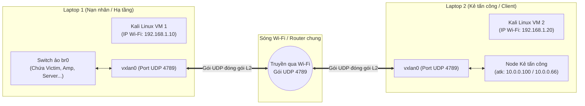

# HƯỚNG DẪN TRIỂN KHAI 7 BÀI LAB TRÊN 2 LAPTOP THẬT (VMWARE KALI LINUX QUA WIFI)

> **Mục đích:** Hướng dẫn chi tiết từ A-Z cách chia vai và thực hành chuỗi 7 bài lab an toàn mạng TCP/IP trên **2 máy tính Laptop vật lý riêng biệt**, cùng chạy máy ảo Kali Linux trên VMware và kết nối chung một mạng Wi-Fi.  
> Giúp giảng viên quan sát trực tiếp gói tin mạng và các cuộc tấn công trao đổi qua sóng Wi-Fi thực tế giữa hai máy tính!

---

## I. TỔNG QUAN KIẾN TRÚC MẠNG 2 LAPTOP

### 1. Thách thức lớn khi chạy trên 2 máy thật qua Wi-Fi
Khi triển khai các bài lab bảo mật TCP/IP giữa 2 máy thật qua Wi-Fi, sinh viên thường gặp các rào cản chí mạng:
1. **Router Wi-Fi chặn IP Spoofing**: Các router Wi-Fi hiện đại bật tính năng chống giả mạo IP nguồn (uRPF/Anti-spoofing). Nếu bạn giả mạo IP `10.0.0.77` hay `10.0.0.200`, router Wi-Fi sẽ tự động hủy (drop) gói tin ngay lập tức.
2. **Router Wi-Fi chặn Broadcast**: Trong Lab 04 (Smurf), router Wi-Fi cấm phát gói ping tới địa chỉ broadcast mạng LAN (`.255`).
3. **AP Isolation (Cách ly máy khách)**: Nhiều mạng Wi-Fi trường học hoặc quán cà phê bật chế độ AP Isolation, ngăn không cho 2 laptop nhìn thấy nhau.

### 2. "Vũ khí công nghiệp": Công nghệ VXLAN Overlay (RFC 7348)
Để giải quyết triệt để 100% các rào cản trên mà **không cần sửa một dòng mã nguồn Python Scapy nào**:
* Hệ thống sử dụng công nghệ **VXLAN (Virtual Extensible LAN)** chuẩn công nghiệp của Linux.
* **Nguyên lý:** Toàn bộ khung mạng ảo Layer 2 của bài lab (bao gồm cả các gói tin dị dạng, IP giả mạo `10.0.0.x`, gói broadcast) được đóng gói nguyên vẹn bên trong các gói tin **UDP chuẩn (cổng 4789)**.
* **Hiệu quả:**
  * Router Wi-Fi chỉ nhìn thấy hai laptop đang gửi các gói UDP bình thường cho nhau, **hoàn toàn không thể can thiệp hay chặn đứng**.
  * Hai máy ảo Kali Linux trên 2 laptop được nối thông với nhau như thể cắm chung một sợi dây cáp mạng LAN vật lý!
  * Toàn bộ các địa chỉ IP gốc trong giáo trình (`10.0.0.1`, `10.0.0.2`, `10.0.0.200`, `10.0.0.66`...) được giữ nguyên vẹn 100%!



---

## II. THIẾT LẬP MÔI TRƯỜNG KẾT NỐI BAN ĐẦU

### Bước 1: Kết nối Wi-Fi giữa 2 Laptop
> [!TIP]
> **Mẹo hay nhất để không bị chặn mạng trường:**
> Hãy dùng **1 điện thoại bật tính năng "Phát Wi-Fi" (Mobile Hotspot)** cho cả 2 chiếc laptop cùng kết nối vào, HOẶC dùng 1 chiếc laptop Windows bật **"Mobile Hotspot"** trong Windows Settings để chiếc laptop kia bắt vào. Mạng này cực kỳ sạch, ổn định và không có tường lửa chặn.

### Bước 2: Cấu hình card mạng trên VMware Workstation
Trên cả 2 laptop:
1. Mở VMware Workstation $\rightarrow$ Chọn máy ảo Kali Linux.
2. Vào **VM $\rightarrow$ Settings $\rightarrow$ Network Adapter**.
3. Chọn chế độ: **Bridged (Connected directly to the physical network)**.
   * *Khuyên dùng:* Tích chọn thêm ô **"Replicate physical network connection state"**.
4. Khởi động cả 2 máy ảo Kali Linux lên.

### Bước 3: Lấy địa chỉ IP Wi-Fi của mỗi máy Kali Linux
Mở terminal trên từng máy Kali Linux và chạy:
```bash
hostname -I
```
* Giả sử:
  * **Laptop 1** có IP Wi-Fi là: `192.168.43.10`
  * **Laptop 2** có IP Wi-Fi là: `192.168.43.20`
* **Kiểm tra thông mạng:**
  * Tại Laptop 1 gõ: `ping -c 2 192.168.43.20`
  * Tại Laptop 2 gõ: `ping -c 2 192.168.43.10`
  * Cả 2 máy phản hồi ping thành công là bạn đã sẵn sàng 100%!

---

## III. CHI TIẾT THỰC HIỆN LAB 04 TRÊN 2 LAPTOP (SMURF ATTACK)

### 1. Phân vai thực tế:
* **Laptop 1 (Máy Nạn nhân & Trạm khuếch đại):** Đóng vai hệ thống mạng nội bộ công ty gồm Nạn nhân `vic` (`10.0.0.200`) và 3 trạm khuếch đại `amp1`, `amp2`, `amp3` (`10.0.0.11`, `.12`, `.13`).
* **Laptop 2 (Máy Kẻ tấn công thực thụ):** Đóng vai hacker `atk` (`10.0.0.100`) ngồi ở laptop riêng, kết nối vào mạng và phát động tấn công.

### 2. Các bước thực hiện:

#### Bước 1: Khởi động mạng trên Laptop 1
Tại terminal của **Laptop 1**, chạy lệnh setup cho host kèm IP của Laptop 2:
```bash
cd /home/tantayen/Projects/TCPIP/LabLoHongBaoMatTCPIP
sudo bash setup_lab4_2pc.sh host 192.168.43.20
```

#### Bước 2: Kết nối mạng từ Laptop 2
Tại terminal của **Laptop 2**, chạy lệnh tham gia kèm IP của Laptop 1:
```bash
cd /home/tantayen/Projects/TCPIP/LabLoHongBaoMatTCPIP
sudo bash setup_lab4_2pc.sh attacker 192.168.43.10
```
*Laptop 2 tự động kiểm tra ping thông sang Nạn nhân `10.0.0.200` của Laptop 1.*

#### Bước 3: Bật theo dõi gói tin trên Laptop 1
Tại **Laptop 1**, mở terminal theo dõi Nạn nhân:
```bash
sudo ip netns exec vic tcpdump -i vic0 -nn icmp
```

#### Bước 4: Phát động tấn công từ Laptop 2
Tại **Laptop 2**, gõ lệnh phát động tấn công Smurf:
```bash
sudo ip netns exec atk python3 smurf_attack.py
```

#### Bước 5: Thầy và trò cùng quan sát 2 màn hình laptop:
* **Trên màn hình Laptop 2:** Thông báo gửi 10 gói tin giả mạo IP nguồn `10.0.0.200` tới địa chỉ broadcast `10.0.0.255`.
* **Ngay lập tức trên màn hình Laptop 1:** Cửa sổ `tcpdump` của nạn nhân bị "dội bão" **30 gói tin Echo Reply** tới tấp từ cả 3 trạm khuếch đại `.11`, `.12`, `.13`!
* **Minh chứng sống động:** 1 bạn bấm Enter ở laptop này, màn hình laptop kia hứng bão gói tin qua sóng Wi-Fi thực tế!

---

## IV. CHI TIẾT THỰC HIỆN LAB 05 TRÊN 2 LAPTOP (ICMP REDIRECT ATTACK)

### 1. Phân vai thực tế:
* **Laptop 1 (Hạ tầng mạng đích & Nạn nhân):** Chứa Nạn nhân `vic` (`10.0.0.2`), Router Gateway hợp pháp `gw` (`10.0.0.1`), và Server đích `dst` (`10.0.1.5`).
* **Laptop 2 (Kẻ tấn công đứng giữa - MITM):** Chứa kẻ tấn công `atk` (`10.0.0.66`) đóng vai Gateway giả mạo.

### 2. Các bước thực hiện:

#### Bước 1: Khởi động hạ tầng trên Laptop 1
Tại **Laptop 1**, chạy lệnh:
```bash
cd /home/tantayen/Projects/TCPIP/LabLoHongBaoMatTCPIP
sudo bash setup_lab5_2pc.sh host 192.168.43.20
```
Kiểm tra tuyến đường ban đầu của Nạn nhân:
```bash
sudo ip netns exec vic ip route get 10.0.1.5
```
*(Màn hình hiển thị: `10.0.1.5 via 10.0.0.1 dev vic0` $\rightarrow$ Đi qua Gateway chuẩn).*

#### Bước 2: Kết nối Attacker từ Laptop 2
Tại **Laptop 2**, chạy lệnh:
```bash
cd /home/tantayen/Projects/TCPIP/LabLoHongBaoMatTCPIP
sudo bash setup_lab5_2pc.sh attacker 192.168.43.10
```

#### Bước 3: Mở "kính lúp" nghe lén trên Laptop 2
Tại **Laptop 2**, mở terminal lắng nghe các gói tin liên quan đến `10.0.1.5`:
```bash
sudo ip netns exec atk tcpdump -i atk0 -nn host 10.0.1.5
```
*(Hiện tại màn hình hoàn toàn trống vì nạn nhân chưa gửi dữ liệu qua Laptop 2).*

#### Bước 4: Bắn gói tin ICMP Redirect từ Laptop 2
Tại một terminal khác của **Laptop 2**, chạy script tấn công:
```bash
sudo ip netns exec atk python3 icmp_redirect.py
```
*Script gửi gói ICMP Redirect giả danh Gateway `10.0.0.1` bay qua sóng Wi-Fi sang Laptop 1.*

#### Bước 5: Kiểm tra kết quả bẻ lái định tuyến trên Laptop 1
Tại **Laptop 1**, kiểm tra lại bảng định tuyến của nạn nhân:
```bash
sudo ip netns exec vic ip route get 10.0.1.5
```
* **Hiện tượng kỳ diệu:** Tuyến đường đã bị thay đổi thành:
  `10.0.1.5 via 10.0.0.66 dev vic0 ... <redirected> cache`!
* Toàn bộ dữ liệu của Nạn nhân đã bị bẻ lái sang IP của **Laptop 2** (`10.0.0.66`)!

#### Bước 6: Chứng minh chiếm quyền nghe lén Man-in-the-Middle thành công
Tại **Laptop 1**, gõ lệnh gửi gói tin tới máy đích:
```bash
sudo ip netns exec vic ping -c 3 10.0.1.5
```
* **Quan sát màn hình Laptop 2:** Màn hình `tcpdump` trên Laptop 2 lập tức bắt trọn vẹn cả 3 gói tin ping của Laptop 1 bay sang!
* Cuộc tấn công chiếm quyền điều hướng Man-in-the-Middle giữa 2 laptop vật lý thành công 100%!

---

## V. CHI TIẾT THỰC HIỆN CÁC BÀI LAB CÒN LẠI (LAB 01, 02, 03, 06, 07)

### Các bài Lab 2 máy: Lab 01, Lab 02, Lab 03, Lab 06 (Dùng chung `setup_pair_2pc.sh`)
* **Laptop 1 (Máy Nạn nhân `h2` - 10.0.0.2):**
  ```bash
  sudo bash setup_pair_2pc.sh host <IP_KALI_LAPTOP_2>
  ```
* **Laptop 2 (Máy Kẻ tấn công `h1` - 10.0.0.1):**
  ```bash
  sudo bash setup_pair_2pc.sh guest <IP_KALI_LAPTOP_1>
  ```

| Bài Lab | Thao tác trên Laptop 1 (`h2` - Nạn nhân) | Thao tác trên Laptop 2 (`h1` - Kẻ tấn công) | Hiện tượng quan sát |
| :--- | :--- | :--- | :--- |
| **Lab 01** *(ISN & Spoofing)* | `sudo ip netns exec h2 python3 server_h2.py` | `sudo ip netns exec h1 python3 isn_sampler.py`<br/>`sudo ip netns exec h1 python3 spoof_sniff.py` | Laptop 2 gửi dữ liệu giả mạo `10.0.0.77`, màn hình Laptop 1 nhận và in ra dòng chữ! |
| **Lab 02** *(Source Route)* | `sudo ip netns exec h2 tcpdump -i veth2 -nn icmp` | `sudo ip netns exec h1 python3 ssrr.py` | Gói Request từ Laptop 2 gửi tới, Laptop 1 bị ép quay đầu trả lời thẳng về Laptop 2! |
| **Lab 03** *(ICMP Tunnel)* | `sudo ip netns exec h2 sysctl -w net.ipv4.icmp_echo_ignore_all=1`<br/>`sudo ip netns exec h2 python3 icmp_server.py` | `sudo ip netns exec h1 python3 icmp_client.py` | Dữ liệu mật từ Laptop 2 được băm nhỏ tuồn qua ping sang Laptop 1 ghép lại nguyên vẹn! |
| **Lab 06** *(Teardrop)* | `sudo ip netns exec h2 ping -i 0.3 10.0.0.1` | `sudo ip netns exec h1 python3 teardrop_attack.py` | Laptop 2 bắn gói phân mảnh đè nhau sang Laptop 1. Laptop 1 không bị sập, ping vẫn nhảy đều! |

---

### Bài Lab 07: DNSSEC (Dùng `setup_dns_2pc.sh`)
* **Laptop 1 (Hệ thống Máy chủ DNS):**
  ```bash
  sudo bash setup_dns_2pc.sh host <IP_KALI_LAPTOP_2>
  sudo bash setup_dnssec_configs.sh
  sudo bash setup_unbound.sh
  # Khoi dong BIND9 va Unbound
  sudo ip netns exec dns-auth named -c /tmp/named-auth.conf -g &
  sudo ip netns exec dns-res unbound -c /tmp/unbound.conf -d &
  ```
* **Laptop 2 (Máy Khách `client` - 10.0.0.4):**
  ```bash
  sudo bash setup_dns_2pc.sh client <IP_KALI_LAPTOP_1>
  # Gui truy van kiem thuc DNSSEC qua Wi-Fi sang Laptop 1:
  sudo ip netns exec client dig @10.0.0.3 www.lab.test +dnssec
  ```
  *Laptop 2 nhận kết quả có cờ `ad` và bản ghi chữ ký `RRSIG` được kiểm thực từ xa qua sóng Wi-Fi!*

---

## VI. DỌN DẸP MÔI TRƯỜNG KHI KẾT THÚC
Trên **cả hai laptop**, chỉ cần chạy một lệnh duy nhất:
```bash
sudo bash clean_2pc.sh
```
Lệnh sẽ tự động xóa sạch các card `vxlan0`, bridge `br0`, và toàn bộ các không gian mạng ảo trên máy.

---

## VII. BẢNG TỔNG KẾT FILE KỊCH BẢN DÀNH CHO 2 LAPTOP

| Tên File Script | Vị trí áp dụng | Chức năng chính |
| :--- | :--- | :--- |
| **`setup_lab4_2pc.sh`** | Lab 04 (Smurf Attack) | Dựng mạng khuếch đại trên Laptop 1 và kết nối máy Attacker trên Laptop 2 qua Wi-Fi |
| **`setup_lab5_2pc.sh`** | Lab 05 (ICMP Redirect) | Dựng Gateway & Nạn nhân trên Laptop 1, đưa Kẻ tấn công trên Laptop 2 vào chiếm quyền MITM |
| **`setup_pair_2pc.sh`** | Lab 01, 02, 03, 06 | Kết nối cặp máy `h1` (Laptop 2) và `h2` (Laptop 1) qua đường hầm VXLAN |
| **`setup_dns_2pc.sh`** | Lab 07 (DNSSEC) | Đặt toàn bộ máy chủ DNS trên Laptop 1 và đưa máy khách `client` sang Laptop 2 |
| **`clean_2pc.sh`** | Dùng chung cho cả 7 bài | Dọn dẹp sạch sẽ VXLAN, Bridge và Network Namespaces trên cả 2 máy |
