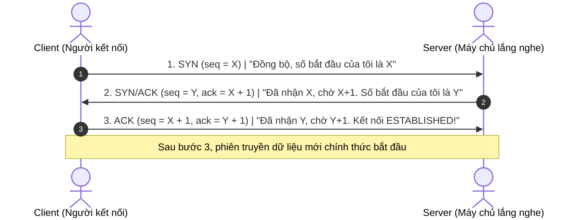

# BÁO CÁO THỰC HÀNH CHI TIẾT — BÀI LAB 01
## Đề tài: Tấn công dự đoán TCP Sequence Number & Giả mạo gói tin (TCP ISN Prediction & Blind Spoofing)

---

## I. MỤC TIÊU BÀI THỰC HÀNH

1. **Hiểu bản chất bắt tay 3 bước (TCP Three-Way Handshake)** và vai trò sống còn của hai số thứ tự:
   * **`SEQ` (Sequence Number)**: Số thứ tự đánh dấu từng byte dữ liệu.
   * **`ACK` (Acknowledgment Number)**: Số thứ tự byte tiếp theo mà bên nhận đang chờ đợi.
2. **Hiểu lỗ hổng dự đoán ISN (Initial Sequence Number)**: Vì sao trên các hệ thống cũ (thập niên 1980–1990), kẻ tấn công ngoài luồng (off-path attacker) có thể đoán được ISN để giả mạo một kết nối TCP hoàn chỉnh mà không cần nhìn thấy phản hồi của server.
3. **Kiểm chứng cơ chế phòng thủ hiện đại (RFC 6528)**: Sử dụng Python Scapy lấy mẫu 30 số ISN liên tiếp trên nhân Linux hiện đại để chứng minh tính ngẫu nhiên mật mã (không còn quy luật tăng tuyến tính).
4. **Mô phỏng tấn công giả mạo IP nguồn (On-Path IP Spoofing)**: Thực hiện gửi dữ liệu độc hại đến máy chủ dưới danh nghĩa một địa chỉ IP ma (`10.0.0.77`) bằng cách nghe lén gói tin trên đường truyền ảo.

---

## II. KIẾN THỨC NỀN TẢNG CỐT LÕI

### 1. Bắt tay 3 bước TCP (Three-Way Handshake)
Giao thức IP vốn là giao thức không tin cậy (Unreliable). Để đảm bảo dữ liệu truyền đi không bị mất mát hay đảo lộn thứ tự, TCP sinh ra cơ chế bắt tay 3 bước để thiết lập phiên trước khi truyền dữ liệu:



* **ISN (Initial Sequence Number)**: Là con số $X$ hoặc $Y$ đầu tiên được mỗi bên tự chọn khi bắt đầu kết nối.

### 2. Lỗ hổng lịch sử: Bộ đếm ISN toàn cục (Global Clock Counter)
* Theo chuẩn TCP ban đầu (RFC 793), hệ thống duy trì một đồng hồ đếm tăng tuyến tính: cứ mỗi giây tăng thêm $+64.000$ (hoặc $+1$ theo clock tick).
* **Khai thác của Hacker (Vụ tấn công Kevin Mitnick 1994)**:
  1. Hacker làm tê liệt máy Nạn nhân thật (ví dụ máy Giám Đốc) bằng đòn SYN Flood để máy này không thể gửi gói `RST` phản hồi.
  2. Hacker gửi kết nối hợp pháp đến Server để đo giá trị ISN hiện tại của Server.
  3. Hacker tính nhẩm: $\text{ISN}_{\text{tiếp theo}} = \text{ISN}_{\text{đo}} + 64.000 \times \Delta t$.
  4. Hacker gửi gói `SYN` giả mạo IP Giám Đốc, và nhắm mắt gửi luôn gói `ACK` với số đoán được.
  5. Bắt tay thành công, Hacker gửi lệnh độc hại vào hệ thống với danh nghĩa Giám Đốc.

### 3. Cơ chế phòng thủ RFC 6528 (Linux hiện đại)
Hệ điều hành ngày nay loại bỏ hoàn toàn bộ đếm tuyến tính. Số ISN được tính toán độc lập cho từng phiên kết nối thông qua hàm băm mật mã:
$$\text{ISN} = \text{MD5/SHA256}(\text{IP}_{\text{src}}, \text{Port}_{\text{src}}, \text{IP}_{\text{dst}}, \text{Port}_{\text{dst}}, \text{SecretKey}) + \text{Clock}$$
Do có khóa bí mật (`SecretKey`) của nhân hệ điều hành, kẻ tấn công bên ngoài tuyệt đối không thể tính toán hay đoán mò được ISN.

---

## III. GIẢI THÍCH CHI TIẾT CÁC FILE MÃ NGUỒN TRONG BÀI LAB

Bộ lab gồm 4 file chính đặt tại thư mục: `/home/tantayen/Projects/TCPIP/LabLoHongBaoMatTCPIP/`

```
LabLoHongBaoMatTCPIP/
├── setup_pair.sh      # Script dựng môi trường mạng ảo 2 máy (h1, h2)
├── server_h2.py       # Chương trình máy chủ dịch vụ chạy trên Victim (h2)
├── isn_sampler.py     # Script kiểm tra tính ngẫu nhiên của ISN
└── spoof_sniff.py     # Script thực hiện tấn công giả mạo IP và hoàn tất bắt tay TCP
```

---

### 1. File `setup_pair.sh` (Khởi tạo môi trường ảo hóa mạng)

* **Chức năng**: Sử dụng tính năng Linux Network Namespaces (`ip netns`) để tạo ra 2 "máy con" hoàn toàn cô lập ngay trên 1 hệ điều hành Kali Linux duy nhất, nối với nhau bằng cặp dây mạng ảo `veth1` - `veth2`.
* **Cơ chế hoạt động**:
  1. `ip netns add h1` và `ip netns add h2`: Tạo 2 không gian mạng riêng biệt.
  2. `ip link add veth1 type veth peer name veth2`: Tạo sợi dây cáp mạng ảo có 2 đầu cắm.
  3. Cắm đầu `veth1` vào máy `h1` (IP: `10.0.0.1/24`), đầu `veth2` vào máy `h2` (IP: `10.0.0.2/24`).
  4. `ip netns exec h1 ip addr add 10.0.0.77/24 dev veth1`: Gán thêm địa chỉ ảo `10.0.0.77` vào card `veth1` để card mạng này sẵn sàng trả lời ARP và nhận gói tin trả lời từ máy `h2`.
  5. `sysctl -w net.ipv4.conf.*.rp_filter=0`: Tắt cơ chế Reverse Path Filtering để nhân Linux không tự động chặn các gói tin mang địa chỉ IP lạ.
  6. `iptables -A OUTPUT -p tcp --tcp-flags RST RST -j DROP`: Chặn không cho nhân hệ điều hành của `h1` tự tiện gửi gói tin `RST` (Hủy kết nối) làm phá vỡ tiến trình bắt tay do Scapy tự quản lý.

---

### 2. File `server_h2.py` (Dịch vụ lắng nghe trên máy Victim `h2`)

* **Chức năng**: Đóng vai trò là một máy chủ dịch vụ TCP (ví dụ Web Server hoặc dịch vụ từ xa) chạy trên máy Nạn nhân `h2` (`10.0.0.2:9000`).
* **Tại sao dùng file này thay cho lệnh `nc -lk -p 9000`?**  
  Lệnh `netcat` truyền thống trên Linux sau khi nhận một phiên kết nối bị ngắt đột ngột sẽ tự động tắt tiến trình. File `server_h2.py` được lập trình bằng thư viện `socket` của Python với vòng lặp vô tận `while True`, giúp máy chủ luôn mở cổng 9000, không bao giờ bị văng khi chạy nhiều bài test.
* **Cơ chế hoạt động**:
  1. Mở socket lắng nghe trên `10.0.0.2` tại cổng `9000`.
  2. Khi có ai kết nối tới, in ngay thông tin: `[!] CO KET NOI MOI! Tu dia chi IP: <IP> (Port: <Port>)`.
  3. Đọc dữ liệu gửi đến và in rõ ra màn hình: `[>>>] NOI DUNG NHAN DUOC: ...`.

---

### 3. File `isn_sampler.py` (Thu thập và phân tích tính ngẫu nhiên ISN)

* **Chức năng**: Gửi liên tiếp 30 gói `SYN` tới Server `10.0.0.2:9000`, đọc trường `SEQ` trong gói `SYN/ACK` trả về và tính độ chênh lệch giữa các số liên tiếp.
* **Cơ chế hoạt động**:
  1. Vòng lặp `for i in range(30)`:
     * Dùng Scapy tạo gói tin: `IP(src="10.0.0.1", dst="10.0.0.2")/TCP(sport=RandShort(), dport=9000, flags="S")`.
     * Gửi đi và chờ nhận phản hồi bằng hàm `sr1()`.
     * Khi nhận được gói `SYN/ACK` (cờ có giá trị `0x12`), bóc tách số `ans[TCP].seq` và lưu vào danh sách `isns`.
     * Gửi ngay một gói `RST` để đóng kết nối giải phóng tài nguyên cho server.
  2. Duyệt qua mảng và tính toán hiệu số giữa hai lần liên tiếp: `delta = isns[i] - isns[i-1]`.
  3. In bảng so sánh ra màn hình.

---

### 4. File `spoof_sniff.py` (Tấn công giả mạo IP nguồn & hoàn tất bắt tay TCP)

* **Chức năng**: Kẻ tấn công `h1` mạo danh IP ma `10.0.0.77` gửi kết nối và truyền một thông điệp độc hại vào máy chủ `h2`.
* **Cơ chế hoạt động chi tiết**:
  * **Bước 1 (Khởi động bộ nghe lén trước)**: Sử dụng `AsyncSniffer` của Scapy để bắt đầu lắng nghe trên card mạng `veth1`. Màng lọc `lfilter` được thiết lập chặt chẽ:
    ```python
    lfilter=lambda p: (
        p.haslayer(TCP)
        and p[TCP].dport == 12345
        and (p[TCP].flags & 0x12) == 0x12
    )
    ```
    *Chỉ bắt đúng gói tin TCP gửi về cổng 12345 và có đủ 2 cờ SYN+ACK.*
  * **Bước 2 (Gửi gói SYN giả mạo)**: Attacker gửi gói SYN với `src="10.0.0.77"`, `dst="10.0.0.2"`, `sport=12345`, `dport=9000`.
  * **Bước 3 (Chộp lấy số ISN)**: Server `h2` gửi phản hồi về địa chỉ `10.0.0.77`. Do card `veth1` nhận diện gói tin này, `AsyncSniffer` bắt trúng gói tin và đọc được số `isn = sa[0][TCP].seq`.
  * **Bước 4 (Gửi gói ACK xác nhận)**: Attacker gửi gói ACK với `ack = isn + 1` để đưa phiên làm việc lên trạng thái `ESTABLISHED`.
  * **Bước 5 (Bơm dữ liệu)**: Attacker gửi gói tin PSH/ACK chứa nội dung độc hại:
    `b"hello-from-spoofed-source-10.0.0.77\n"`
    Server `h2` chấp nhận gói tin và in ra màn hình.

---

## IV. QUÁ TRÌNH THỰC HÀNH & KẾT QUẢ QUAN SÁT ĐƯỢC

> **LỰA CHỌN MÔ HÌNH THỰC HIỆN:**
> * **Phương án 1 (TRIỂN KHAI TRÊN 2 MÁY THẬT - KALI LINUX QUA WI-FI):** Độc lập, thực tế, ấn tượng nhất khi quay video thuyết trình 2 laptop.
> * **Phương án 2 (MÔ PHỎNG TRÊN 1 MÁY - NETWORK NAMESPACE):** Sử dụng `setup_pair.sh` tạo 2 máy ảo `h1` và `h2` nối qua cặp veth.

---

### PHƯƠNG ÁN 1: TRIỂN KHAI TRÊN 2 MÁY THẬT (KALI LINUX — CÙNG MẠNG WI-FI)

#### 1. Chuẩn bị mạng
* **Máy 1 (Attacker):** Kết nối Wi-Fi, kiểm tra IP bằng `ip a show wlan0` (giả sử IP: `192.168.1.100`).
* **Máy 2 (Victim):** Kết nối chung Wi-Fi, kiểm tra IP bằng `ip a show wlan0` (giả sử IP: `192.168.1.105`).
* Kiểm tra ping giữa 2 máy: Từ Máy 1 gõ `ping -c 2 192.168.1.105` đảm bảo thông suốt.

#### 2. Các bước tiến hành trên 2 máy thật
* **Bước 1 (Trên Máy 2 - Victim):** Khởi động máy chủ dịch vụ:
  ```bash
  python3 server_h2.py
  ```
  *(Máy chủ mở cổng 9000 trên `0.0.0.0`, lắng nghe mọi kết nối qua card Wi-Fi `wlan0`).*

* **Bước 2 (Trên Máy 1 - Attacker):** Lấy mẫu 30 số ISN từ xa qua sóng Wi-Fi:
  ```bash
  sudo python3 isn_sampler.py 192.168.1.105
  ```
  *Kết quả:* Máy 1 bắn 30 gói TCP SYN tới Máy 2, thu thập 30 số ISN và in bảng phân tích độ lệch `diff` ngẫu nhiên RFC 6528.

* **Bước 3 (Trên Máy 1 - Attacker):** Thực hiện tấn công giả mạo IP nguồn:
  ```bash
  sudo python3 spoof_sniff.py 192.168.1.105
  ```
  *Cơ chế tự động:* Script tự động kích hoạt luồng trả lời ARP cho IP giả mạo `192.168.1.222`, bắt gói SYN/ACK của Máy 2 gửi về qua Wi-Fi, hoàn tất bắt tay 3 bước và gửi payload độc hại.
  *Quan sát trên Máy 2:* Màn hình in ra dòng chữ: `[+] Nhan duoc tu ('192.168.1.222', 12345): b'hello-from-spoofed-source-192.168.1.222'`!

---

### PHƯƠNG ÁN 2: MÔ PHỎNG TRÊN 1 MÁY (NETWORK NAMESPACE)

### 1. Bố trí môi trường làm việc
Mở 2 cửa sổ dòng lệnh Terminal trên Kali Linux:
* **Terminal Trái (Attacker `h1` - 10.0.0.1)**: Đóng vai kẻ tấn công.
* **Terminal Phải (Victim `h2` - 10.0.0.2)**: Đóng vai máy chủ bị tấn công.

### 2. Các bước tiến hành

#### Bước 1: Khởi tạo mạng ảo
Tại Terminal Trái:
```bash
sudo bash setup_pair.sh
```
*Kết quả:* Hệ thống thông báo topo sẵn sàng và lệnh ping từ 10.0.0.1 sang 10.0.0.2 thành công $100\%$.

#### Bước 2: Chui vào không gian mạng của từng máy
* Terminal Trái: `sudo ip netns exec h1 bash` (kiểm tra `ip a` thấy IP `10.0.0.1`).
* Terminal Phải: `sudo ip netns exec h2 bash` (kiểm tra `ip a` thấy IP `10.0.0.2`).

#### Bước 3: Mở máy chủ trên Victim (`h2`)
Tại Terminal Phải (Victim):
```bash
python3 server_h2.py
```
*Hiện tượng:* Máy chủ báo đang mở cổng 9000 và đứng chờ kết nối.

#### Bước 4: Kiểm tra tính ngẫu nhiên của ISN
Tại Terminal Trái (Attacker):
```bash
python3 isn_sampler.py 10.0.0.2
```
*Hiện tượng quan sát được:*
* Thu thập đủ 30 số ISN.
* Độ chênh lệch giữa các số liên tiếp là các số khổng lồ (vài trăm triệu đến vài tỷ), nhảy loạn xạ cả âm và dương (ví dụ: `833022735`, `-58908007`, `2073033611`...).
* **Kết luận khoa học:** Hệ thống đã tuân theo chuẩn RFC 6528, kẻ tấn công đứng ngoài mạng (off-path) hoàn toàn không thể đoán được ISN.

#### Bước 5: Thực hiện tấn công giả mạo nguồn IP
Tại Terminal Trái (Attacker):
```bash
python3 spoof_sniff.py
```
*Hiện tượng quan sát được:*
* Terminal Trái báo: *Đã bắt được SYN/ACK thành công! ISN thực tế của server = 0x328a9b7e (847944574)*. Đã gửi ACK và gửi dữ liệu thành công.
* **Ngay lập tức, tại Terminal Phải (Victim):**
  ```text
  [!] CO KET NOI MOI! Tu dia chi IP: 10.0.0.77 (Port: 12345)
  [>>>] NOI DUNG NHAN DUOC: hello-from-spoofed-source-10.0.0.77
  ```
* **Kết luận:** Server `h2` đã bị lừa hoàn toàn, tin rằng gói tin đến từ máy `10.0.0.77`, mặc dù trong mạng không hề có máy thật nào mang IP này.

---

## V. CÁC LỖI KỸ THUẬT GẶP PHẢI TRONG QUÁ TRÌNH THỰC HIỆN & BÀI HỌC KINH NGHIỆM

1. **Lỗi `nc` tự thoát (Exit)**:
   * *Nguyên nhân:* Lệnh `nc -lk -p 9000` trên bản Debian/Kali khi bị đóng kết nối bởi `isn_sampler.py` sẽ thoát ra ngoài khiến cổng 9000 bị đóng.
   * *Khắc phục:* Viết file `server_h2.py` bằng Python socket với vòng lặp vô tận để server luôn sống.
2. **Lỗi `Không bắt được gói SYN/ACK` trong `spoof_sniff.py`**:
   * *Nguyên nhân 1 (Trễ nhịp):* Do hàm `send()` chạy trước hàm `sniff()`, trên mạng ảo gói tin phản hồi quá nhanh nên máy nghe lén chưa kịp bật đã lỡ mất gói tin. Khắc phục: Dùng `AsyncSniffer` bật nghe lén trước $0.3$ giây rồi mới gửi gói SYN.
   * *Nguyên nhân 2 (Phân giải ARP Tầng 2):* Địa chỉ `10.0.0.77` chưa được gán vào card mạng `veth1`, khiến máy `h2` khi gửi gói tin hỏi ARP `Who has 10.0.0.77?` thì không nhận được phản hồi nên vứt bỏ gói SYN/ACK. Khắc phục: Gán thêm alias `10.0.0.77/24` vào card `veth1`.

---

## VI. GIẢI PHÁP PHÒNG THỦ (MITIGATION)

1. **Ngẫu nhiên hóa ISN bằng mật mã (RFC 6528)**: Bắt buộc kích hoạt trên mọi hệ điều hành để triệt tiêu hoàn toàn khả năng đoán số thứ tự ngoài luồng (off-path attacks).
2. **Lọc địa chỉ nguồn tại biên mạng (BCP 38 / RFC 2827)**:
   * Cấu hình trên Router biên: Router chỉ cho phép các gói tin có địa chỉ IP nguồn thuộc đúng dải mạng hợp lệ của khách hàng đi qua.
   * Nếu thấy gói tin có IP nguồn lạ (`10.0.0.77`) xuất phát từ cổng mạng nội bộ của khách hàng khác -> Router lập tức hủy bỏ (Ingress/Egress Filtering).
3. **Mã hóa và xác thực tầng trên (TLS, SSH, IPsec)**:
   * Tuyệt đối không bao giờ dùng địa chỉ IP làm căn cứ xác thực danh tính người dùng (bãi bỏ hoàn toàn các dịch vụ cũ như `rlogin`, `rsh`, `.rhosts`).
   * Sử dụng chứng chỉ số, chữ ký điện tử hoặc khóa công khai SSH để kể cả khi hacker giả mạo được IP và bắt tay TCP, hacker vẫn không thể vượt qua cửa sổ đăng nhập.

---

## VII. ĐÁP ÁN 5 CÂU HỎI ÔN TẬP TRONG GIÁO TRÌNH CỦA GIẢNG VIÊN

| STT | Câu hỏi của Giảng viên | Đáp án chuẩn xác & ăn điểm cao |
| :---: | :--- | :--- |
| **1** | *Giải thích vai trò của SEQ và ACK trong bắt tay 3 bước. Vì sao bên tấn công off-path phải đoán đúng ISN?* | **Đáp:** `SEQ` dùng để đánh số thứ tự dữ liệu gửi đi, `ACK` dùng để báo cho bên kia biết byte tiếp theo đang chờ nhận. Kẻ tấn công off-path không nhìn thấy gói `SYN/ACK` của server nên không biết server chọn `ISN` là bao nhiêu. Nếu không đoán đúng `ISN`, gói `ACK` gửi đi sẽ có giá trị sai lệch khiến server từ chối và hủy kết nối (RST), cuộc tấn công thất bại. |
| **2** | *Từ dữ liệu ở Bước 2.2, cho biết các ISN có theo quy luật không? Giá trị chênh lệch nói lên điều gì?* | **Đáp:** Các số ISN hoàn toàn ngẫu nhiên và không hề có quy luật. Giá trị chênh lệch nhảy loạn xạ hàng trăm triệu đến hàng tỷ đơn vị, chứng minh Linux đã áp dụng hàm băm mật mã RFC 6528 để sinh số ISN ngẫu nhiên, loại bỏ hoàn toàn lỗ hổng tăng tuyến tính thời xưa. |
| **3** | *Trong Bước 2.3, nếu attacker ở ngoài đoạn mạng (không sniff được SYN/ACK) thì phải làm gì để hoàn tất bắt tay?* | **Đáp:** Nếu ở ngoài mạng (off-path), attacker không thể nghe lén được nên bắt buộc phải quay lại phương pháp **dự đoán ISN**. Nhưng trên hệ điều hành hiện đại, do ISN đã được ngẫu nhiên hóa 32-bit ($2^{32} \approx 4.3$ tỷ khả năng) nên việc đoán mò là bất khả thi trong thực tế. |
| **4** | *BCP 38 ngăn chặn thành phần nào của cuộc tấn công? Vì sao chỉ ngẫu nhiên hóa ISN là chưa đủ?* | **Đáp:** BCP 38 ngăn chặn bước **giả mạo địa chỉ IP nguồn (IP Spoofing)** bằng cách loại bỏ các gói tin có IP nguồn không hợp lệ tại router biên. Chỉ ngẫu nhiên hóa ISN là chưa đủ vì nếu kẻ tấn công nằm cùng đường truyền (on-path / chung mạng LAN), hắn vẫn có thể nghe lén gói tin để lấy ISN thật mà không cần đoán mò. |
| **5** | *Dùng lệnh nào để quan sát ISN do chính kernel của bạn sinh ra cho một kết nối thật?* | **Đáp:** Dùng lệnh `tcpdump -S -i <interface> tcp` (tùy chọn `-S` bắt buộc tcpdump in ra số Sequence Number tuyệt đối do kernel sinh ra thay vì in số tương đối bắt đầu từ 0). |

---

## VIII. KỊCH BẢN THUYẾT TRÌNH KHI QUAY VIDEO (VOICEOVER)

> **LỰA CHỌN KỊCH BẢN QUAY PHÙ HỢP VỚI MÔ HÌNH CỦA BẠN:**
> * **KỊCH BẢN A: QUAY TRÊN 2 MÁY THẬT (KALI LINUX — CÙNG MẠNG WI-FI)**
> * **KỊCH BẢN B: QUAY TRÊN 1 MÁY (CHIA ĐÔI MÀN HÌNH TERMINAL - NETWORK NAMESPACE)**

---

### KỊCH BẢN A: QUAY TRÊN 2 MÁY THẬT (KALI LINUX QUA WI-FI)

> **Bố cục ghi hình:**
> * Đặt 2 laptop cạnh nhau (hoặc dùng phần mềm quay màn hình trên cả 2 máy):
>   * **Máy 1 (Bên trái):** Máy Kẻ tấn công (Attacker) — IP ví dụ `192.168.1.100`.
>   * **Máy 2 (Bên phải):** Máy Nạn nhân (Victim) — IP ví dụ `192.168.1.105`.

#### [0:00 - 0:35] Mở đầu & Giới thiệu 2 máy thật
* **Lời thoại:**
  *"Kính chào thầy và các bạn! Hôm nay em xin trình bày bài thực hành số 01: Tấn công dự đoán số thứ tự TCP Sequence Number và Kỹ thuật giả mạo TCP Spoofing. Để chứng minh tính thực tế cao nhất, em triển khai bài lab trực tiếp trên 2 máy tính vật lý thật cùng chạy Kali Linux và kết nối chung một mạng Wi-Fi:
  * Máy tính bên phải là máy Nạn nhân (Victim) có địa chỉ IP là `192.168.1.105`.
  * Máy tính bên trái là máy Kẻ tấn công (Attacker) có địa chỉ IP là `192.168.1.100`."*

#### [0:35 - 1:15] Bước 1: Khởi động máy chủ dịch vụ trên Máy 2 (Victim)
* **Thao tác trên Máy 2 (Bên phải):**
  ```bash
  python3 server_h2.py
  ```
* **Lời thoại giải thích:**
  *"Đầu tiên, trên máy Nạn nhân bên phải, em khởi động file `server_h2.py`. Chương trình này mở một socket TCP tiêu chuẩn, lắng nghe trên cổng `9000` của tất cả các card mạng. Như thầy và các bạn thấy, máy chủ đã bật và đang ở trạng thái chờ kết nối từ các máy trong mạng Wi-Fi."*

#### [1:15 - 2:20] Bước 2: Thu thập 30 số ISN từ xa qua sóng Wi-Fi từ Máy 1
* **Thao tác trên Máy 1 (Bên trái):**
  ```bash
  sudo python3 isn_sampler.py 192.168.1.105
  ```
* **Lời thoại giải thích:**
  *"Bây giờ tại máy tấn công bên trái, em chạy lệnh `sudo python3 isn_sampler.py 192.168.1.105`. File Python này sử dụng thư viện Scapy để liên tục gửi 30 gói TCP SYN qua sóng Wi-Fi tới cổng 9000 của máy nạn nhân. Với mỗi gói SYN/ACK máy nạn nhân gửi ngược lại, chương trình bóc tách trường Initial Sequence Number (ISN) và tính toán độ chênh lệch giữa các lần liên tiếp.*
  
  *Thầy và các bạn hãy quan sát bảng kết quả in ra trên màn hình máy 1: Cột giá trị ISN biến thiên ngẫu nhiên và cột độ lệch (diff) nhảy cách nhau hàng triệu, hàng tỷ đơn vị, hoàn toàn không theo bất kỳ quy luật tăng dần nào. Điều này kiểm chứng trên máy thật rằng nhân Linux hiện đại đã áp dụng tiêu chuẩn bảo mật RFC 6528, dùng hàm băm mật mã để sinh số ngẫu nhiên, khiến cho đòn tấn công đoán mò ISN từ xa (off-path) hoàn toàn bị vô hiệu hóa!"*

#### [2:20 - 3:45] Bước 3: Thực hiện tấn công Giả mạo IP nguồn (Spoofing) trên mạng Wi-Fi
* **Thao tác trên Máy 1 (Bên trái):**
  ```bash
  sudo python3 spoof_sniff.py 192.168.1.105
  ```
* **Lời thoại giải thích:**
  *"Sang phần 2: Kẻ tấn công thực hiện kỹ thuật giả mạo IP trên mạng cục bộ Wi-Fi bằng file `spoof_sniff.py`:*
  1. *Script chế tạo gói tin TCP SYN giả mạo IP nguồn là một địa chỉ ma `192.168.1.222` gửi tới máy nạn nhân.*
  2. *Điểm đặc biệt: Script tích hợp sẵn luồng phản hồi ARP tự động, trả lời thay cho IP ma `192.168.1.222` để máy nạn nhân chuyển tiếp gói tin SYN/ACK về đúng card Wi-Fi của attacker.*
  3. *Máy 1 bắt được gói SYN/ACK, trích xuất ISN thật, gửi tiếp gói ACK hoàn tất bắt tay 3 bước và bơm dữ liệu độc hại.*
  
  *Thầy và các bạn hãy nhìn sang màn hình Máy 2 bên phải: Máy chủ lập tức in ra dòng chữ: `[+] Nhan duoc tu ('192.168.1.222', 12345): b'hello-from-spoofed-source-192.168.1.222'`! Kẻ tấn công đã hoàn toàn mạo danh thành công một IP lạ để gửi dữ liệu vào máy chủ qua mạng Wi-Fi thực tế!"*

#### [3:45 - 4:25] Bước 4: Biện pháp phòng vệ & Kết luận
* **Lời thoại giải thích:**
  *"Qua thực nghiệm trên 2 máy thật, chúng ta thấy rõ: Để phòng chống triệt để các đòn tấn công giả mạo IP trên hạ tầng mạng, các doanh nghiệp bắt buộc phải cấu hình tính năng Ingress Filtering (BCP 38) trên các thiết bị mạng Switch và Router để loại bỏ các gói tin mang IP nguồn giả mạo, đồng thời luôn mã hóa toàn bộ dữ liệu ở Tầng ứng dụng bằng giao thức TLS/SSH. Em xin kết thúc bài thực hành số 01 tại đây!"*

---

### KỊCH BẢN B: QUAY TRÊN 1 MÁY (CHIA ĐÔI MÀN HÌNH TERMINAL - NETWORK NAMESPACE)

---

### [0:00 - 0:30] Mở đầu & Giới thiệu đề tài
* **Lời thoại:**
  *"Kính chào thầy và các bạn! Hôm nay em xin trình bày bài thực hành số 01 trong chuỗi chuyên đề An toàn Giao thức TCP/IP: Tấn công dự đoán số thứ tự ban đầu TCP Sequence Number và Kỹ thuật giả mạo kết nối TCP Spoofing. Để đảm bảo an toàn và cô lập tuyệt đối, em sử dụng tính năng Network Namespace của Linux để giả lập hai máy trạm: bên trái là máy tấn công h1, bên phải là máy nạn nhân h2."*

---

### [0:30 - 1:15] Bước 1: Khởi tạo mô hình mạng ảo
* **Thao tác trên terminal trái:**
  ```bash
  sudo bash setup_pair.sh
  ```
* **Lời thoại giải thích:**
  *"Đầu tiên, em thực thi script `setup_pair.sh`. File script này có nhiệm vụ khởi tạo hai không gian mạng độc lập là h1 và h2, sau đó tạo một cặp card mạng ảo veth nối trực tiếp hai máy với nhau. Máy h1 được gán địa chỉ IP `10.0.0.1`, máy h2 nhận địa chỉ `10.0.0.2`. Ở cuối kịch bản, script tự động thực hiện lệnh ping kiểm tra. Như thầy và các bạn thấy trên màn hình, hai máy đã phản hồi ping thành công với độ trễ siêu thấp 0.04 ms, mạng đã sẵn sàng!"*

---

### [1:15 - 1:55] Bước 2: Bật máy chủ dịch vụ trên máy nạn nhân
* **Thao tác trên terminal phải:**
  ```bash
  sudo ip netns exec h2 python3 server_h2.py
  ```
* **Lời thoại giải thích:**
  *"Tiếp theo, ở cửa sổ bên phải của nạn nhân h2, em chạy lệnh `sudo ip netns exec h2 python3 server_h2.py`. Câu lệnh `ip netns exec h2` sẽ kích hoạt chương trình Python bên trong không gian mạng của h2. File `server_h2.py` mở một socket TCP tiêu chuẩn, lắng nghe tại cổng `9000`. Khi có bất kỳ ai kết nối tới và gửi tin nhắn, máy chủ sẽ in địa chỉ IP của người gửi và nội dung tin nhắn ra màn hình. Hiện máy chủ đang ở trạng thái lắng nghe."*

---

### [1:55 - 3:00] Bước 3: Thu thập và Kiểm chứng tính ngẫu nhiên của TCP ISN
* **Thao tác trên terminal trái:**
  ```bash
  sudo ip netns exec h1 python3 isn_sampler.py
  ```
* **Lời thoại giải thích:**
  *"Bây giờ tại máy tấn công h1 bên trái, em bắt đầu Phần 1 của bài lab bằng lệnh `sudo ip netns exec h1 python3 isn_sampler.py`. File `isn_sampler.py` này sử dụng thư viện Scapy để liên tục gửi 30 gói tin TCP SYN tới cổng 9000 của h2. Với mỗi gói SYN/ACK máy chủ h2 trả về, chương trình sẽ bóc tách trường số thứ tự ban đầu ISN (Initial Sequence Number) và tính toán độ chênh lệch giữa các lần liên tiếp.*
  
  *Quan sát bảng dữ liệu in ra trên màn hình: Cột ISN gồm các số nguyên 32-bit nhảy loạn xạ, và cột độ lệch (diff) biến thiên hàng trăm triệu đến hàng tỷ đơn vị, hoàn toàn không có bất kỳ quy luật cộng dồn tuyến tính nào. Điều này chứng minh nhân Linux hiện đại đã áp dụng tiêu chuẩn bảo mật RFC 6528, sử dụng hàm băm mật mã hóa để sinh số ngẫu nhiên, khiến cho kiểu tấn công đoán mò ISN từ xa (off-path) thời xưa hoàn toàn bị triệt hạ!"*

---

### [3:00 - 4:15] Bước 4: Thực hiện Tấn công Giả mạo IP (On-path Blind Spoofing)
* **Thao tác trên terminal trái:**
  ```bash
  sudo ip netns exec h1 python3 spoof_sniff.py
  ```
* **Lời thoại giải thích:**
  *"Sang Phần 2: Kịch bản kẻ tấn công nằm cùng đường mạng (on-path). Em chạy script `spoof_sniff.py`. Chương trình này thực hiện cuộc tấn công qua 3 giai đoạn rất tinh vi:*
  1. *Đầu tiên, nó gửi một gói TCP SYN giả mạo IP nguồn là `10.0.0.77` — một địa chỉ ma không hề tồn tại trong mạng.*
  2. *Vì nằm cùng đường mạng ảo, hàm `sniff()` của Scapy đã nghe lén được gói SYN/ACK mà máy chủ h2 gửi trả về cho IP 10.0.0.77, từ đó trích xuất chính xác số ISN thật của server.*
  3. *Ngay lập tức, nó tự tạo gói TCP ACK với số `ack_seq = isn + 1` để hoàn tất quá trình bắt tay 3 bước, rồi bắn tiếp một gói chứa dữ liệu độc hại.*
  
  *Thầy và các bạn hãy nhìn sang cửa sổ bên phải của nạn nhân h2: Máy chủ lập tức in ra dòng chữ: `[+] Nhan duoc tu ('10.0.0.77', 12345): b'hello-from-spoofed-source-10.0.0.77'`. Kẻ tấn công đã hoàn toàn mạo danh thành công một IP lạ để gửi dữ liệu vào hệ thống mà nạn nhân không hề hay biết!"*

---

### [4:15 - 5:00] Bước 5: Dọn dẹp môi trường & Biện pháp phòng vệ
* **Thao tác trên terminal trái:**
  ```bash
  sudo bash clean_pair.sh
  ```
* **Lời thoại giải thích:**
  *"Cuối cùng, em thực hiện lệnh `sudo bash clean_pair.sh`. Kịch bản này sẽ dừng toàn bộ tiến trình Python, xóa cặp card mạng ảo veth và giải phóng hai namespace h1, h2, trả lại trạng thái nguyên bản cho máy.*
  
  *Qua bài thực hành số 01, chúng ta rút ra bài học cốt lõi: Ngẫu nhiên hóa ISN bằng RFC 6528 chỉ chống được tấn công ngoài mạng. Để chống tấn công nghe lén và giả mạo trên đường truyền, các nhà mạng và doanh nghiệp bắt buộc phải cấu hình bộ lọc BCP 38 (Ingress Filtering) tại router biên để chặn đứng các gói tin có IP nguồn giả mạo, đồng thời luôn mã hóa kênh truyền bằng TLS hoặc SSH. Em xin kết thúc bài thực hành số 01 tại đây. Cảm ơn thầy và các bạn đã lắng nghe!"*

