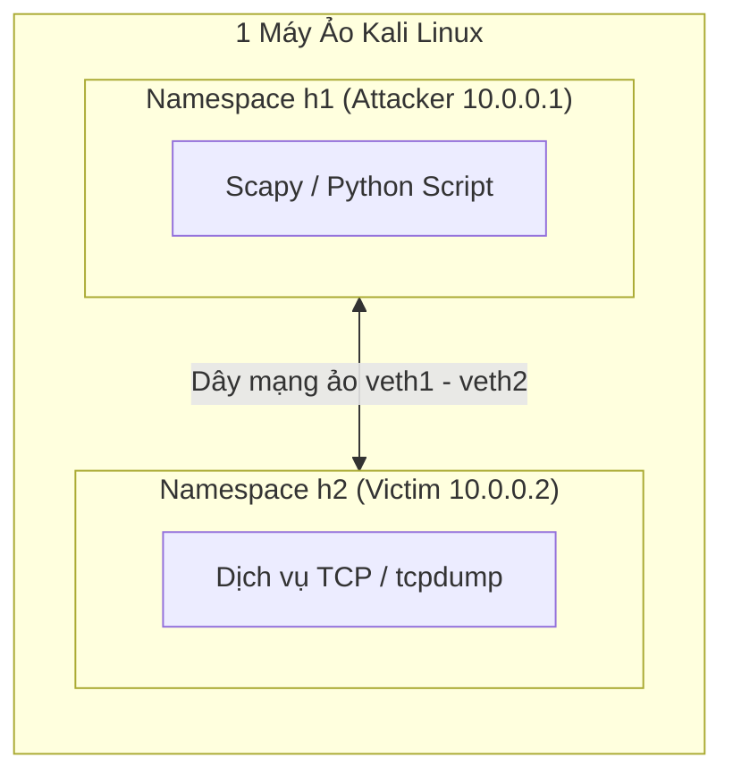

# CẨM NANG TOÀN DIỆN: CHINH PHỤC LAB LỖ HỔNG BẢO MẬT TCP/IP
> **Dành riêng cho sinh viên cần lấy lại gốc, thực hành trơn tru và tự tin đạt điểm cao khi thuyết trình trước Giảng viên.**

---

## PHẦN 1: BỨC TRANH TOÀN CẢNH — TẠI SAO BẠN "MẤT GỐC" VẪN HỌC TỐT?

### 1. Nguồn gốc của mọi vấn đề trong TCP/IP
Bạn không cần nhớ hàng trăm định nghĩa khô khan. Chỉ cần nắm đúng **1 sự thật lịch sử**:
> **Internet thuở ban đầu (những năm 1970–1980) được thiết kế cho các nhà khoa học tin tưởng lẫn nhau.**  
> Giao thức TCP/IP sinh ra với triết lý: *"Ai gửi thì tôi tin, gói tin ghi địa chỉ nguồn ở đâu thì tôi trả lời về đó, hệ thống ưu tiên tính thông suốt và truyền tải dữ liệu hơn là bảo mật."*

Chính vì sự "ngây thơ" nguyên bản này, các lỗ hổng kinh điển đã xuất hiện:
1. **Không xác thực người gửi**: Ai cũng có thể tự bịa ra địa chỉ IP nguồn (IP Spoofing).
2. **Tin tưởng thông báo điều khiển**: Router bảo đi đường nào thì máy trạm nghe lời đi đường đó (ICMP Redirect).
3. **Dữ liệu truyền trần trụi**: Mọi thứ gửi đi đều là chữ rõ (Cleartext), cho phép nhồi dữ liệu lậu (ICMP Tunneling) hoặc nghe lén.
4. **Giả định thứ tự hoàn hảo**: Máy tính giả định các mảnh ghép dữ liệu gửi đến sẽ khớp nhau, không ngờ kẻ xấu cố tình gửi các mảnh đè lên nhau gây tràn bộ nhớ (Teardrop).

---

### 2. "Bộ ba vũ khí" bạn dùng trong toàn bộ 7 bài Lab
Thầy cô cho bạn 7 file Word lab rất chi tiết. Điểm cực kỳ thông minh của bộ lab này là: **Toàn bộ thực hiện trên đúng 1 máy ảo Kali Linux duy nhất!** Bạn không cần bật 4–5 máy ảo làm đơ máy tính.

| Công cụ | Bản chất đời thực | Vai trò trong bài Lab |
| :--- | :--- | :--- |
| **`ip netns` (Network Namespaces)** | Như tạo các **"phòng cách âm độc lập"** trong 1 căn nhà. | Biến 1 máy ảo Kali thành nhiều máy: `h1` (Kẻ tấn công), `h2` (Nạn nhân), `gw` (Router). |
| **`Scapy` (Python)** | Như **"chiếc bút vẽ tự do"** | Hệ điều hành bình thường chỉ gửi gói tin đúng chuẩn. Scapy cho phép bạn tự bịa gói tin dị dạng, đổi cờ, sửa IP nguồn để tấn công. |
| **`tcpdump`** | Như **"chiếc kính lúp soi camera an ninh"** | Bắt và hiển thị từng byte gói tin chạy qua dây mạng ảo (`veth`). |



---

## PHẦN 2: HƯỚNG DẪN CÀI ĐẶT MÔI TRƯỜNG NHANH CHÓNG

Trước khi làm bất kỳ bài nào, bạn chỉ cần mở Terminal trên máy Kali Linux và chạy lệnh chuẩn bị 1 lần:

```bash
# Cập nhật và cài đặt công cụ cần thiết cho toàn bộ 7 bài lab
sudo apt update
sudo apt install -y python3-scapy tcpdump netcat-traditional bind9 unbound dnsutils
```

> [!TIP]
> **Cách mở Terminal điều khiển từng "máy con":**
> - Mở máy Attacker: `sudo ip netns exec h1 bash`
> - Mở máy Victim: `sudo ip netns exec h2 bash`
> Khi ở trong namespace nào, mọi lệnh mạng (`ping`, `curl`, `python3`) chỉ có tác dụng trong "máy con" đó!

---

## PHẦN 3: GIẢI MÃ CHI TIẾT 7 BÀI LAB (TỪ NGUYÊN LÝ ĐẾN DEMO & PHÒNG THỦ)

---

### BÀI 1: TCP SEQUENCE NUMBER PREDICTION (Dự đoán số thứ tự TCP)

#### 1. Hiểu trong 30 giây (Ví dụ đời thường)
* Bạn và bạn thân trao đổi thư từ mật mã. Để biết thư không bị thất lạc hay tráo đổi, hai người thống nhất: Thư đầu tiên tớ đánh số 100, thư cậu trả lời phải ghi "Đã nhận 100, số tiếp theo là 101".
* Nếu một kẻ lạ mặt muốn mạo danh bạn thân gửi thư cho bạn, kẻ đó **bắt buộc phải đoán đúng số thứ tự** mà bạn đang chờ. Nếu đoán trúng, bạn sẽ tin sái cổ bức thư giả đó!

#### 2. Kỹ thuật & Kịch bản Lab
* **Bắt tay 3 bước TCP**: `Client (SYN, SEQ=x) -> Server (SYN/ACK, SEQ=y, ACK=x+1) -> Client (ACK, ACK=y+1)`.
* **Lỗ hổng ngày xưa**: Ngày xưa, các hệ điều hành (như BSD Unix thời Kevin Mitnick 1994) tạo số $y$ (ISN) bằng cách cứ mỗi giây cộng thêm một hằng số cố định (ví dụ $+64000$). Kẻ tấn công đứng ngoài mạng (off-path), không nhìn thấy gói SYN/ACK của server, nhưng tính nhẩm là đoán trúng $y$, từ đó gửi gói tin mạo danh thành công.
* **Lab kiểm chứng điều gì?**
  1. **Bước 2.2**: Dùng Scapy gửi 30 gói SYN liên tục đến server và in các số ISN nhận về. Bạn sẽ thấy các số chênh lệch nhau hoàn toàn ngẫu nhiên (không hề theo quy luật $+64000$ nữa). **Kết luận**: Linux hiện đại đã áp dụng RFC 6528 (băm ngẫu nhiên), không thể đoán mò được nữa!
  2. **Bước 2.3**: Kẻ tấn công giả mạo IP nguồn là `10.0.0.77` để gửi dữ liệu cho victim. Vì ở cùng mạng nên attacker bắt lén được ISN để gửi ACK hợp lệ.

#### 3. Thao tác thực hành cốt lõi
1. Dựng mạng: `sudo bash setup_pair.sh`
2. Terminal Victim (`h2`): `sudo ip netns exec h2 ncat -lk 10.0.0.2 9000`
3. Terminal Attacker (`h1`): Chạy `isn_sampler.py` để chứng minh tính ngẫu nhiên của ISN.
4. Chạy `spoof_sniff.py`: Thấy victim nhận dòng chữ `"hello-from-spoofed-source"` từ IP ma `10.0.0.77`.

#### 4. Phòng thủ
* Ngẫu nhiên hóa ISN bằng hàm băm mật mã (RFC 6528 - mặc định trên Linux/Windows).
* Bật BCP 38 (Ingress/Egress Filtering): Router thấy gói tin có IP nguồn lạ không thuộc mạng nội bộ thì hủy ngay.

---

### BÀI 2: SOURCE ROUTING (Lỗ hổng Định tuyến tại nguồn)

#### 1. Hiểu trong 30 giây (Ví dụ đời thường)
* Thông thường, khi gửi thư, bạn chỉ ghi địa chỉ Người Nhận. Bưu điện (Router) sẽ tự tìm đường đi tối ưu nhất.
* Nhưng chế độ **Source Routing** cho phép người gửi tự dán một tờ giấy lên phong bì: *"Bắt buộc bưu tá phải đi qua nhà anh A, rồi qua nhà anh B, rồi mới tới đích"*.
* Kẻ gian lợi dụng điều này: Giả mạo địa chỉ cơ quan công an gửi thư cho bạn, nhưng lại ép đường thư trả lời phải ghé qua nhà kẻ gian để hắn đọc trộm!

#### 2. Kỹ thuật & Kịch bản Lab
* Gói tin IP có phần Header Options: **SSRR** (Strict Source Route - đi đúng chính xác từng trạm) hoặc **LSRR** (Loose Source Route - đi qua các trạm này, ở giữa muốn đi đâu tùy).
* Kẻ tấn công gửi gói tin giả nguồn `10.0.0.99` đến nạn nhân, kèm tùy chọn SSRR chỉ định chặng về phải đi qua `10.0.0.1` (máy của attacker). Nhờ đó, victim bị lừa gửi phản hồi về đúng tay kẻ tấn công.

#### 3. Thao tác thực hành cốt lõi
1. Dựng mạng: `sudo bash setup_pair.sh`
2. Attacker chạy Scapy chèn `IPOption_SSRR(routers=['10.0.0.1'])`.
3. Quan sát bằng tcpdump: Dùng bộ lọc `ip[0] & 0xf > 5` để phát hiện gói tin có IP Option (bình thường Header IP chỉ dài 20 byte, tức IHL = 5. Nếu IHL > 5 nghĩa là có Options kèm theo).
4. Bật phòng thủ: `sudo ip netns exec h2 sysctl -w net.ipv4.conf.all.accept_source_route=0`. Sau khi bật, victim từ chối ngay lập tức mọi gói tin có source route.

#### 4. Phòng thủ
* Tắt tính năng chấp nhận Source Route trên tất cả Router và Máy chủ (`accept_source_route = 0`).

---

### BÀI 3: ICMP TUNNELING (Đường hầm truyền lậu dữ liệu qua Ping)

#### 1. Hiểu trong 30 giây (Ví dụ đời thường)
* Tường lửa công ty cấm bạn gửi file ra ngoài (chặn cổng 80, 443, 21, v.v.), nhưng lại cho phép lệnh `ping` (ICMP) để kỹ thuật viên kiểm tra mạng.
* Kẻ xấu chia nhỏ file tài liệu mật, nhét từng đoạn vào **ruột (Payload)** của các gói tin ping gửi ra máy chủ của hắn ở ngoài Internet. Tường lửa nhìn thấy chỉ tưởng là kiểm tra mạng bình thường nên cho qua!

#### 2. Kỹ thuật & Kịch bản Lab
* Gói tin ICMP Echo Request gồm: Header (Type 8, Code 0, Checksum, Identifier, Sequence) + **Data Payload** (thường chỉ chứa chuỗi vô thưởng vô phạt như bảng chữ cái `abcd...` khoảng 32-64 byte).
* Attacker viết script Python nhồi chuỗi bí mật (ví dụ: file văn bản, mật khẩu) vào trường Data này. Máy chủ nhận gói tin sẽ bóc phần Data ra và ghép lại thành file hoàn chỉnh.

#### 3. Thao tác thực hành cốt lõi
1. Dựng mạng: `sudo bash setup_pair.sh`
2. Server (`h2`): Chạy script lắng nghe ICMP, in ra `packet[Raw].load`.
3. Client (`h1`): Đọc file bí mật và gửi qua ICMP: `send(IP(dst="10.0.0.2")/ICMP()/chunk)`.
4. Bật iptables chặn sạch TCP: `sudo ip netns exec h1 iptables -A OUTPUT -p tcp -j DROP`. Chứng minh: Dù TCP chết hoàn toàn, dữ liệu vẫn thoát ra ngoài trót lọt qua ICMP!

#### 4. Phòng thủ
* Dùng IDS/IPS (Snort/Suricata, Zeek) để soi payload ICMP: Nếu gói ICMP có kích thước lớn bất thường (> 64 bytes) hoặc tần suất gửi liên tục dày đặc -> Cảnh báo ngay.
* Chặn ICMP Echo Request/Reply đi ra ngoài Internet nếu không cần thiết.

---

### BÀI 4: SMURF ATTACK (Tấn công từ chối dịch vụ khuếch đại ICMP)

#### 1. Hiểu trong 30 giây (Ví dụ đời thường)
* Kẻ xấu cầm loa phóng thanh hét lớn vào một hội trường 1000 người: *"Ai tên là Nam giơ tay và hét 'Có' gửi về địa chỉ nhà ông A nhé!"* (nhưng hắn lại giả vờ bảo mình chính là ông A).
* Kết quả: 1000 người đồng thanh trả lời, làm hòm thư nhà ông A bị ngập lụt thư từ, sập cửa nhà! (Tấn công DoS khuếch đại).

#### 2. Kỹ thuật & Kịch bản Lab
* **Địa chỉ Broadcast**: Khi gửi gói tin đến IP broadcast của mạng (ví dụ `10.0.0.255`), tất cả các máy trong mạng LAN đó đều nhận được.
* Attacker gửi **1 gói ICMP Echo Request** đến `10.0.0.255`, nhưng **giả mạo IP nguồn là IP của Nạn nhân (`10.0.0.2`)**.
* Nếu các máy trong mạng bật tính năng phản hồi broadcast, 4-5 máy sẽ đồng loạt gửi ICMP Echo Reply dội thẳng vào máy Nạn nhân. Hệ số khuếch đại = số lượng máy phản hồi!

```mermaid
flowchart TD
    Attacker["Kẻ tấn công (10.0.0.3)"] -->|1 gói ICMP Echo Request (Nguồn giả: 10.0.0.2)| Broadcast["Địa chỉ Broadcast (10.0.0.255)"]
    Broadcast --> Host4["Host 10.0.0.4"]
    Broadcast --> Host5["Host 10.0.0.5"]
    Broadcast --> Host6["Host 10.0.0.6"]
    Host4 -->|Echo Reply| Victim["Nạn nhân (10.0.0.2) - Bị ngập lụt!"]
    Host5 -->|Echo Reply| Victim
    Host6 -->|Echo Reply| Victim
```

#### 3. Thao tác thực hành cốt lõi
1. Dựng mạng 5 host: `sudo bash setup_lan.sh`
2. Mở cho phép trả lời ping broadcast trên các host: `sysctl -w net.ipv4.icmp_echo_ignore_broadcasts=0`.
3. Attacker bắn 1 gói ping broadcast với IP nguồn là victim.
4. Terminal victim: tcpdump thấy hàng loạt gói Reply từ các IP khác nhau ập về cùng lúc.
5. Bật phòng thủ: `sysctl -w net.ipv4.icmp_echo_ignore_broadcasts=1` -> Lưu lượng dội về biến mất ngay!

#### 4. Phòng thủ
* Cấu hình các máy tính: `net.ipv4.icmp_echo_ignore_broadcasts = 1` (Mặc định Linux đã bật).
* Cấu hình Router theo RFC 2644: Chặn không cho gói tin Directed Broadcast đi qua biên mạng.

---

### BÀI 5: ICMP REDIRECT ATTACK (Cướp luồng định tuyến / Nghe lén Man-in-the-Middle)

#### 1. Hiểu trong 30 giây (Ví dụ đời thường)
* Bạn muốn đi sang quận bên cạnh, thường phải đi qua bác Cảnh sát giao thông (Default Gateway).
* Một kẻ lừa đảo đứng cạnh giả giọng bác Cảnh sát, nói thầm vào tai bạn: *"Đường kia tắc rồi, từ nay muốn đi sang quận đó thì cứ đi qua nhà tao cho nhanh nhé"*.
* Bạn tin lời, thế là từ đó mọi bưu phẩm bạn gửi đi đều tự động đi qua tay kẻ lừa đảo mà không hề hay biết!

#### 2. Kỹ thuật & Kịch bản Lab
* Giao thức ICMP có thông điệp **Type 5 (Redirect)**: Khi Gateway thấy máy tính gửi gói tin qua một con đường chưa tối ưu, Gateway gửi gói Redirect bảo máy tính cập nhật bảng định tuyến tạm thời (Routing Cache).
* **Khai thác**: Kẻ tấn công giả danh Gateway (`src = 10.0.0.1`), gửi gói ICMP Redirect bảo Nạn nhân: *"Muốn tới dải mạng `10.0.1.0/24`, hãy gửi qua Gateway mới là `10.0.0.3` (chính là Attacker)"*.
* Nạn nhân cập nhật cache định tuyến. Toàn bộ lưu lượng sau đó bị bẻ lái qua máy Attacker (Man-in-the-Middle).

#### 3. Thao tác thực hành cốt lõi
1. Dựng mạng có Router: `sudo bash setup_redirect.sh`
2. Nạn nhân kiểm tra route ban đầu: `ip route get 10.0.1.99` (thấy đi qua `10.0.0.1`).
3. Attacker chạy script Scapy tạo gói `ICMP(type=5, code=1, gw="10.0.0.3")` với IP nguồn giả là `10.0.0.1`.
4. Nạn nhân gõ lại: `ip route get 10.0.1.99` -> Thấy đường đi đã đổi thành `via 10.0.0.3`!
5. Bật phòng thủ: `sysctl -w net.ipv4.conf.all.accept_redirects=0`.

#### 4. Phòng thủ
* Tắt tính năng nhận gói ICMP Redirect trên các máy tính trạm (`accept_redirects = 0`). Máy chủ/máy trạm chỉ nên dùng đường đi tĩnh hoặc giao thức định tuyến an toàn.

---

### BÀI 6: TEARDROP ATTACK (Tấn công mảnh IP chồng lấn làm sập máy)

#### 1. Hiểu trong 30 giây (Ví dụ đời thường)
* Một bức tranh ghép hình 100 mảnh được gửi qua bưu điện. Bình thường mảnh 1 là từ ô 1 đến ô 10, mảnh 2 từ ô 11 đến ô 20.
* Kẻ phá hoại gửi: Mảnh 1 từ ô 1 đến 35. Mảnh 2 hắn ghi nhãn là bắt đầu từ ô 24 đến 43 (bị đè lên mảnh 1).
* Máy tính đời cũ khi tính toán kích thước vùng nhớ để sao chép: `Độ dài = Vị trí kết thúc - Vị trí bắt đầu`. Do bị đè, phép trừ ra số âm (hoặc tràn số nguyên dương thành hàng tỷ), máy tính bị hoảng loạn và hiện Màn hình xanh chết chóc (BSOD)!

#### 2. Kỹ thuật & Kịch bản Lab
* **Phân mảnh IP (Fragmentation)**: Khi gói tin lớn hơn MTU (thường 1500 byte), IP sẽ chia nhỏ thành các mảnh, sử dụng cờ **MF (More Fragments)** và trường **Fragment Offset** (tính theo đơn vị 8 byte).
* Trong bài lab:
  * Mảnh 1: `offset = 0`, `mf = 1`, dữ liệu dài 36 byte (byte 0..35).
  * Mảnh 2: `offset = 3` (tức là byte $3 \times 8 = 24$), `mf = 0`, dữ liệu dài 20 byte (byte 24..43).
  * Khoảng byte từ 24 đến 35 bị **chồng lấn (overlap)**!
* **Trên Linux hiện đại**: Hệ điều hành phát hiện sự bất thường này, từ chối ghép gói và tăng bộ đếm lỗi `IpReasmFails` lên $+1$ chứ không hề bị crash.

#### 3. Thao tác thực hành cốt lõi
1. Dựng mạng: `sudo bash setup_pair.sh`
2. Kiểm tra bộ đếm lỗi trên victim: `sudo ip netns exec h2 nstat -az IpReasmFails` (giả sử = 0).
3. Attacker bắn các mảnh Teardrop qua Scapy.
4. Kiểm tra lại bộ đếm trên victim: Thấy `IpReasmFails` tăng lên (chứng minh hệ thống đã phát hiện và tự vệ thành công).

#### 4. Phòng thủ
* Sử dụng Kernel hiện đại đã vá lỗi tính toán con trỏ bộ nhớ (Reassembly boundary check).
* Sử dụng Tường lửa Stateful hoặc IDS để ráp nối và kiểm tra các mảnh IP ở biên trước khi đưa vào mạng nội bộ.

---

### BÀI 7: DNSSEC (Phòng chống giả mạo tên miền bằng chữ ký số)

#### 1. Hiểu trong 30 giây (Ví dụ đời thường)
* Bạn tra danh bạ điện thoại hỏi: *"Số của ngân hàng Vietcombank là gì?"*. Một kẻ đứng giữa hét lên: *"Là số 0909xxxx của tao đấy!"* (DNS Spoofing / Cache Poisoning). Bạn gọi vào đó và bị mất tài khoản.
* **DNSSEC giải quyết thế nào?** Cuốn danh bạ của ngân hàng có dán **Chữ ký số kèm con dấu điện tử**. Bạn lấy chìa khóa công khai của ngân hàng ra kiểm tra: Con dấu chuẩn thì bạn mới tin, con dấu giả hoặc không có dấu thì máy tính vứt đi ngay!

#### 2. Kỹ thuật & Kịch bản Lab
* DNS truyền thống (UDP port 53) hoàn toàn không có xác thực, dễ bị đầu độc bộ nhớ đệm (Kaminsky Attack).
* DNSSEC bổ sung các bản ghi bảo mật:
  * **RRSIG**: Chữ ký số gắn liền với từng bản ghi (A, MX, v.v.).
  * **DNSKEY**: Khóa công khai dùng để xác minh chữ ký.
  * **DS**: Tóm lược khóa con đặt ở máy chủ cha (tạo thành Chuỗi tin cậy - Chain of Trust).
* Trong Lab:
  1. Dựng máy chủ DNS chính thống (`dns-auth`) có ký DNSSEC. Client truy vấn qua Resolver (`dns-res`) -> Thấy xuất hiện cờ **`ad` (Authenticated Data)** trong kết quả trả về của lệnh `dig`.
  2. Dựng máy chủ DNS giả mạo (`rogue`) trả về IP sai không có chữ ký.
  3. Resolver kiểm tra thấy chữ ký không hợp lệ -> Trả về lỗi **`SERVFAIL`** (thà báo lỗi còn hơn trả dữ liệu giả cho người dùng!).

#### 3. Thao tác thực hành cốt lõi
1. Dựng mạng 4 host: `sudo bash setup_dns.sh`
2. Client tra cứu tên miền hợp lệ: `sudo ip netns exec client dig @10.0.0.3 test.lab.test +dnssec` -> Kiểm tra cờ `flags: qr rd ra ad` (chữ **`ad`** là mấu chốt!).
3. Chuyển hướng sang máy chủ giả mạo `rogue` -> Kết quả trả về `status: SERVFAIL`.
4. Tắt xác thực DNSSEC (`+cd` - Checking Disabled) -> Thấy client bị lừa nhận IP giả mạo.

#### 4. Phòng thủ
* Kích hoạt DNSSEC Validation trên tất cả các DNS Resolver (như 8.8.8.8, Cloudflare 1.1.1.1, hoặc DNS nội bộ công ty).
* Lưu ý quan trọng: DNSSEC chỉ bảo vệ **tính toàn vẹn và xác thực nguồn gốc** (Integrity & Authentication), **KHÔNG bảo vệ tính bí mật** (không mã hóa). Muốn bảo mật nội dung hỏi đáp DNS cần kết hợp thêm **DoH (DNS over HTTPS)** hoặc **DoT (DNS over TLS)**!

---

## PHẦN 4: 15 CÂU HỎI VẤN ĐÁP "TỬ THẦN" CỦA GIẢNG VIÊN & ĐÁP ÁN ĂN ĐIỂM 10

| STT | Câu hỏi của Giảng viên | Câu trả lời chuẩn xác, ngắn gọn & ăn điểm |
| :---: | :--- | :--- |
| **1** | *"Tại sao trong Lab 1, hệ điều hành hiện đại lại không còn bị tấn công đoán TCP ISN nữa?"* | **Đáp**: Vì hệ điều hành ngày nay tuân theo chuẩn **RFC 6528**, sử dụng hàm băm mật mã ngẫu nhiên kết hợp với khóa bí mật để sinh ISN cho mỗi kết nối, chứ không tăng tuyến tính theo thời gian như hệ thống cũ. |
| **2** | *"Off-path attacker và On-path attacker khác nhau thế nào trong tấn công TCP?"* | **Đáp**: On-path (trên đường truyền) có thể nghe lén gói tin nên đọc được luôn ISN. Còn Off-path (đứng ngoài) không thấy gói SYN/ACK của server nên bắt buộc phải đoán mò ISN mới hoàn tất được bắt tay 3 bước. |
| **3** | *"Phân biệt Loose (LSRR) và Strict (SSRR) Source Routing?"* | **Đáp**: Strict (SSRR) bắt buộc gói tin phải đi qua chính xác lần lượt từng IP chỉ định, không được rẽ ngang. Loose (LSRR) chỉ yêu cầu đi qua các mốc đó, giữa các mốc có thể đi qua router trung gian tùy ý. |
| **4** | *"Làm sao để dùng tcpdump phát hiện gói tin có dùng IP Options?"* | **Đáp**: Dùng bộ lọc `ip[0] & 0xf > 5`. Vì trường độ dài Header (IHL) bình thường bằng 5 (20 bytes). Nếu có Options, IHL sẽ lớn hơn 5. |
| **5** | *"Vì sao gói tin ICMP Ping lại là nơi lý tưởng để kẻ tấn công tuồn dữ liệu (Tunneling)?"* | **Đáp**: Vì ICMP thường được các quản trị viên mở trên tường lửa để kiểm tra mạng, và gói tin ICMP Echo có trường Payload cho phép nhét dữ liệu tùy ý mà không bị giao thức kiểm duyệt. |
| **6** | *"Làm sao phát hiện ICMP Tunneling nếu kẻ tấn công đã mã hóa dữ liệu trước khi gửi?"* | **Đáp**: Dù mã hóa không đọc được chữ, ta vẫn phát hiện được thông qua: (1) Kích thước payload lớn bất thường (>64 bytes), (2) Tần suất gửi liên tục với lượng traffic đột biến, (3) Độ hỗn loạn thông tin (Entropy) của payload rất cao. |
| **7** | *"Hệ số khuếch đại trong tấn công Smurf phụ thuộc vào cái gì?"* | **Đáp**: Phụ thuộc vào số lượng máy tính đang hoạt động trong mạng LAN nhận gói broadcast và có bật tính năng phản hồi ICMP Echo Request. 1 gói gửi đi = N gói phản hồi đè bẹp nạn nhân. |
| **8** | *"Tại sao tấn công Smurf bắt buộc phải giả mạo địa chỉ nguồn (IP Spoofing)?"* | **Đáp**: Vì nếu không giả mạo IP nguồn thành IP của Nạn nhân, toàn bộ lưu lượng phản hồi dội về sẽ đè bẹp chính máy của Attacker! |
| **9** | *"Điều kiện nào để máy Linux chấp nhận một gói tin ICMP Redirect?"* | **Đáp**: Gói tin phải đến từ chính Gateway hiện tại của máy, chứa đúng thông tin của phiên truyền thông đang mở trong phần dữ liệu gốc, và máy nạn nhân chưa tắt tính năng `accept_redirects`. |
| **10** | *"So sánh ICMP Redirect Attack với ARP Spoofing?"* | **Đáp**: ARP Spoofing hoạt động ở **Tầng 2 (Data Link)** để sửa bảng ARP trong cùng mạng LAN vật lý. ICMP Redirect hoạt động ở **Tầng 3 (Network)** để bẻ lái bảng định tuyến (Routing table) sang gateway khác. |
| **11** | *"Trường Fragment Offset trong gói tin IP tính theo đơn vị gì?"* | **Đáp**: Tính theo đơn vị **8 byte** (Octets). Vì trường Offset chỉ có 13 bit trong khi kích thước tối đa của gói tin IP là $2^{16} = 65535$ byte ($65535 / 8 \approx 8192$ vừa vặn với 13 bit). |
| **12** | *"Tại sao Teardrop Attack làm sập các máy tính cũ như Windows 95?"* | **Đáp**: Do lỗi lập trình trong hàm ghép mảnh IP: Khi mảnh sau chồng lấn lên mảnh trước, phép tính `độ dài = offset_mảnh_sau + length - offset_mảnh_trước` bị ra số âm, khi truyền vào hàm `memcpy` bị ép kiểu thành số nguyên không dấu khổng lồ gây tràn bộ nhớ đệm và sập kernel. |
| **13** | *"Cờ AD trong kết quả lệnh dig có ý nghĩa gì?"* | **Đáp**: AD là **Authenticated Data**, nghĩa là Resolver đã dùng DNSSEC để xác minh toàn bộ chuỗi tin cậy (Chain of Trust) chữ ký số của tên miền này và xác nhận dữ liệu là chuẩn xác, không bị giả mạo. |
| **14** | *"Tại sao DNSSEC không ngăn chặn được việc người khác biết bạn đang vào trang web nào?"* | **Đáp**: Vì DNSSEC chỉ ký số để đảm bảo tính toàn vẹn (không bị sửa đổi), chứ **không hề mã hóa** gói tin DNS. Muốn giấu nội dung truy vấn phải dùng thêm DoH (DNS over HTTPS) hoặc DoT. |
| **15** | *"BCP 38 (Network Ingress Filtering) là gì và nó giúp ích gì cho TCP/IP?"* | **Đáp**: BCP 38 là tiêu chuẩn cấu hình router tại biên mạng: Chỉ cho phép các gói tin có địa chỉ IP nguồn thuộc dải mạng hợp lệ của khách hàng đi ra ngoài, chặn đứng hoàn toàn trò giả mạo IP (IP Spoofing) từ gốc rễ. |

---

## PHẦN 5: KỊCH BẢN THUYẾT TRÌNH 10 PHÚT "CHUẨN KHÔNG CẦN CHỈNH"

Khi lên bảng trình bày, hãy tự tin theo sườn sau:

### 1. Mở đầu (1 phút) — Gây ấn tượng mạnh
> *"Kính thưa thầy/cô và các bạn. Bộ giao thức TCP/IP là xương sống của toàn bộ Internet ngày nay. Tuy nhiên, khi ra đời vào thập niên 1980, nó được thiết kế dựa trên niềm tin tuyệt đối giữa các bên, hoàn toàn thiếu vắng các cơ chế bảo mật xác thực nguồn gốc. Hôm nay, nhóm em xin phép trình bày về các lỗ hổng kinh điển trong ngăn xếp TCP/IP, cách kẻ tấn công khai thác chúng và các giải pháp phòng thủ hiện đại thông qua bài thực hành mô phỏng trên Linux Network Namespaces."*

### 2. Nội dung chính (7 phút) — Đi từ Lỗ hổng -> Thao tác Demo -> Kết quả
* **Chiếu sơ đồ mạng ảo (`ip netns`)**: Giải thích ngắn gọn cách nhóm dùng 1 máy Kali Linux để giả lập môi trường tấn công - phòng thủ cô lập.
* **Trình bày trọng tâm 2–3 bài tiêu biểu nhất** (Nếu thời gian có hạn, hãy chọn **Lab 1 - TCP ISN**, **Lab 3 - ICMP Tunneling**, và **Lab 7 - DNSSEC** vì đây là 3 bài có tính thời sự và được thầy cô đánh giá cao nhất):
  1. *Nêu bản chất lỗ hổng (Ví dụ: Tại sao ICMP vốn dùng để ping lại biến thành công cụ trộm dữ liệu?).*
  2. *Chỉ vào màn hình Terminal/tcpdump: Cho thấy gói tin chạy qua, các trường cờ hoặc payload bị nhồi nhét.*
  3. *Chỉ ra sự khác biệt khi bật cơ chế phòng thủ (Ví dụ: Bật `sysctl` hoặc DNSSEC thì hệ thống chặn thế nào).*

### 3. Kết luận & Bài học rút ra (2 phút)
> *"Qua 7 bài lab, chúng em rút ra 3 trụ cột phòng thủ mạng cốt lõi:  
> 1. Không bao giờ tin tưởng địa chỉ nguồn chưa qua xác thực (áp dụng BCP 38).  
> 2. Luôn áp dụng mã hóa và chữ ký số ở các tầng trên (TLS cho dữ liệu, DNSSEC cho phân giải tên miền).  
> 3. Cấu hình hệ điều hành chuẩn mực, tắt bỏ các tính năng thừa như Source Routing hay ICMP Redirect.  
> Em xin chân thành cảm ơn thầy/cô đã lắng nghe và rất mong nhận được câu hỏi góp ý từ thầy/cô ạ!"*

---
*(Tài liệu này được biên soạn dựa trên nội dung thực hành `LabLoHongBaoMatTCPIP` và giáo trình `LoHongBaoMatTCPIP`)*
